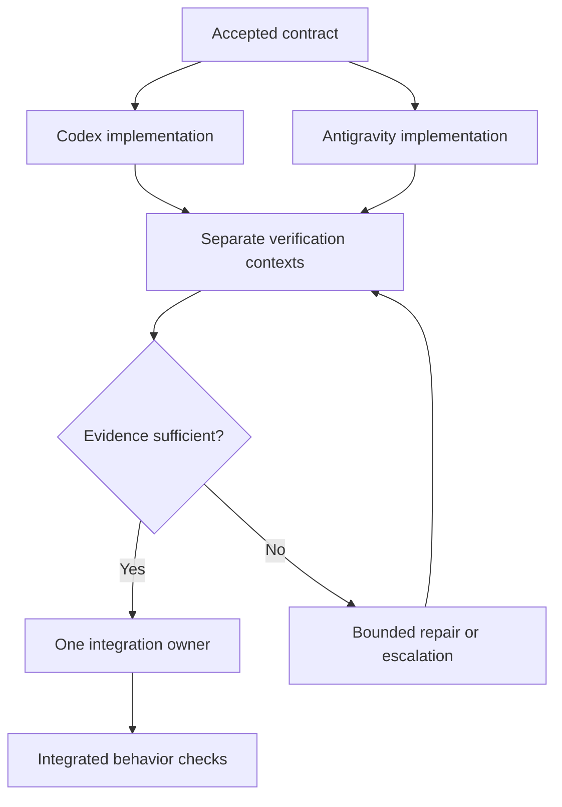

# AI Coding Repository Reference Guide

**For:** Codex and Google Antigravity today; Claude Code later  
**Source review date:** 5 October 2026  
**Scope:** Every unique resource in your latest list, with practical examples and additional primary references. Part II adds a second list of ten AI engineering collections.

Your list contains **12 entries but 11 unique resources**: nine GitHub repositories, the skills.sh directory, and one specific skill. Entries 9 and 10 both point to `VoltAgent/awesome-design-md`; it is covered once. Paperclip, which you mentioned earlier, appears as an additional optional reference in Section 13.

**Part II** (Sections 16–26) covers a second list: ten GitHub repositories for AI engineering, most of them curated lists of learning material and tools rather than installable workflow components.

This guide explains what each resource contributes, how its main pieces work, how to try it, and where it belongs in your workflow. Repository descriptions and commands were checked against source files and supporting documentation. **The installers and paid agent runs were not executed for this report.** A reviewed source revision can be newer than the package available from a registry; check the installed version before copying version-sensitive commands. Appendix A records the reviewed revisions.

The adoption recommendations and running examples are my synthesis. They are not claims that the maintainers endorse this exact combination of tools.

## Contents

- [A map of the resources](#a-map-of-the-resources)
- [The concepts that connect them](#the-concepts-that-connect-them)
- [1. Claudex Loop](#1-claudex-loop)
- [2. Graph Engineering](#2-graph-engineering)
- [3. Loop Engineering](#3-loop-engineering)
- [4. Ruflo](#4-ruflo)
- [5. ECC](#5-ecc)
- [6. Graphify](#6-graphify)
- [7. Spec Kit](#7-spec-kit)
- [8. no-mistakes](#8-no-mistakes)
- [9. Awesome DESIGN.md](#9-awesome-designmd)
- [11. skills.sh](#11-skillssh)
- [12. performance-optimization](#12-performance-optimization)
- [13. Additional references](#13-additional-references)
- [14. A practical adoption order](#14-a-practical-adoption-order)
- [15. One feature using these ideas](#15-one-feature-using-these-ideas)
- [Part II: AI engineering collections](#part-ii-ai-engineering-collections)
- [16. Awesome LLM Apps](#16-awesome-llm-apps)
- [17. Free AI Agents Resources](#17-free-ai-agents-resources)
- [18. Awesome LLM](#18-awesome-llm)
- [19. Awesome LLM RAG](#19-awesome-llm-rag)
- [20. Awesome RAG](#20-awesome-rag)
- [21. Awesome AI Agents](#21-awesome-ai-agents)
- [22. Awesome AI Engineering](#22-awesome-ai-engineering)
- [23. MCP Quickstart Resources](#23-mcp-quickstart-resources)
- [24. Awesome Local LLM](#24-awesome-local-llm)
- [25. Awesome Generative AI Guide](#25-awesome-generative-ai-guide)
- [26. Using the second list](#26-using-the-second-list)
- [Appendix A: Source revisions](#appendix-a-source-revisions)
- [Appendix B: Decision and troubleshooting tables](#appendix-b-decision-and-troubleshooting-tables)

## A map of the resources

These projects address different problems. Installing all of them does not automatically produce a coherent multi-agent system. Decide which responsibility each component owns before combining it with another.

| Your entry | Resource | Main contribution | Useful output | Suggested timing |
|---|---|---|---|---|
| 1 | Claudex Loop | Review and implementation across Codex and Claude Code | Reviewed plan, decision log, independently inspected changes | Full workflow after Claude Code is available |
| 2 | Graph Engineering | Design knowledge graphs and task dependencies | Ontology, extraction process, task graph | Learn and apply now |
| 3 | Loop Engineering | Operate recurring agent work with persistent state | Maintenance queue, run log, budgets, bounded loops | After a reliable manual workflow |
| 4 | Ruflo | Add orchestration, memory, MCP tools, and optional plugins | Coordinated task state and reusable project memory | Optional later pilot |
| 5 | ECC | Supply reusable engineering practices and harness adapters | Selected skills, rules, review agents, hooks | Selectively now |
| 6 | Graphify | Make code and documents navigable through a graph | Queryable graph, relationship report, impact paths | When codebase navigation becomes costly |
| 7 | Spec Kit | Carry requirements through planning and verification | Specification, technical plan, tasks, convergence report | Now for substantial features |
| 8 | no-mistakes | Gate publishing through an agent-driven validation pipeline | Checked branch, findings, PR, CI follow-up | After local checks and CI are dependable |
| 9–10 | Awesome DESIGN.md | Provide examples of written visual design systems | An adapted project `DESIGN.md` | Now for products with a UI |
| 11 | skills.sh | Discover and install reusable Agent Skills | Selected skill bundles in the correct harness location | Now, in small numbers |
| 12 | performance-optimization | Guide performance work from measurement to verification | Baseline, bottleneck evidence, measured result | When a performance requirement or problem exists |

The timing column is a recommendation for your two-agent setup. A text reference or skill is inexpensive to adopt; a background runtime, scheduler, or publishing pipeline adds operational work.

## The concepts that connect them

### Model, harness, skill, tool, and coordinator

| Concept | Meaning | Example in this guide |
|---|---|---|
| Model | The system producing reasoning and generated output | A model selected inside Codex or Antigravity |
| Harness | The application around the model: tools, permissions, sessions, and execution | Codex CLI, Antigravity IDE/CLI, Claude Code |
| Skill | A reusable package of instructions and supporting resources | `performance-optimization`, `graph-engineering` |
| Tool | A callable operation that retrieves information or performs an action | A Graphify query or Ruflo memory search |
| Coordinator | The owner of task assignment, dependencies, and integration decisions | You initially; a carefully configured runtime later |
| Artifact | A durable result another participant can inspect | A specification, commit, test log, or screenshot |

The [Agent Skills specification](https://agentskills.io/specification) defines a directory bundle built around `SKILL.md`. Scripts, references, and assets can accompany it. Copying only the Markdown file can break a skill that depends on those resources.

[MCP](https://modelcontextprotocol.io/docs/2026-07-28/getting-started/intro) provides a protocol for connecting applications to tools and resources. An MCP connection does not by itself decide which agent owns a task or prove that a worker executed it. A configured server, a registered role, and a completed implementation are three separate things.

For your setup, distinguish **a model available inside Antigravity** from **a separately installed agent CLI**. Selecting a Claude model in an editor does not establish that the `claude` executable required by Claudex exists. Similarly, software that launches `agy` needs a working Antigravity CLI, even if the IDE already works.

### Knowledge graphs and task graphs

A knowledge graph represents relationships in information: a service calls another service, a document describes a component, or a decision applies to a subsystem. Graphify builds this kind of navigation structure; Graph Engineering teaches how to design a domain graph.

A task graph represents dependencies in work: implementation needs the interface contract, verification needs the resulting code, and integration needs both accepted slices. Graph Engineering also explains this second meaning. A code relationship does not automatically become a scheduling dependency.

### Instructions and evidence

Use different artifacts for different questions:

| Artifact | Question it should answer |
|---|---|
| `AGENTS.md` or a harness-native instruction file | How should the agent work in this repository? |
| Feature specification | What behavior must the product provide? |
| Technical plan | How will that behavior be implemented? |
| `DESIGN.md` | What visual language and interaction conventions should the UI follow? |
| Task record | Who owns this slice, and what must finish first? |
| Handoff | What changed, at which revision, and what has been checked? |
| Verification evidence | What actually ran, what passed, and what remains untested? |

Avoid maintaining several independently edited plans for the same feature. If Spec Kit owns the feature plan, point other review skills at that plan. If `DESIGN.md` owns visual tokens, translate those tokens into one shared implementation instead of asking every agent to invent its own palette.

## 1. Claudex Loop

**Repository:** [chaseai-yt/claudex-loop](https://github.com/chaseai-yt/claudex-loop)  
**Category:** Cross-provider planning, review, implementation, and inspection skills.

### What it provides

Claudex combines a coordinating conversation with delegated work through Codex and Claude Code. The full loop gathers requirements, develops a plan, obtains review from the other provider, implements the accepted plan, and obtains a fresh inspection of the resulting changes.

The repository now contains several related skills:

| Skill | Purpose | Important dependency |
|---|---|---|
| `claudex-route` | Recommend a suitable role/model or make one scoped handoff | A selected CLI is needed only when actually delegating |
| `claudex-loop` | Run the complete planning and development process | Both Codex and Claude Code CLIs, plus Python 3.10+ |
| `codex-review` | Preserve an explicit Codex review entry point | Shared `claudex-loop` runtime |
| `codex-build` | Preserve an explicit Codex builder entry point | Shared `claudex-loop` runtime |

`claudex-route` can be used independently. A recommendation from Route does not itself launch another model or authorize an implementation. See the [README](https://github.com/chaseai-yt/claudex-loop/blob/8cf5e2c1771c5151d90c12642391d0ba8fa71b0e/README.md).

### How the full loop works

The coordinating host resolves requirements and arbitrates review findings. When Codex hosts the loop, Claude normally reviews the plan; when Claude Code hosts it, Codex normally reviews. The builder can be selected explicitly. Final inspection uses the opposite provider and starts in a fresh session.

The runtime launches individual CLI turns; the coordinating skill owns the overall process. It records structured results, session information, coverage, and limitations. Plan approvals bind to the plan's content hash. Code inspections record the inspected changes, so later edits require another inspection. An exit code of zero means the delegated turn completed validly; it can still return `REVISE` or `BLOCKED`.

The [runtime reference](https://github.com/chaseai-yt/claudex-loop/blob/8cf5e2c1771c5151d90c12642391d0ba8fa71b0e/skills/claudex-loop/references/runtime.md) is especially useful for understanding permissions and result validation. It also explains that a Git worktree isolates checkout changes but does not restrict every action the process could perform outside that checkout.

### How to try it

For the full workflow, first confirm that both CLIs are installed and authenticated:

```bash
codex --version
codex login status
claude --version
claude auth status
python3 --version
```

For manual installation, clone the repository and copy the complete skill collection from that checkout into the documented user skill directories. Keep the shared runtime alongside the compatibility skills.

```bash
git clone https://github.com/chaseai-yt/claudex-loop.git
cd claudex-loop
mkdir -p ~/.agents/skills ~/.claude/skills
cp -R skills/. ~/.agents/skills/
cp -R skills/. ~/.claude/skills/
```

Inspect any existing same-name skills before copying, and record the checkout revision you adopted. Restart the agent session after installation. The README also documents a Claude Code marketplace/plugin route; choose the installation method that fits that harness.

A useful chat request after both CLIs are available is:

```text
Use claudex-loop to review the existing plan at
specs/orders-export/plan.md. Use review mode and two review rounds.
Resolve findings against the specification and repository evidence.
```

This example reuses one canonical plan. A request limited to review stays limited to review; separately asking for implementation provides that additional scope.

### Where it fits for you

Use the underlying practice immediately: have one agent build and the other inspect a fixed revision in a fresh context. Adopt the automated Claudex loop after adding Claude Code. Antigravity is not a documented replacement for the Claude CLI in this runner.

Good candidates are migrations, complex feature plans, and changes where a second interpretation can expose missed assumptions. For a small, obvious edit, delegation overhead can exceed the value of another full review cycle.

### Limits to understand

Independent review can improve scrutiny; it does not prove correctness. Ask for evidence and actual coverage rather than a minimum number of objections. Keep review and repair budgets finite, and rerun the relevant proof checks after edits. Model recommendations in the repository should be treated as configurable choices, not permanent rankings or guarantees about your account's model access.

**Read next:** [Skill implementation](https://github.com/chaseai-yt/claudex-loop/blob/8cf5e2c1771c5151d90c12642391d0ba8fa71b0e/skills/claudex-loop/SKILL.md), [runtime reference](https://github.com/chaseai-yt/claudex-loop/blob/8cf5e2c1771c5151d90c12642391d0ba8fa71b0e/skills/claudex-loop/references/runtime.md), [validation record](https://github.com/chaseai-yt/claudex-loop/blob/8cf5e2c1771c5151d90c12642391d0ba8fa71b0e/VALIDATION.md).

## 2. Graph Engineering

**Repository:** [codejunkie99/graph-engineering](https://github.com/codejunkie99/graph-engineering)  
**Category:** Graph methodology, teaching material, and an Agent Skill.

### What it provides

Graph Engineering addresses two related questions: how agents retrieve structured knowledge, and how their work should be connected. Its knowledge-graph material distills a graduate course from Southeast University into English references, a teaching skill, and reusable workflow prompts. Its task-graph material discusses decomposition, separate verification, and integration ownership.

The important directories are `graph-engineering/`, which contains the skill bundle, and `graph-engineering/references/`, which contains the supporting material. `WORKFLOWS.md` provides teaching and construction prompts that can also be used without a specialized runtime. See the [README](https://github.com/codejunkie99/graph-engineering/blob/cfacb56a05a31ba69bf84d0b8b00f5ce463127ef/README.md).

### The knowledge-graph process

The skill presents nine stages. The table below interprets their purpose as deliverables you can inspect:

| Stage | Deliverable to ask for |
|---|---|
| Scope | Questions the graph must answer and why simpler search is insufficient |
| Representation | A decision about typed JSON edges, a property graph, RDF, or another representation |
| Ontology | Allowed entity types, relationship types, and attributes |
| Entities | Recognized entities tied to source locations |
| Relations | Typed relationships supported by source evidence |
| Events | Time-dependent changes represented explicitly where needed |
| Quality | A sampled assessment of extraction errors |
| Fusion | A policy for identity, deduplication, and conflicting facts |
| Serving | A query or retrieval interface that answers the original questions |

For example, in an orders application, `Order`, `Customer`, `ExportJob`, and `Service` might be distinct types. A useful relationship is `ExportJob READS Order`; a vague relationship such as `ExportJob RELATED_TO Customer` needs clarification before it becomes trustworthy retrieval context.

The central practical lesson is to define the domain and preserve evidence before scaling extraction. Two names for the same entity can otherwise become disconnected nodes; an inferred relationship can otherwise look indistinguishable from an observed fact. The [skill](https://github.com/codejunkie99/graph-engineering/blob/cfacb56a05a31ba69bf84d0b8b00f5ce463127ef/graph-engineering/SKILL.md) and its modeling, extraction, and fusion references explain these stages.

### The task-graph process

Draw a dependency only when the next task needs the previous task's output. If UI and backend work share an agreed API contract, they may proceed independently from that contract. If the UI still needs an undecided API response shape, they are not ready to split.

The repository's task-graph guidance emphasizes independent worker contexts, separate verification, one integration owner, and bounded retries. The following diagram applies those ideas to your two-agent setup:



This diagram describes logical stages, not a requirement to run every node in its own simultaneous agent process. The same two harnesses can switch roles between implementation and verification.

### How to try it

The README's native installation example targets Claude Code. For Codex and Antigravity, a practical adaptation is to put the **complete** skill directory under the project skill location both harnesses discover:

```bash
git clone https://github.com/codejunkie99/graph-engineering.git
mkdir -p /path/to/your-project/.agents/skills
cp -R graph-engineering/graph-engineering \
  /path/to/your-project/.agents/skills/
```

This is a proposed portable installation, rather than a claim of a separately maintained Antigravity adapter. Confirm that both agents discover the skill and can open its references. Alternatively, start by reading and using a selected prompt from `WORKFLOWS.md`.

A useful first exercise is: “Map the actual dependencies for adding CSV export. Identify tasks that can run independently, name the shared contracts, and assign one owner to every output.” For knowledge graphs, start with a small representative document sample and a few concrete questions.

### Where it fits for you

Apply task-graph thinking before introducing an orchestration runtime. Use the knowledge-graph teaching material when you need to model a domain, interpret Graphify output, or design graph-based retrieval.

This repository is methodological scaffolding. It does not automatically launch your coding agents, provision a graph database, or maintain a production knowledge graph. The published research it cites evaluates particular tasks and configurations; its numeric results should not be converted into expected productivity gains for your projects.

**Read next:** [Task graphs](https://github.com/codejunkie99/graph-engineering/blob/cfacb56a05a31ba69bf84d0b8b00f5ce463127ef/graph-engineering/references/task-graphs.md), [workflows](https://github.com/codejunkie99/graph-engineering/blob/cfacb56a05a31ba69bf84d0b8b00f5ce463127ef/WORKFLOWS.md), [source course](https://github.com/npubird/KnowledgeGraphCourse), [Google's agent-scaling research](https://research.google/blog/towards-a-science-of-scaling-agent-systems-when-and-why-agent-systems-work/).

## 3. Loop Engineering

**Repository:** [cobusgreyling/loop-engineering](https://github.com/cobusgreyling/loop-engineering)  
**Category:** Operating patterns and tools for recurring agent work.

### What it provides

Loop Engineering is concerned with what happens across repeated runs: how work is discovered, prioritized, acted on, verified, and remembered. Its patterns cover daily triage, PR follow-up, CI repair, dependency updates, changelog drafting, issue triage, and post-merge cleanup.

The unified CLI, `@cobusgreyling/loop`, provides commands such as `init`, `doctor`, `audit`, `status`, and `cost`. Companion tools support worktrees, loop state, circuit breakers, and action gates. The [README](https://github.com/cobusgreyling/loop-engineering/blob/db8df77355b8476d600fbfbd44dac4e90b0966e8/README.md) maps recurring jobs to patterns.

### How a loop becomes an operating process

The scaffold separates several responsibilities:

| Artifact or mechanism | Purpose |
|---|---|
| `STATE.md` | Current queue, priorities, and recent state |
| `LOOP.md` | What the loop does and how it operates |
| `loop-budget.md` | Limits on recurring work |
| `loop-run-log.md` | Record of actual runs and outcomes |
| Circuit breaker | Stop repeated failures or exhausted attempts |
| `gate.yaml` | Rules for particular actions, such as allowed auto-merges |
| Worktree | Keep a fix attempt separate from the main checkout |

A scheduler still has to invoke the appropriate agent or runner. Scaffolding the files is preparation; a completed run with a reviewed outcome establishes that the process works.

The [quickstart](https://github.com/cobusgreyling/loop-engineering/blob/db8df77355b8476d600fbfbd44dac4e90b0966e8/docs/QUICKSTART.md) recommends starting with report-only runs, then assisted fixes, and considering unattended actions only after verification has proved reliable. Its readiness score is a diagnostic, not a correctness certificate.

### How to try it with Codex

In a reviewable branch or small pilot repository:

```bash
npx @cobusgreyling/loop init . --pattern daily-triage --tool codex
npx @cobusgreyling/loop doctor .
npx @cobusgreyling/loop cost --pattern daily-triage --level L1 --cadence 1d
```

Review the scaffold before arranging recurring execution. A first manual task can inspect CI failures, unresolved issues, or dependency alerts and write a prioritized report. Keep that task small enough that you can compare the report with the actual repository state.

The reviewed quickstart documents `claude`, `grok`, `codex`, and `opencode` scaffold selectors. It does not document an `antigravity` selector. Antigravity can still follow the operating method and read the same state artifacts, but scheduling or headless execution requires a separately verified adaptation.

### Maintenance versus feature delivery

A maintenance queue and a feature completion plan serve different purposes. Daily triage might identify that the export path lacks tests; a bounded feature task then owns adding those tests. Do not interpret an indefinitely recurring triage loop as a complete feature implementation strategy.

The [refactor guide](https://github.com/cobusgreyling/loop-engineering/blob/db8df77355b8476d600fbfbd44dac4e90b0966e8/docs/refactor.md) recommends small slices, separate worktrees, independent verification, and reviewable PRs. For your workflow, a useful first recurring job is a daily report with three actionable items and links to evidence. Measure whether those reports help before enabling automatic changes.

### Limits to understand

A stale queue can repeatedly send agents toward obsolete work. A rapid cadence can consume quota even when little changes. An automated retry can hide a missing prerequisite by trying the same failing action repeatedly. Define the run interval, attempt cap, shared-state owner, and stopping condition together.

Worktree isolation keeps changes apart; it is not an operating-system sandbox. Similarly, two independently written scripts can still collide on a shared queue, lockfile, or remote PR unless ownership is explicit.

**Read next:** [Quickstart](https://github.com/cobusgreyling/loop-engineering/blob/db8df77355b8476d600fbfbd44dac4e90b0966e8/docs/QUICKSTART.md), [refactor path](https://github.com/cobusgreyling/loop-engineering/blob/db8df77355b8476d600fbfbd44dac4e90b0966e8/docs/refactor.md), [patterns](https://github.com/cobusgreyling/loop-engineering/tree/db8df77355b8476d600fbfbd44dac4e90b0966e8/patterns), [failure modes](https://github.com/cobusgreyling/loop-engineering/blob/db8df77355b8476d600fbfbd44dac4e90b0966e8/docs/failure-modes.md).

## 4. Ruflo

**Repository:** [ruvnet/ruflo](https://github.com/ruvnet/ruflo)  
**Category:** Agent orchestration, memory, MCP runtime, and plugin ecosystem.

### What it provides

Ruflo supplies a larger operating layer around coding agents: task coordination, role definitions, reusable workflows, memory retrieval, hooks, diagnostics, and optional integrations. Parts of its source and packages retain the `claude-flow` name, so seeing both names in the repository is expected.

Its main surfaces are the CLI, an MCP server, skills and agent definitions, and plugins. Claude Code and Codex have documented setup paths. The broad provider list describes model and runtime integrations; it should not be interpreted as proof that every editor has a native adapter. See the [README](https://github.com/ruvnet/ruflo/blob/c00229406c1c3993c96627cbb6952f5ebfe0a3aa/README.md).

### What orchestration and memory mean here

An orchestrator can track roles and task state while the coding harness executes the actual work. Ruflo's [Codex adapter](https://github.com/ruvnet/ruflo/blob/c00229406c1c3993c96627cbb6952f5ebfe0a3aa/v3/%40claude-flow/codex/README.md) explicitly makes that distinction. A tool that registers a coder role is not sufficient evidence that a second process wrote code.

The memory components store and retrieve patterns, decisions, or experiences. The [explanatory guide](https://github.com/ruvnet/ruflo/blob/c00229406c1c3993c96627cbb6952f5ebfe0a3aa/docs/ruflo-explained.md) distinguishes those mechanisms from retraining a commercial foundation model. For a coding project, treat memory as a searchable notebook whose entries still need sources, scope, and freshness checks.

A useful example is a record explaining why exports use streaming rather than accumulating all rows in memory. That record should identify the decision, relevant workload, evidence, date, and code revision. A future agent should retrieve and reassess it, rather than apply “stream everything” as an unconditional rule.

### How to try it with Codex

Start in a disposable or reviewable pilot project. The Codex adapter documents a minimal setup:

```bash
npx ruflo@latest init --codex --minimal
codex mcp list
```

`@latest` is the upstream-style example, not a reproducibility pin. For sustained use, replace it with a release you have tested and record that version. Initialization can write instructions and configuration and register an MCP server; inspect the resulting changes.

Verify the stages separately:

1. The expected project files exist and contain the intended settings.
2. Codex lists the MCP connection.
3. The agent successfully performs one bounded read operation through the server.
4. If you intend to delegate execution, a real worker runs and produces an attributable artifact.
5. A fresh session can retrieve a deliberately stored, accurate memory entry.

This avoids confusing setup success with runtime execution. The full adapter also documents dual Codex/Claude Code initialization. Add that only when both harnesses are available and the single-harness pilot is understood.

### Where it fits for you

Ruflo can become useful when manual task routing, repeated context reconstruction, or project memory management becomes expensive. With two agents, you can first learn those requirements through a small written task board and handoffs.

For Antigravity, the sources reviewed here do not establish an equivalent native executor adapter. A compatible MCP client may access tools, but that is a narrower capability than being an automatically managed worker. Keep Antigravity tasks manually assigned until you verify the actual execution path.

### Limits to understand

Ruflo has a large capability surface. Some documentation records an older package snapshot, and counts or model comparisons vary across files. Treat the [status document](https://github.com/ruvnet/ruflo/blob/c00229406c1c3993c96627cbb6952f5ebfe0a3aa/docs/STATUS.md) as a dated report, and inspect the current package and relevant component before relying on a specific feature.

Measure improvements using your own tasks. Faster memory retrieval does not necessarily mean faster end-to-end feature delivery. Installing every plugin can introduce duplicate commands, background work, and extra context. Start with one orchestration responsibility or one memory use case, and keep one owner of dispatch and integration.

**Read next:** [Ruflo explained](https://github.com/ruvnet/ruflo/blob/c00229406c1c3993c96627cbb6952f5ebfe0a3aa/docs/ruflo-explained.md), [Codex adapter](https://github.com/ruvnet/ruflo/blob/c00229406c1c3993c96627cbb6952f5ebfe0a3aa/v3/%40claude-flow/codex/README.md), [user guide](https://github.com/ruvnet/ruflo/blob/c00229406c1c3993c96627cbb6952f5ebfe0a3aa/docs/USERGUIDE.md).

## 5. ECC

**Repository:** [affaan-m/ECC](https://github.com/affaan-m/ECC), reached through your lowercase `ecc` link  
**Category:** Engineering practices, skills, agent definitions, memory, and harness customization.

### What it provides

ECC packages a substantial collection of development practices and supporting tools. It includes planning, test-driven development, code review, verification, language-specific guidance, security work, handoffs, and optional learning and memory mechanisms.

Its useful contribution is the reusable procedure: a reviewer receives a concrete remit, a verification workflow names the checks, and a handoff preserves relevant project context. The repository also supplies installation adapters for several harnesses, including Codex and Antigravity. Start with the [README](https://github.com/affaan-m/ECC/blob/ef648e01899ba3e8dc6371642deaaf64b4477775/README.md).

### The pieces to distinguish

| ECC component | Purpose | What to verify |
|---|---|---|
| Rules | Persistent conventions for a project or language | They fit the actual stack and do not contradict existing instructions |
| Skills | Procedures invoked when a task calls for them | Names, descriptions, and bundled references are discoverable |
| Agent definitions | Specialized review or implementation roles | The harness supports the declared model/tool fields |
| Workflows or commands | Explicit entry points into a procedure | The installed harness uses the expected invocation syntax |
| Hooks | Actions connected to lifecycle or tool events | The relevant harness supports the event and the hook really runs |
| Memory or instincts | Reusable context learned or recorded over time | Entries are accurate, scoped, and reviewable |

A Markdown agent definition does not automatically become a permanently running worker. Likewise, copying Claude-oriented hook configuration into another harness does not establish equivalent behavior.

The [command-to-agent map](https://github.com/affaan-m/ECC/blob/ef648e01899ba3e8dc6371642deaaf64b4477775/docs/COMMAND-AGENT-MAP.md) helps locate the intended component instead of installing the entire catalog.

### A useful first selection

For a normal feature, consider one verification skill and one review role. Add TDD guidance when the task needs behavioral tests or the project already follows TDD. Add a language pack only for a language you use.

ECC's [verification skill](https://github.com/affaan-m/ECC/blob/ef648e01899ba3e8dc6371642deaaf64b4477775/skills/verification-loop/SKILL.md) covers build, types, lint, tests, security-oriented inspection, and diff review. Adapt commands and thresholds to the repository. For example, a documentation-only edit does not need to run an unrelated deployment pipeline, while a changed authorization path needs focused behavior tests even if overall coverage is high.

The [TDD skill](https://github.com/affaan-m/ECC/blob/ef648e01899ba3e8dc6371642deaaf64b4477775/skills/tdd-workflow/SKILL.md) provides a failing-test-to-implementation process and supports plan handoffs. Preserve your feature's acceptance criteria when applying it; generic test volume should not replace testing the requested behavior.

### Codex installation

The reviewed README documents the native plugin route for current Codex releases:

```bash
codex plugin marketplace add affaan-m/ECC
codex plugin add ecc@ecc
codex plugin list --json
```

Use this only if your installed Codex supports these commands. The README separately describes a deprecated configuration-sync route. **Choose one installation method for a harness.** Stacking a native plugin and legacy sync can duplicate skills or configuration.

Plugin discovery, hook trust, and the actual operation of the selected skill are separate verification steps. Do not treat a successful marketplace command as proof that every ECC capability is active.

### Antigravity installation

The [Antigravity guide](https://github.com/affaan-m/ECC/blob/ef648e01899ba3e8dc6371642deaaf64b4477775/docs/ANTIGRAVITY-GUIDE.md) describes a native Antigravity 2.0 layout and states that ECC 2.2.0 or newer is required. It maps rules, workflows, skills, and adapted agent definitions into `.agents/`.

The reviewed top-level README uses `ecc-universal@2.2.3` in package examples; verify that release before using it:

```bash
npm view ecc-universal@2.2.3 version
npx ecc-universal@2.2.3 install --profile minimal --target antigravity
```

Run the install from the project you want to configure, then start a new Antigravity conversation and inspect its Customizations inventory. Existing legacy `.agent/` installations have a managed migration path; follow the guide rather than manually renaming directories tracked by the installer.

### Shared skill ownership matters

Codex and Antigravity can both see project `.agents/skills/`. An Antigravity installation can therefore make the same skill visible to Codex. If Codex also receives that skill through a plugin, inspect the effective inventory for duplicates.

For your first adoption, choose a small common set and record where each skill comes from. Different components may use different owners, but two installers should not independently manage the same skill path. Keep shared task and design guidance in your project instead of relying on inconsistent global copies.

### Limits to understand

Adapters do not guarantee feature parity across harnesses. Hooks, tool names, model fields, command syntax, and memory loading can differ. Some older guide examples predate current product features; use the current adapter documentation for installation details.

Large collections also have a context cost: the agent must distinguish many descriptions and overlapping procedures. ECC is most useful when you can name the specific engineering gap a component addresses.

**Read next:** [Short guide](https://github.com/affaan-m/ECC/blob/ef648e01899ba3e8dc6371642deaaf64b4477775/the-shortform-guide.md), [Antigravity guide](https://github.com/affaan-m/ECC/blob/ef648e01899ba3e8dc6371642deaaf64b4477775/docs/ANTIGRAVITY-GUIDE.md), [command map](https://github.com/affaan-m/ECC/blob/ef648e01899ba3e8dc6371642deaaf64b4477775/docs/COMMAND-AGENT-MAP.md), [Codex navigation guide](https://github.com/affaan-m/ECC/blob/ef648e01899ba3e8dc6371642deaaf64b4477775/docs/CODEX-NAVIGATION-GUIDE.md).

## 6. Graphify

**Repository:** [Graphify-Labs/graphify](https://github.com/Graphify-Labs/graphify)  
**Category:** Code and document knowledge-graph extraction, navigation, and querying.

### What it provides

Graphify builds a relationship graph from a corpus that can include code, documentation, schemas, PDFs, and media. For code, it extracts structure such as imports, calls, classes, and inheritance. Queries can then help locate relevant areas, trace paths, or inspect the impact of a change.

The product has both a command-line tool and assistant integrations. It can produce `graph.json`, a graph report, and optional visual or documentation exports. The correct Python package name is **`graphifyy`**, with two final `y` characters; the executable remains **`graphify`**. Its reviewed default branch is `v8`, so do not assume every repository uses `main`. See the [README](https://github.com/Graphify-Labs/graphify/blob/35adf432b9d50f6f3d530ab5d7ec316819ef081c/README.md).

### How extraction works

Local AST parsing builds code relationships without a model call. Other content can require conversion, transcription, or semantic extraction through a configured backend. Graphify then combines fragments and analyzes graph structure, including connected communities.

The [architecture explanation](https://github.com/Graphify-Labs/graphify/blob/35adf432b9d50f6f3d530ab5d7ec316819ef081c/docs/how-it-works.md) describes provenance, confidence labels, caching, and the graph format. An extracted call edge and an inferred conceptual relationship carry different evidential weight. Confidence scores are annotations about extraction, not measured probabilities that the whole answer is correct.

For your agents, the graph should help answer “where should I look?” The relevant source files, current branch, and tests still determine what is true now.

### How to try it

The README specifies Python 3.10+ and recommends an isolated tool installation:

```bash
uv tool install graphifyy
graphify --help
graphify extract . --code-only
graphify query "what connects the orders API to export generation?"
```

The `--code-only` flag belongs to `extract`; it is not interchangeable with the chat skill's invocation. Begin with this path to evaluate structural navigation without configuring a semantic backend.

For a project-scoped Codex integration, the README documents:

```bash
graphify install --project --platform codex
```

It also documents `graphify antigravity install` and the generic Agent Skills target. Inspect the files those routes manage before combining them. Both assistants may share a skill directory while having different instruction or hook files.

### A useful agent request

```text
Use the graph to find the export path, its API entry point, and its tests.
Then open the relevant source files at the current revision.
Report the likely change surface and any graph relationships that need
confirmation before implementation.
```

This keeps retrieval and verification connected. It also makes a missed or ambiguous edge visible instead of turning it into an unnoticed assumption.

### Updating and sharing the graph

Refresh the graph when the code or indexed documents change. The README's Git-hook workflow rebuilds code after commits and branch switches, while its team guidance calls for `graphify update .` after pulls or merges. Background rebuilding can lag a new commit.

Choose which graph products to share. The README distinguishes queryable outputs from machine-specific paths, caches, and interpreter pointers. In worktrees, confirm that the query uses the graph for that checkout; a graph built on another branch can suggest an obsolete path.

### Where it fits for you

Graphify is valuable when both agents repeatedly spend time rediscovering architecture, or when a change crosses several subsystems. It complements Graph Engineering: one supplies extraction and querying, while the other teaches how to evaluate and design the relationships.

Graphify is not the task coordinator. A highly connected source component is not automatically the next implementation task. Also distinguish local parsing from later hosted model calls: selecting a remote semantic backend changes the data and cost path.

Some README configuration advice can lag the coding harness, including feature flags for parallel extraction. Follow the current harness documentation rather than copying an old flag solely because a third-party integration page mentions it.

**Read next:** [How it works](https://github.com/Graphify-Labs/graphify/blob/35adf432b9d50f6f3d530ab5d7ec316819ef081c/docs/how-it-works.md), [project documentation](https://docs.graphify.com), [command reference in the README](https://github.com/Graphify-Labs/graphify/blob/35adf432b9d50f6f3d530ab5d7ec316819ef081c/README.md#full-command-reference).

## 7. Spec Kit

**Repository:** [github/spec-kit](https://github.com/github/spec-kit)  
**Category:** Structured processes for specifications, implementation, bug fixing, and assessment.

### What it provides

Spec Kit supplies templates, helper scripts, agent integrations, and documented processes. Its main feature workflow carries a specification through technical planning, task generation, implementation, and convergence checks. The reviewed README also describes separately installable bug-fixing and idea-assessment processes; those are independent entry points rather than mandatory phases before every feature.

The basic benefit is traceability: a reviewer can connect a requirement to an implementation task and its evidence. Spec Kit does not automatically create a team of independently executing agents. See the [README](https://github.com/github/spec-kit/blob/ae5ade7234be5cb1d975f736c4e06dd46d1326d6/README.md).

### How the feature workflow works

| Step | Question answered | Result to review |
|---|---|---|
| Constitution | Which project principles constrain the work? | Project guardrails |
| Specify | What outcome and behavior are required? | Feature specification |
| Clarify | Which ambiguities affect the outcome? | Resolved decisions |
| Plan | What technical approach fits the repository? | Implementation plan and relevant contracts |
| Tasks | What work is needed and what depends on what? | Actionable task list |
| Analyze | Are the artifacts consistent? | Gaps or conflicts before coding |
| Implement | Does the code realize the tasks? | Code and task evidence |
| Converge | What still prevents the feature from satisfying the artifacts? | Remaining tasks or a convergence result |

The [SDD command reference](https://github.com/github/spec-kit/blob/ae5ade7234be5cb1d975f736c4e06dd46d1326d6/docs/reference/agentic-sdd.md) describes these steps. Use the optional gates proportionately: a major interface change benefits from detailed analysis, while a small correction may fit the bug-fixing process.

### How to install and initialize

The reviewed installation guide requires Python 3.11+ and supports `uv` or other Python installation routes. The package is `specify-cli`; the command is `specify`.

```bash
uv tool install specify-cli
specify version
specify init my-project --integration codex
```

For an existing repository, first create a reviewable baseline and an adoption branch. Then use the documented in-place route:

```bash
specify init --here --force --integration codex
```

`--force` allows initialization into a non-empty directory and can replace conflicting managed files. Review the generated diff. It does not automatically reverse-engineer a complete specification for your existing application. The [existing-project guide](https://github.com/github/spec-kit/blob/ae5ade7234be5cb1d975f736c4e06dd46d1326d6/docs/guides/existing-projects.md) recommends beginning with the next bounded change.

### Codex and Antigravity details

The reviewed integration keys are `codex` and **`agy`**. Both use project `.agents/skills/`, while their chat invocation syntax differs:

| Harness | Initialization key | Example chat invocation |
|---|---|---|
| Codex | `codex` | `$speckit-specify` |
| Antigravity | `agy` | `/speckit-specify` |

References may show dotted forms such as `/speckit.specify`; the [integration reference](https://github.com/github/spec-kit/blob/ae5ade7234be5cb1d975f736c4e06dd46d1326d6/docs/reference/integrations.md) explains the corresponding syntax. These are requests entered in agent chat, not shell commands.

Because the skill paths overlap, start with one integration owner. Confirm that the other harness sees and can invoke the resulting skills before attempting a second installation. Spec Kit's integration lifecycle includes multi-install checks and managed-file manifests; use that lifecycle rather than independently copying overlapping generated files.

### An example Codex sequence

Invoke each step separately, inspect the result, and then continue:

```text
$speckit-constitution Preserve authorization and existing API compatibility.
$speckit-specify Add CSV export for the orders visible under current filters.
$speckit-clarify
$speckit-plan Reuse the existing service layer and stream large exports.
$speckit-tasks
$speckit-analyze
$speckit-implement
$speckit-converge
```

The prompts above are examples, not universal requirements. Your constitution should capture actual project constraints. Your plan should name the repository's real test commands and contracts.

### Where it fits for you

Use Spec Kit as the owner of requirements and the feature plan when a change is substantial enough to need those artifacts. Then allocate task slices to Codex and Antigravity. Keep shared contracts settled before parallel coding starts, and nominate one writer for generated plan and task files.

Claudex can later review the Spec Kit plan. ECC can help implement or verify a slice. Awesome DESIGN.md can inform the visual contract. None of those should silently create a competing version of the specification.

### Limits to understand

Generated detail can still contain unsupported assumptions. A task checkbox is not proof that behavior works, and a convergence report still needs credible evidence. Decide whether completed specs become historical records or living contracts, so later agents know how to interpret them.

For concurrent features or worktrees, check how your installed version selects its feature directory. Avoid allowing a shared “current feature” pointer to send two sessions into the wrong artifact set.

**Read next:** [Installation](https://github.github.io/spec-kit/installation.html), [integrations](https://github.github.io/spec-kit/reference/integrations.html), [existing projects](https://github.github.io/spec-kit/guides/existing-projects.html), [SDD process](https://github.github.io/spec-kit/reference/agentic-sdd.html).

## 8. no-mistakes

**Repository:** [kunchenguid/no-mistakes](https://github.com/kunchenguid/no-mistakes)  
**Category:** Local Git publishing gate with agent-driven validation and repair.

### What it provides

`no-mistakes` adds a local Git remote that acts as a proxy before the actual publishing destination. A gated push starts a validation pipeline in a disposable worktree. The pipeline can review, test, check documentation and lint, apply eligible fixes, and then publish a branch and open a PR. It can also monitor CI and handle failures.

This is a delivery component with real side effects. It is useful when generated changes are easy to produce but consistently validating and preparing them for review takes effort. The [README](https://github.com/kunchenguid/no-mistakes/blob/18f3fe3a1a0b13ee951088ec18e9dd5ddcf03de2/README.md) explains the gate and subsequent repair behavior.

### How the execution model works

The daemon executes pipeline work through a configured agent runner. The coding agent that asks to start a gate and the agent that performs the gate's review can be different. A runnable pipeline agent is required even if deterministic test and lint commands are configured.

The [agent guide](https://github.com/kunchenguid/no-mistakes/blob/18f3fe3a1a0b13ee951088ec18e9dd5ddcf03de2/docs/src/content/docs/guides/agents.md) documents native Codex through `codex` and Antigravity through `agy`, alongside other runners. A working Antigravity editor session alone does not establish that the daemon can launch `agy`.

For your first setup, selecting `agent: codex` makes the pipeline runner explicit. Add Antigravity or another fallback only after confirming it works. A fallback may change the reviewer or implementation behavior; record the actual runner used when evaluating results.

### How to try it

Use a pilot repository with a real remote and small, intentional commits. The [installation guide](https://kunchenguid.github.io/no-mistakes/start-here/installation/) documents platform installers, Go installation, Nix, and source builds. The platform installer also restarts a background daemon, so read that guide before running it.

After installation:

```bash
no-mistakes doctor
no-mistakes init
git remote -v
```

The diagnostics should establish that a pipeline runner is available. For GitHub PR and CI operations, configure the documented provider tooling and authentication. The [quickstart](https://github.com/kunchenguid/no-mistakes/blob/18f3fe3a1a0b13ee951088ec18e9dd5ddcf03de2/docs/src/content/docs/start-here/quick-start.md) explains normal and fork contribution routing.

For an already committed pilot branch, this starts a real gate that can subsequently publish:

```bash
git push no-mistakes feature/orders-export
```

It is not a read-only review command. Know the configured push target and PR base before invoking it.

### Configuration that deserves attention

The repository configuration lives in `.no-mistakes.yaml`. A small illustrative selection is:

```yaml
agent: codex
commands:
  test: "npm run test:export"
  lint: "npm run lint"
ci:
  revalidate_repairs: true
```

`test:export` is a placeholder script you would define in your own project, not a command supplied by no-mistakes. Choose focused local commands and retain broad regression checks in CI.

The [configuration reference](https://github.com/kunchenguid/no-mistakes/blob/18f3fe3a1a0b13ee951088ec18e9dd5ddcf03de2/docs/src/content/docs/reference/repo-config.md) explains that agent selection, executable commands, and other gate-control settings are normally read from the trusted default branch. Editing those fields only on the branch being gated may therefore not change the effective policy.

`ci.revalidate_repairs: true` requests review of every CI repair. That adds another validation pass and associated runtime cost; use it when that evidence is part of your delivery requirement.

### Where it fits for you

Adopt it after you can already run reliable local checks and understand your CI. It can own the publishing pipeline while Codex and Antigravity remain implementation tools.

Keep repair ownership clear. If no-mistakes is repairing CI on a branch, another agent should not independently force-push a different repair at the same time. Inspect the exact resulting commit and diff, especially after automated repairs or rebases.

### Limits to understand

The name does not promise zero defects. Review quality depends on the configured agent, the evidence available, and the completeness of your checks. A disposable worktree protects the original checkout's changes; it is not a complete process sandbox.

The local gate can also be bypassed by pushing directly to the actual remote. For requirements that must apply to everyone, use CI and appropriate repository rules alongside the local workflow. See [GitHub rulesets](https://docs.github.com/en/repositories/configuring-branches-and-merges-in-your-repository/managing-rulesets/about-rulesets) for the server-side policy layer.

**Read next:** [Installation](https://kunchenguid.github.io/no-mistakes/start-here/installation/), [agent selection](https://kunchenguid.github.io/no-mistakes/guides/agents/), [configuration](https://kunchenguid.github.io/no-mistakes/reference/repo-config/), [pipeline reference](https://kunchenguid.github.io/no-mistakes/reference/pipeline-steps/).

## 9. Awesome DESIGN.md

**Repository:** [VoltAgent/awesome-design-md](https://github.com/VoltAgent/awesome-design-md)  
**Your list:** Entries 9 and 10 are the same repository.  
**Category:** Curated written analyses of visual design systems.

### What it provides

This repository contains `DESIGN.md` examples inspired by recognizable websites and products. They describe visual atmosphere, semantic colors, typography, spacing, component styling, elevation, responsive behavior, and design rules. Site directories can also contain visual preview pages.

The useful output is a written visual contract that a coding agent can read. The repository is a reference collection; it does not launch agents, coordinate tasks, or install a design runtime. See the [README](https://github.com/VoltAgent/awesome-design-md/blob/13be5c05c63be24b57581162364167028020f043/README.md).

### What a DESIGN.md adds

A request such as “make this dashboard polished” leaves many decisions unspecified. A useful design document answers concrete questions:

- Which colors are for emphasis, text, surfaces, errors, and focus?
- How large and dense are headings, labels, and table rows?
- Which controls use filled, outlined, or subtle styling?
- How do layouts adapt to narrow screens and long content?
- What happens in loading, empty, error, disabled, and success states?

That contract helps two agents converge on one product instead of implementing separate visual interpretations. It also gives a reviewer something specific to compare with the rendered UI.

The inspected [Uber-inspired example](https://github.com/VoltAgent/awesome-design-md/blob/13be5c05c63be24b57581162364167028020f043/design-md/uber/DESIGN.md) combines token-oriented frontmatter with detailed prose, component guidance, and font substitution discussion. It labels itself an inspired interpretation. Treat collection entries as analyses, not official brand documentation.

### How to use it well

1. Select one example whose information density and interaction style fit your product.
2. Read the full document and preview, rather than choosing from a brand name alone.
3. Record the source URL and revision in your project.
4. Adapt the guidance into a root `DESIGN.md` for your own product.
5. Resolve colors, fonts, component states, and responsive rules before splitting UI implementation.
6. Create shared tokens/components from the accepted document.
7. Compare actual rendered pages with the contract and record any deliberate deviations.

Preserve applicable license notices when copying repository material. Use your own product name, assets, and appropriately licensed fonts. This separates the useful analysis from an assumption that the source brand's identity or proprietary assets have been supplied with it.

### Suggested content for your own document

| Section | Decisions to make explicit |
|---|---|
| Product context | Primary users, main tasks, and appropriate density |
| Visual direction | What to retain or reject from the reference |
| Tokens | Semantic color, spacing, type, radius, and elevation values |
| Components | Buttons, inputs, navigation, tables, cards, dialogs |
| States | Loading, empty, error, disabled, focus, and success behavior |
| Layout | Containers, breakpoints, overflow, and mobile arrangements |
| Accessibility | Keyboard behavior, labels, contrast, focus visibility, reduced motion |
| Verification | Pages, viewports, scenarios, and evidence to inspect |

You can add a short project instruction such as:

```text
Before changing UI, read DESIGN.md and the shared token definitions.
Reuse existing components. Check narrow layouts and interactive states.
Record any design-contract change before implementing it across pages.
```

Explicitly asking the agent to read the file is more dependable than assuming every harness automatically recognizes `DESIGN.md`. The README's reference to Google Stitch does not establish identical automatic discovery or format validation in every coding tool.

### Where it fits for you

Use Antigravity for a UI slice and rendered-browser evidence if that fits your actual tools. Use Codex for shared components, data behavior, or implementation review as appropriate. Both agents should follow the same visual contract and avoid editing the same token file concurrently.

Spec Kit defines the required product behavior; `DESIGN.md` describes how that behavior is presented. The performance skill can then test whether images, fonts, transitions, or large tables introduce unacceptable costs.

### Limits to understand

A screenshot resemblance is only part of UI quality. A beautiful reference does not supply authorization logic, data behavior, accessibility proof, or a suitable mobile layout for your product. Check keyboard navigation, long labels, realistic data, and state transitions.

Use [WCAG 2.2](https://www.w3.org/TR/WCAG22/) as an accessibility reference and [Playwright visual comparisons](https://playwright.dev/docs/test-snapshots) when repeatable screenshot checks are useful. Keep baseline and comparison environments consistent.

**Read next:** [Collection](https://github.com/VoltAgent/awesome-design-md/tree/13be5c05c63be24b57581162364167028020f043/design-md), [sample design document](https://github.com/VoltAgent/awesome-design-md/blob/13be5c05c63be24b57581162364167028020f043/design-md/uber/DESIGN.md), [license](https://github.com/VoltAgent/awesome-design-md/blob/13be5c05c63be24b57581162364167028020f043/LICENSE), [Stitch DESIGN.md overview](https://stitch.withgoogle.com/docs/design-md/overview/). The Stitch page is included as the repository's format reference; its content was not retrievable during this review.

## 11. skills.sh

**Website:** [skills.sh](https://www.skills.sh/)  
**Installer source:** [vercel-labs/skills](https://github.com/vercel-labs/skills)  
**Category:** Skill discovery, distribution, and installation.

### What it provides

skills.sh is a directory for discovering Agent Skills and finding their installation sources. Its associated CLI, used through `npx skills`, installs selected bundles into supported harness locations. It also provides listing, updating, and removal operations.

The directory helps answer “which reusable procedure might help with this task?” It does not itself run a multi-agent development team or validate that the installed procedure improves your project. Installation counts and audit badges are useful signals to investigate, rather than proof of relevance or quality. See the [directory](https://www.skills.sh/) and the [CLI README](https://github.com/vercel-labs/skills/blob/18f96ea131dab3b0fcc9b27cf7c6f6cbb6174680/README.md).

### How discovery differs from activation

The source bundle contains instructions and optional executable resources. The installer places it where the chosen harness can discover it. The agent then needs to load and apply the skill when appropriate. A skill folder being present is therefore different from the skill influencing a particular task.

Useful verification is simple: start a new session, confirm the skill's exact name, ask the agent to use it, and inspect the produced artifact. If the skill has a helper script, confirm that the script and its dependencies are available in the environment where the agent runs.

### A selective installation example

From your project root:

```bash
npx skills add addyosmani/agent-skills --list
npx skills add addyosmani/agent-skills \
  --skill performance-optimization \
  --agent codex antigravity \
  --copy
npx skills list
```

The example selects one skill and avoids `--global`, so it uses project scope. The reviewed CLI targets place both Codex and Antigravity project skills under `.agents/skills/`. For an Antigravity CLI-specific target, the CLI also lists `antigravity-cli`; check the target corresponding to your surface.

The installer supports symlinks and copies. A copy can be easier to make self-contained in a committed project or worktree; a symlink can reduce duplication where all participants have the same canonical location. Inspect the actual installed paths and tracked files, because a link to a machine-only location will not reproduce on another computer.

### How to evaluate a skill before adopting it

Read the complete `SKILL.md`, then any referenced scripts or documents that materially affect execution. Check that the declared scope matches your task, that paths and commands fit your harness, and that output expectations are concrete.

Use a small known task as a pilot. Compare the result with your current process: did the skill improve evidence, reduce repeated explanation, or catch an actual error? Keep the revision and installation owner recorded so you can update or remove the bundle deliberately.

For reproducible adoption, you can install from a locally reviewed checkout at a recorded revision; the CLI accepts local source paths. Treat broad updates as changes to your development process and review their diff before adopting them across active work.

### Where it fits for you

Use skills.sh as the distribution layer for a few focused capabilities. ECC and the other repositories already contain many skills; check for overlapping names and purposes before adding similar ones from the catalog.

Global location conventions can differ across tool versions and surfaces. Project `.agents/skills/` is a useful common path for your current harnesses, but it does not make all hook, plugin, or agent-definition formats portable.

**Read next:** [Directory documentation](https://www.skills.sh/docs), [installer README](https://github.com/vercel-labs/skills/blob/18f96ea131dab3b0fcc9b27cf7c6f6cbb6174680/README.md), [Agent Skills specification](https://agentskills.io/specification), [Antigravity skill locations](https://antigravity.google/docs/skills).

## 12. performance-optimization

**Directory entry:** [performance-optimization on skills.sh](https://www.skills.sh/addyosmani/agent-skills/performance-optimization)  
**Source repository:** [addyosmani/agent-skills](https://github.com/addyosmani/agent-skills)  
**Actual skill:** [skills/performance-optimization/SKILL.md](https://github.com/addyosmani/agent-skills/blob/1401c8b8030e023baeebb31781a6653fe8e93026/skills/performance-optimization/SKILL.md)  
**Category:** Measurement-led application performance work.

### What it provides

This is one skill inside a larger repository. It directs an agent to establish a baseline, locate a bottleneck, make a targeted change, measure again, and preserve evidence. Its scope includes frontend loading and interaction, backend latency, database behavior, and regression monitoring.

The source emphasizes retaining changes only when measurement supports them and correctness remains intact. It includes detailed patterns and a shared performance checklist; do not assume the catalog preview contains the complete instructions.

### What makes the workflow useful

Performance proposals are often plausible without being effective. For example, adding memoization can complicate code even when the expensive operation is a network request, and increasing a connection pool can move the queue rather than remove the bottleneck.

The skill's [optimization patterns](https://github.com/addyosmani/agent-skills/blob/1401c8b8030e023baeebb31781a6653fe8e93026/skills/performance-optimization/references/optimization-patterns.md) cover examples such as repeated per-row queries, unbounded fetching, ineffective indexes, image loading, re-renders, bundles, and caching. Use the relevant pattern after profiling identifies the problem. A generic pattern is a hypothesis about your application, not evidence that the problem exists there.

### Metrics need an explicit context

For web experiences, Google's current Core Web Vitals guidance uses the following good thresholds:

| Metric | What it measures | Good threshold |
|---|---|---|
| LCP | Loading of the largest content element | At most 2.5 seconds |
| INP | Interaction responsiveness | At most 200 milliseconds |
| CLS | Unexpected layout movement | At most 0.1 |

Assess those targets at the **75th percentile of real page loads**, segmented appropriately across mobile and desktop. A local Lighthouse score is useful synthetic evidence, but it does not establish that your real users meet all field targets. See [Web Vitals](https://web.dev/articles/vitals).

For an API, choose metrics such as p95 latency under a stated concurrency and dataset. For an export, include memory use and completion time. State cache conditions, runtime versions, hardware, request counts, and relevant correctness checks before comparing results.

### How to try it

Use the selective skills.sh installation from Section 11, then invoke `performance-optimization` by name in the agent's chat. A productive request is:

```text
Investigate slow orders filtering using performance-optimization.
Establish a repeatable baseline on the agreed representative dataset.
Identify the dominant bottleneck, propose one change, and remeasure it.
Preserve filtering and authorization behavior. Report uncertainty and
reverted experiments as well as successful changes.
```

Have one agent own the experiment and the other reproduce or inspect it. Avoid simultaneously changing the database query, UI rendering, and caching if you need to attribute the result to one cause.

### What evidence to keep

The following is a template, not a benchmark result:

| Field | Record |
|---|---|
| Symptom | The user-visible slow action |
| Revision | Baseline commit and candidate commit |
| Workload | Dataset shape, requests, concurrency, and cache state |
| Measurement | Command or procedure and number of repetitions |
| Baseline | Metric distribution or summary plus observed variance |
| Hypothesis | Why this change should remove the measured bottleneck |
| Result | Comparable after-measurement |
| Correctness | Relevant checks and preserved behavior |
| Decision | Retain, revert, or gather more evidence |
| Follow-up | A proportionate regression check or field monitor |

A small improvement within measurement noise should be reported as inconclusive. Where performance is the sole justification for extra complexity, that uncertainty matters to the decision to retain it. Keep a short record of failed experiments so future agents do not repeatedly rediscover them.

### Where it fits for you

Add measurable budgets to the specification when performance is a real requirement. Use the skill during investigation or after a suspected regression. Connect visual decisions from `DESIGN.md` to their actual performance effects, rather than assuming that a particular aesthetic is inexpensive.

### Limits to understand

The skill's sample bundle sizes, API timings, and other budgets are examples to adapt. They are not standards that every application must satisfy. Optimizing for a synthetic score can also overlook real interaction latency, memory pressure, or product correctness.

For database work, inspect the actual query plan. The [PostgreSQL EXPLAIN reference](https://www.postgresql.org/docs/current/using-explain.html) explains how to interpret planning and execution evidence; `EXPLAIN ANALYZE` runs the statement, so choose an appropriate test workload.

**Read next:** [Skill source](https://github.com/addyosmani/agent-skills/blob/1401c8b8030e023baeebb31781a6653fe8e93026/skills/performance-optimization/SKILL.md), [patterns](https://github.com/addyosmani/agent-skills/blob/1401c8b8030e023baeebb31781a6653fe8e93026/skills/performance-optimization/references/optimization-patterns.md), [shared checklist](https://github.com/addyosmani/agent-skills/blob/1401c8b8030e023baeebb31781a6653fe8e93026/references/performance-checklist.md), [Web Vitals](https://web.dev/articles/vitals).

## 13. Additional references

### Foundations worth adding to your reading list

These references explain the interfaces and verification methods on which the repositories depend. They are reading resources; they do not imply that you should install another complete framework.

| Reference | Why it is necessary | Read it when |
|---|---|---|
| [Agent Skills specification](https://agentskills.io/specification) | Defines the portable skill bundle and manifest | Adapting or inspecting a skill |
| [AGENTS.md](https://agents.md/) | Describes a shared format for repository instructions | Writing common project guidance |
| [MCP introduction](https://modelcontextprotocol.io/docs/2026-07-28/getting-started/intro) | Explains the protocol connecting clients to tools and resources | Adding Graphify, Ruflo, or another MCP server |
| [Git worktree documentation](https://git-scm.com/docs/git-worktree) | Explains multiple checkouts and their lifecycle | Running independent coding sessions |
| [uv tools documentation](https://docs.astral.sh/uv/concepts/tools/) | Explains isolated Python tool installation | Installing Graphify or Spec Kit |
| [OpenAI: Skills in plugins](https://developers.openai.com/plugins/concepts/skills) | Distinguishes procedural skill guidance from server capabilities | Evaluating a skill-plus-MCP integration |
| [OpenAI: Rethinking skills and prompts](https://developers.openai.com/blog/rethinking-skills-and-prompts-for-gpt-6-astra) | Explains the cost of excessive or bloated skill descriptions | Reducing an overloaded Codex setup |
| [Antigravity skills](https://antigravity.google/docs/skills) | Documents workspace/global discovery and invocation by surface | Verifying your installed Antigravity skills |
| [Claude Code skills](https://code.claude.com/docs/en/skills) | Documents Claude's skill loading and behavior | Adding Claude Code to the team |
| [Anthropic: Building effective agents](https://www.anthropic.com/engineering/building-effective-agents) | Explains common workflow patterns and complexity tradeoffs | Deciding whether another orchestration layer is justified |
| [Google: Scaling agent systems](https://research.google/blog/towards-a-science-of-scaling-agent-systems-when-and-why-agent-systems-work/) | Shows why task structure affects whether teams help | Choosing sequential versus parallel work |
| [GitHub rulesets](https://docs.github.com/en/repositories/configuring-branches-and-merges-in-your-repository/managing-rulesets/about-rulesets) | Explains server-side repository policy | Making merge/publishing requirements enforceable |
| [WCAG 2.2](https://www.w3.org/TR/WCAG22/) | Supplies accessibility criteria beyond visual appearance | Reviewing UI behavior and design guidance |
| [Playwright visual comparisons](https://playwright.dev/docs/test-snapshots) | Explains repeatable screenshot comparisons and environment sensitivity | Guarding a stable UI design |
| [Web Vitals](https://web.dev/articles/vitals) | Defines user-facing loading, interaction, and stability metrics | Setting and validating web performance goals |
| [PostgreSQL EXPLAIN](https://www.postgresql.org/docs/current/using-explain.html) | Explains query-plan evidence | Diagnosing database performance |

Two broader lessons from these sources inform the recommendations here. Anthropic recommends starting with a simple solution and adding complexity when the workload needs it. Google's scaling research finds that the value of more agents depends strongly on decomposition and coordination. Neither supports assuming that a bigger installed agent stack automatically delivers better results.

For current Codex setup details, use official OpenAI documentation and the installed tool's help alongside third-party instructions. Some OpenAI user-documentation pages could not be retrieved during this review, so this report does not prescribe a current multi-agent configuration flag or model default.

### Paperclip: the additional repository you mentioned earlier

**Repository:** [paperclipai/paperclip](https://github.com/paperclipai/paperclip)

Paperclip adds an organizational management layer: agent roles, goals, tasks, budgets, governance, and work history exposed through a server and dashboard. Its [README](https://github.com/paperclipai/paperclip/blob/1c07b5903b1b11139b1e1ce052a3cd4885865d90/README.md) describes bringing existing agents into that system. It can become useful when tracking assignments and costs across several projects or long-running workers becomes difficult.

Its [adapter overview](https://docs.paperclip.ing/reference/adapters/overview/) documents Codex and Claude Code adapters, among others. The reviewed list does not establish a dedicated Antigravity adapter. Generic process, HTTP, and external-adapter paths exist, but a custom bridge requires validation; the documented UI availability of some generic adapters also differs from their runtime availability. A Gemini CLI adapter should not be assumed to launch Antigravity.

The reviewed quickstart requires **Node.js 24.11+** and shows:

```bash
npx paperclipai@latest onboard --yes
```

Read the [installation guide](https://docs.paperclip.ing/reference/cli/installation/) before using that command. Onboarding and managed-service setup differ from reading a repository, and source development has additional requirements.

For your initial two-agent workflow, a small task table can teach you what you want Paperclip to manage. Later, Paperclip could own project-level assignments and budgets, Ruflo could provide a narrowly scoped worker capability, and no-mistakes could own delivery validation. **That is a proposed division of responsibility, not a prebuilt integration verified here.** Test one connection at a time and keep a single owner for dispatch and publishing.

Choose Paperclip because you need its task and management model. Do not add it simply to make a two-agent workflow appear more elaborate.

## 14. A practical adoption order

### Phase 1: Establish a shared project contract

Create concise repository instructions, agree on the real build/test commands, and define a small feature with observable acceptance criteria. Add `DESIGN.md` when the product has a UI. Use Spec Kit for changes that justify structured specification artifacts.

Borrow Graph Engineering's dependency discipline. Settle shared API shapes, fixtures, and visual tokens before dividing implementation. Assign one coordinator and one owner to each artifact that multiple agents read.

**Ready to proceed when:** both agents can explain the same feature, name their allowed change surface, and identify the checks that demonstrate completion.

### Phase 2: Make two-agent execution repeatable

Give Codex and Antigravity separate worktrees or clearly separate ownership. Add only the ECC practices or catalog skills that address a real gap. Use Graphify if navigation repeatedly consumes substantial effort.

Freeze a commit before independent review. A handoff should name the revision, changed paths, checks run, known limitations, and any unresolved decisions. Keep one integration owner, then run relevant checks on the integrated result.

**Ready to proceed when:** several small changes have complete handoffs and reproducible evidence, and you can distinguish implementation defects from coordination problems.

### Phase 3: Add Claude Code and cross-provider review

Install and authenticate Claude Code, then test Claudex on a bounded existing plan. Continue using the same specification and acceptance criteria. A sensible first role for Claude Code is independent plan or code review, but roles can change based on observed performance.

Cap the review and repair rounds. Record evidence-backed findings and dispositions. Reinspect the affected changes after substantive fixes rather than relying on an earlier approval.

**Ready to proceed when:** a delegated CLI run produces a valid structured result, its inspected revision is clear, and its findings improve or substantiate a real task.

### Phase 4: Introduce one operational automation

Choose the bottleneck you actually have:

| Bottleneck | Pilot to consider |
|---|---|
| Repeated maintenance discovery | Loop Engineering report-only triage |
| Repeated validation and PR preparation | no-mistakes in a small repository |
| Lost task ownership or cross-project visibility | Paperclip |
| Repeated context reconstruction or specialized tool coordination | A minimal Ruflo capability |

Adopt one pilot, measure its outputs and cost, and keep its boundary explicit. Do not enable several independent retry systems for the same failing branch.

**Ready to expand when:** the pilot has a clear owner, successful observed runs, attributable outputs, and a stopping condition that actually triggers.

## 15. One feature using these ideas

Consider a feature that exports filtered orders as CSV. This example illustrates the combined workflow; the paths and roles are proposed project conventions.

### Define the outcome

The specification should state which filters apply, what authorization is required, what columns are included, how errors are presented, and what happens with large exports. Choose a representative workload and explicit performance targets if they matter to the feature.

The design contract should describe the export button, pending state, success/download behavior, error presentation, and narrow-screen placement. Choose shared tokens once.

### Settle the dependencies

Agree on the endpoint, request parameters, content type, error shape, and test fixtures before splitting the work. Graphify can help locate the existing service, authorization checks, and UI entry point; confirm those locations in current source.

| Slice | Suggested owner | Change surface | Evidence |
|---|---|---|---|
| Export API and data behavior | Codex | Export service, endpoint, focused tests | Filter, authorization, CSV escaping, and representative workload checks |
| Export UI and interaction | Antigravity | Page controls and presentation | Rendered states, keyboard behavior, download journey, narrow layout |
| Shared interface and tokens | Coordinator or one nominated implementer | Contracts, fixtures, token definitions | Both slices consume the same accepted definitions |
| Independent review | Fresh context in the other harness; Claude Code later | Fixed implementation revision | Findings tied to source and acceptance criteria |
| Integration | One owner | Integration branch | The real browser-to-export flow and relevant regression checks |

The role assignment is a starting hypothesis. Change it if your tools or project evidence support a better allocation.

### Use worktrees when editing concurrently

After the shared contract is committed, run these from the repository root to create separate branches from the same current commit:

```bash
git worktree add -b feature/export-api ../export-api HEAD
git worktree add -b feature/export-ui ../export-ui HEAD
```

Open the corresponding directory in each harness. Separate working directories reduce accidental file collisions, but shared remotes, databases, ports, and generated artifacts still need ownership. See the [Git worktree documentation](https://git-scm.com/docs/git-worktree).

### Hand off concrete evidence

A useful handoff is short and factual:

```text
Task: Export API
Revision: <full commit SHA>
Changed paths: <paths>
Contract used: <path and revision>
Acceptance criteria covered: <criterion identifiers>
Checks run: <commands, results, and evidence locations>
Unverified: <specific limitations>
Review request: Check authorization, filters, and escaping at this revision.
```

The independent reviewer receives the specification, contract, and code. After findings are resolved, the integrator checks the real product journey. If performance is in scope, retain comparable before/after measurements; if publishing is gated by no-mistakes, inspect the final repaired revision and CI outcome.

A Loop Engineering report can later track maintenance follow-up. Paperclip or Ruflo can eventually support coordination, but the accepted contract, owned slices, and concrete evidence remain the basis of the work.

## Part II: AI engineering collections

Your second list, shared from a LinkedIn post, names **10 GitHub repositories “every AI developer should know.”** Its links are `lnkd.in` short links. All ten were resolved to their GitHub destinations before review. The post also contains a link to a free workshop (`link.outskill.com`); that is a promotion rather than a repository, so it is not covered here.

Most of Part I's resources are **tools you install into a coding workflow**. Most of Part II's resources are **curated lists**: they point to other projects, papers, and courses rather than doing work themselves. Two exceptions contain runnable code: Awesome LLM Apps (Section 16) and MCP Quickstart Resources (Section 23).

As in Part I, descriptions were checked against the repositories' source files at a recorded revision. **The example apps, servers, and clients were not executed for this report.** Appendix A records the reviewed revisions.

### A map of the second list

| Your entry | Resource | Main contribution | Useful output | Suggested timing |
|---|---|---|---|---|
| 1 | Awesome LLM Apps | Runnable agent, RAG, and MCP app templates plus tested Agent Skills | A working reference app you can read and modify | Now, one template at a time |
| 2 | Free AI Agents Resources | A beginner-to-advanced learning hub for AI agents | A chosen learning path with courses, videos, and books | Now, if agents are new to you |
| 3 | Awesome LLM | A large, broad index of LLM-related GitHub projects | Candidate tools to investigate | As a lookup, not a reading list |
| 4 | Awesome LLM RAG | A research bibliography of RAG papers by subtopic | Papers for a specific retrieval problem | When designing or debugging retrieval |
| 5 | Awesome RAG | A smaller RAG list: surveys, lectures, tools | A short entry point into RAG literature | Before Section 19, as an introduction |
| 6 | Awesome AI Agents | A categorized table of agent frameworks and operations tools | Shortlist of frameworks, memory, eval, and observability tools | When choosing an agent framework or tool |
| 7 | Awesome AI Engineering | A compact reading list on the AI engineer role | Foundational articles, talks, and eval guidance | Now, as background reading |
| 8 | MCP Quickstart Resources | Official minimal MCP servers and clients in five languages | A working MCP server/client pair you understand | Now, before relying on other MCP tools |
| 9 | Awesome Local LLM | Tools, engines, models, and hardware notes for running LLMs locally | A local inference setup matched to your hardware | When privacy, cost, or offline use matters |
| 10 | Awesome Generative AI Guide | Structured journeys, free courses, and interview preparation | A level-appropriate study plan | Now, as the main study path |

### How to read a curated list

A curated list compresses many decisions into one line per entry. That makes it efficient to scan and easy to over-trust.

| Kind of resource | Examples in Part II | What it gives you | What it does not give you |
|---|---|---|---|
| Runnable templates | Awesome LLM Apps | Complete code for a working example | A production-ready, maintained service |
| Reference implementation | MCP Quickstart Resources | Minimal code that tracks an official specification | Hardening for network exposure |
| Learning path | Generative AI Guide, Free AI Agents Resources | An order in which to learn | Proof that every linked course is current |
| Tool index | Awesome LLM, Awesome AI Agents, Awesome Local LLM | Names of candidate projects | An evaluation of fit for your project |
| Research bibliography | Awesome LLM RAG, Awesome RAG | Papers grouped by problem | A recommendation of which technique works for you |

Treat every list entry as **a lead, not an endorsement**. Star badges measure popularity; they do not measure correctness, security, or maintenance. Lists that accept pull requests can also collect self-promotion, and an entry's one-line description is usually written by its own author.

Before adopting something you found through a list, check it the way Part I checks a tool:

| Check | Question |
|---|---|
| Maintenance | When was the last commit? Is the repository archived? |
| License | Does the license permit your intended use? Is there a license at all? |
| Scope | Does it solve the problem you actually have, or a nearby one? |
| Requirements | Which API keys, model providers, GPUs, or services does it need? |
| Security | If it is a skill, plugin, or MCP server, what can it do with your agent's permissions? |
| Evidence | Does its README show measured results, or only claims? |

The license of a list covers the list text. It does not cover the projects it links to, which each have their own terms.

### Maintenance snapshot at review

| Repository | Stars | Last commit | License detected by GitHub |
|---|---|---|---|
| Shubhamsaboo/awesome-llm-apps | ~140,800 | 28 Sep 2026 | Apache-2.0 |
| avinash201199/free-ai-agents-resources | ~1,000 | 1 Mar 2026 | MIT |
| uhub/awesome-llm | ~850 | 19 Sep 2026 | None detected |
| jxzhangjhu/Awesome-LLM-RAG | ~1,400 | 5 Oct 2026 | None detected (README shows an MIT badge, but there is no license file) |
| coree/awesome-rag | ~450 | 1 Dec 2025 | CC0-1.0 |
| NipunaRanasinghe/awesome-ai-agents | ~60 | 4 Oct 2026 | CC0-1.0 |
| dave-nachman/awesome-ai-engineering | ~45 | 3 Aug 2025 | CC0-1.0 |
| modelcontextprotocol/quickstart-resources | ~1,200 | 4 Oct 2026 | Transitioning from MIT to Apache-2.0 |
| rafska/awesome-local-llm | ~2,900 | 3 Oct 2026 | MIT |
| aishwaryanr/awesome-generative-ai-guide | ~29,700 | 17 Sep 2026 | MIT |

These figures are a snapshot. Recheck them before you rely on any of them.

## 16. Awesome LLM Apps

**Repository:** [Shubhamsaboo/awesome-llm-apps](https://github.com/Shubhamsaboo/awesome-llm-apps)  
**Category:** Runnable LLM application templates, agent teams, RAG pipelines, MCP agents, and Agent Skills.

### What it provides

This is the most substantial repository in the second list. It is not just a list of links: most entries are folders in the repository that contain runnable code, usually a Python script with a `requirements.txt` and a Streamlit interface. The README describes it as more than 100 open-source agents, skills, and RAG apps under Apache-2.0. See the [README](https://github.com/Shubhamsaboo/awesome-llm-apps/blob/4bf51ab704fb2c5b3803cd5191b30d7dcdb51dc2/README.md).

| Folder | What it contains | Example |
|---|---|---|
| `starter_ai_agents/` | Single-file agents that need only an API key | AI Travel Agent, AI Data Analysis Agent |
| `advanced_ai_agents/` | Agents with tools, memory, multi-step reasoning, and agent teams | AI Deep Research Agent, LLM Panel Agent Team |
| `rag_tutorials/` | Retrieval pipelines from a basic chain to agentic and corrective RAG | Corrective RAG, Hybrid Search RAG, RAG Failure Diagnostics Clinic |
| `mcp_ai_agents/` | Agents that reach external tools through MCP | GitHub MCP Agent, Multi-MCP Agent Router |
| `always_on_agents/` | Scheduled or event-driven background agents | Hacker News briefing, Release Radar |
| `voice_ai_agents/`, `generative_ui_agents/` | Speech and interactive-UI agents | Customer Support Voice Agent, Dashboard Canvas Agent |
| `ai_agent_framework_crash_course/` | Tutorials for Google ADK and the OpenAI Agents SDK | Tools, memory, handoffs, evaluation |
| `agent_skills/` | Agent Skills with bundled scripts and an evaluation suite | Scope Creep Detector, Commit Archaeologist |

### The Agent Skills folder

The `agent_skills/` folder connects this repository directly to Part I. Each skill is a `SKILL.md` bundle with scripts and references, installable through the skills.sh CLI from Section 11. The [skills README](https://github.com/Shubhamsaboo/awesome-llm-apps/blob/4bf51ab704fb2c5b3803cd5191b30d7dcdb51dc2/agent_skills/README.md) states a bar for inclusion: deterministic work runs as code, references are sourced, and network use is declared.

The [evaluation guide](https://github.com/Shubhamsaboo/awesome-llm-apps/blob/4bf51ab704fb2c5b3803cd5191b30d7dcdb51dc2/agent_skills/evals/README.md) describes tiers of checks: structural linting, a security scanner, trigger-routing tests, tests for bundled scripts, and token-spending behavioral evals. It says the tier model follows `addyosmani/agent-skills`, the source of the performance skill in Section 12.

Two skills are relevant to the review practices in Part I:

| Skill | Purpose | Relation to Part I |
|---|---|---|
| [`scope-creep-detector`](https://github.com/Shubhamsaboo/awesome-llm-apps/blob/4bf51ab704fb2c5b3803cd5191b30d7dcdb51dc2/agent_skills/scope-creep-detector/SKILL.md) | Compare a diff with its stated intent; recommend keep, split, or justify | Supports the “allowed change surface” in Phase 1 of Section 14 |
| `commit-archaeologist` | Reconstruct why code exists from local Git history | Supports handoffs and review of unfamiliar code |

### How to try it

Start with one starter agent to understand the pattern, then one RAG tutorial:

```bash
git clone https://github.com/Shubhamsaboo/awesome-llm-apps.git
cd awesome-llm-apps/starter_ai_agents/ai_travel_agent
python3 -m venv .venv && source .venv/bin/activate
pip install -r requirements.txt
streamlit run travel_agent.py
```

The README's quick start omits the virtual environment; adding one keeps each template's dependencies separate. Read the folder's own README first. This example needs **both an OpenAI key and a SerpAPI key**, entered in the Streamlit page. The folder also has a `local_travel_agent.py` variant for Ollama.

To install one skill into the project skill location shared by Codex and Antigravity, use the same selective pattern as Section 11:

```bash
npx skills add https://github.com/Shubhamsaboo/awesome-llm-apps/tree/main/agent_skills/scope-creep-detector \
  --agent codex antigravity --copy
```

Read the skill's `SKILL.md` and scripts before installing. The skills README says the same: skills run with your agent's permissions.

### Where it fits for you

Use it as a source of **reference implementations**. When you need to understand how corrective RAG, an MCP-connected agent, or a multi-agent team is wired, read a small working example before you write your own. For your coursework or demos, a template is a fast way to get a working baseline.

Pick the template by the pattern you need, not by the domain. A “finance agent team” teaches the same agent-team pattern as a “travel planner agent team.”

### Limits to understand

Templates are written to be clear, not to be production systems. Expect hard-coded model names, little error handling, no authentication, and dependencies that drift from the pinned versions. Many templates call paid APIs, and some need several keys. Model names in a template reflect when it was written; check that the model still exists and is the one you want.

The repository is large and is updated frequently. Record the revision of any template you copy, and keep its Apache-2.0 notice.

**Read next:** [Skills README](https://github.com/Shubhamsaboo/awesome-llm-apps/blob/4bf51ab704fb2c5b3803cd5191b30d7dcdb51dc2/agent_skills/README.md), [skill evals](https://github.com/Shubhamsaboo/awesome-llm-apps/blob/4bf51ab704fb2c5b3803cd5191b30d7dcdb51dc2/agent_skills/evals/README.md), [Corrective RAG](https://github.com/Shubhamsaboo/awesome-llm-apps/tree/4bf51ab704fb2c5b3803cd5191b30d7dcdb51dc2/rag_tutorials/corrective_rag), [RAG Failure Diagnostics Clinic](https://github.com/Shubhamsaboo/awesome-llm-apps/tree/4bf51ab704fb2c5b3803cd5191b30d7dcdb51dc2/rag_tutorials/rag_failure_diagnostics_clinic), [MCP agents](https://github.com/Shubhamsaboo/awesome-llm-apps/tree/4bf51ab704fb2c5b3803cd5191b30d7dcdb51dc2/mcp_ai_agents).

## 17. Free AI Agents Resources

**Repository:** [avinash201199/free-ai-agents-resources](https://github.com/avinash201199/free-ai-agents-resources)  
**Category:** Learning hub for AI agents: courses, videos, books, communities, and learning paths.

### What it provides

This is a single README that collects **free** material for learning about AI agents. It is organized by format rather than by topic: GitHub repositories, YouTube playlists, websites and courses, blogs, communities, and free books. See the [README](https://github.com/avinash201199/free-ai-agents-resources/blob/a80de737dc2ce856ce92329890f404c1445716af/README.md).

Its most useful parts are the **Quick Start** and the **Recommended Learning Paths**:

| Path | Suggested duration | Core material |
|---|---|---|
| Beginner | 2–4 weeks | Microsoft's *AI Agents for Beginners*, the first notebooks of `NirDiamant/GenAI_Agents`, OpenAI's *A Practical Guide to Building Agents* |
| Practical developer | 4–8 weeks | A framework's documentation (LangChain or CrewAI), hands-on video series, a LangGraph series |
| Advanced | 8–16 weeks | All `GenAI_Agents` notebooks, arXiv surveys, Anthropic's engineering blog, building and publishing your own project |

The “Quick Reference: Best Resources by Need” table maps needs such as “just starting,” “learning by doing,” and “design principles” to one resource each.

### How to use it

Choose the path matching your current level and follow it in order. Do not try to cover every link. A practical first week for someone who has used coding agents but not built one:

1. Work through the first lessons of [Microsoft AI Agents for Beginners](https://github.com/microsoft/ai-agents-for-beginners).
2. Read [Anthropic: Building effective agents](https://www.anthropic.com/engineering/building-effective-agents), already listed in Section 13.
3. Build one small agent with one tool, then compare your code with a starter agent in Section 16.

### Where it fits for you

Use it when you need **ordered learning** rather than tools. It is a gentler entry point than the larger indexes in this part. The Generative AI Guide (Section 25) covers similar ground with more structure; pick one of the two as your main path instead of following both.

### Limits to understand

The repository has four files and its last commit at review was 1 March 2026. Several framework descriptions predate later changes; for example, it lists `openai/swarm`, which OpenAI's README now says has been replaced by the OpenAI Agents SDK. Check each framework's current documentation before choosing it.

Video playlists and communities change often, and the “best” labels are the curator's opinion. Durations are estimates.

**Read next:** [README](https://github.com/avinash201199/free-ai-agents-resources/blob/a80de737dc2ce856ce92329890f404c1445716af/README.md), [Microsoft AI Agents for Beginners](https://github.com/microsoft/ai-agents-for-beginners), [OpenAI: A Practical Guide to Building Agents](https://cdn.openai.com/business-guides-and-resources/a-practical-guide-to-building-agents.pdf).

## 18. Awesome LLM

**Repository:** [uhub/awesome-llm](https://github.com/uhub/awesome-llm)  
**Category:** Broad index of LLM-related GitHub projects.

### What it provides

A single README of about 1,000 entries grouped into broad categories: learning resources, editor support, web, data and storage, machine learning, AI agents, user interfaces, media, security, performance, utilities, and business. See the [README](https://github.com/uhub/awesome-llm/blob/9c10e03ed686dac9d79eccde0b5691860d1471c2/README.md).

The list appears to be generated rather than hand-curated. Its commits are all labelled “uhub update,” and each entry reuses the linked repository's own GitHub description. This makes it current and wide, but it also means no one has judged whether each entry is good or correctly placed. For example, its “LLM and Inference” section includes a general Java web framework next to `llama.cpp` and `vllm`.

### How to use it

Use it as a **search surface**, not a reading list. When you need a tool category, open the relevant heading and search the page:

| Need | Section to scan |
|---|---|
| Inference or serving engines | LLM and Inference |
| Agent frameworks | Agent Frameworks and Runtimes |
| Skills and agent tooling | Agent Skills and Tooling |
| Memory, context compression, code graphs | Memory and Context |
| Evaluation | Evaluation and Benchmarks |

Several Part I resources appear here. ECC is listed under Agent Skills and Tooling, and Graphify under Memory and Context. That is a useful way to find **similar projects** to compare against a tool you already know.

### Where it fits for you

Occasional lookup when you need options. Then apply the checks in “How to read a curated list” before adopting anything.

### Limits to understand

There is no license file, so reuse of the list text itself is not clearly permitted. Entries carry no curator commentary, so marketing claims in descriptions (“cut token costs 95%”) are repeated without verification. Category placement is unreliable.

**Read next:** [README](https://github.com/uhub/awesome-llm/blob/9c10e03ed686dac9d79eccde0b5691860d1471c2/README.md).

## 19. Awesome LLM RAG

**Repository:** [jxzhangjhu/Awesome-LLM-RAG](https://github.com/jxzhangjhu/Awesome-LLM-RAG)  
**Category:** Research bibliography for retrieval-augmented generation.

### What it provides

The README states its aim as recording advanced papers on RAG in LLMs. Papers are grouped by subproblem, and each entry gives title, authors, venue and date, and links to the paper and often the code. See the [README](https://github.com/jxzhangjhu/Awesome-LLM-RAG/blob/493780282e0086fe39082ff258b6e1e8dd3dd205/README.md).

| Section | Use it when you need to… |
|---|---|
| Survey and Benchmark | Get an overview or a benchmark to compare against |
| Retrieval-enhanced LLMs | Understand models that integrate retrieval into training or architecture |
| RAG Instruction Tuning / In-Context Learning | Decide between fine-tuning and prompting approaches |
| RAG Embeddings | Choose or train embedding models |
| RAG Search | Improve query rewriting, search, and reranking |
| RAG Long-text and Memory | Handle long documents or long-running context |
| RAG Evaluation | Measure retrieval and answer quality |
| RAG Optimization / Application | See efficiency work and domain applications |

The repository was updated on the day of review, with recent 2026 additions alongside a large body of 2023 papers.

### How to use it

Start with a specific failure, not with the whole list. For example, if your orders-search assistant retrieves the right document but answers wrongly, look under **RAG Evaluation** and **RAG Search** rather than reading in order. Read a survey first so that you know the vocabulary, then one or two papers that address your failure.

Connect the reading to code. Section 16's `rag_tutorials/` has a working example for several techniques named in these papers, such as corrective RAG and hybrid search.

### Where it fits for you

Use it when you are designing a retrieval system or diagnosing one that underperforms. It complements Graph Engineering (Section 2) when you are deciding whether a knowledge graph should replace or supplement vector retrieval.

### Limits to understand

The list accepts pull requests, and some recent additions are miscategorized self-promotion. At review, the top of the Contents and the Workshops and Tutorials sections contained agent-prompt collections, a Claude Code control panel, and a skills marketplace, none of which are RAG workshops or papers. Skim past them.

A paper listing is not peer review: many entries are arXiv preprints. There is no license file even though the README displays an MIT badge.

**Read next:** [README](https://github.com/jxzhangjhu/Awesome-LLM-RAG/blob/493780282e0086fe39082ff258b6e1e8dd3dd205/README.md), [RAG survey (Gao et al.)](https://arxiv.org/abs/2312.10997).

## 20. Awesome RAG

**Repository:** [coree/awesome-rag](https://github.com/coree/awesome-rag)  
**Category:** Compact RAG reading list: surveys, papers, lectures, workshops, and tools.

### What it provides

A smaller and more selective RAG list than Section 19. Its sections are Papers (Survey and General), Resources (Lectures, Talks, Tutorials, and Workshops), Tools, and Other Collections. Papers are grouped by year and carry a live citation-count badge from Semantic Scholar. See the [README](https://github.com/coree/awesome-rag/blob/3af4f0ccafee3543ff1966d69c455b5d4c330d93/README.md).

Useful entries include:

| Kind | Examples |
|---|---|
| Surveys | *Retrieval-Augmented Generation for Large Language Models: A Survey*; *Benchmarking Large Language Models in Retrieval-Augmented Generation* |
| Lectures | Stanford CS25 *Retrieval Augmented Language Models*; *Building RAG-based LLM Applications for Production*; *Advanced RAG Techniques: an Illustrated Overview* |
| Tools | LangChain, LlamaIndex, Verba, Unstructured, Kiln, CocoIndex |

### How to use it

Use it as the **first** RAG reading: one survey, one lecture, one production-oriented talk. Then go to Section 19 for specific subproblems. The “Other Collections” section links to Section 19 and to the RAG survey's own repository, which together form a reasonable path from introduction to depth.

### Where it fits for you

A short, readable introduction to RAG before you design a retrieval feature. The citation badges help you see which papers the field has relied on most.

### Limits to understand

Its content is concentrated on 2023–2024 work, and its last commit at review was 1 December 2025. It does not cover recent agentic-retrieval techniques in depth. Citation counts measure influence, not correctness or fit for your data.

**Read next:** [README](https://github.com/coree/awesome-rag/blob/3af4f0ccafee3543ff1966d69c455b5d4c330d93/README.md), [Potential Additions discussion](https://github.com/coree/awesome-rag/discussions/1).

## 21. Awesome AI Agents

**Repository:** [NipunaRanasinghe/awesome-ai-agents](https://github.com/NipunaRanasinghe/awesome-ai-agents)  
**Category:** Categorized tables of agent frameworks, specialized agents, and agent operations tools.

### What it provides

A curated list arranged as tables with name, live star badge, and short description. It is also published as a [browsable website](https://nipunaranasinghe.github.io/awesome-ai-agents/). See the [README](https://github.com/NipunaRanasinghe/awesome-ai-agents/blob/23265b290fefe8df8bd923194dd45257fa8a150d/README.md).

| Section | Subsections |
|---|---|
| Core Frameworks | General agent frameworks and harnesses |
| Specialized Agents | Coding, research, creative, web and computer use, programming-language, and voice agents |
| Agent Operations | Memory, evaluation, observability, deployment, security and governance, protocols |
| Research & Benchmarks | Papers and benchmarks |
| Community Resources | Communities and newsletters |

The **Agent Operations** section is the most distinctive part. It groups the tooling around agents, such as memory layers, tracing, evaluation, and governance, which most lists mix in with frameworks. Its Protocols table lists MCP, the official MCP servers collection, A2A, and FastMCP.

The repository keeps an automatically generated [CHANGELOG](https://github.com/NipunaRanasinghe/awesome-ai-agents/blob/23265b290fefe8df8bd923194dd45257fa8a150d/CHANGELOG.md) of additions and removals. Its [contribution guide](https://github.com/NipunaRanasinghe/awesome-ai-agents/blob/23265b290fefe8df8bd923194dd45257fa8a150d/CONTRIBUTING.md) asks for projects updated within the last six months and showing “use beyond the author.” Those are clearer inclusion criteria than most lists in Part II.

### How to use it

Go to the operations subsection for the problem you have. For example, before adopting Ruflo's memory (Section 4), compare it with entries under **Memory**. Before building agent tracing, check **Observability** and **Evaluation**.

### A note on the name

This is not the best-known repository named “awesome-ai-agents.” `e2b-dev/awesome-ai-agents` has about 30,000 stars and is listed by Section 17. The LinkedIn link points to the NipunaRanasinghe repository, which is much smaller (about 60 stars at review) but actively maintained and better organized around agent operations. If you are looking for a broad catalog of agent products, also check the e2b list.

### Limits to understand

A small maintainer base means coverage depends on contributions; absence from the list says little. Star badges are loaded live, so they show today's popularity, not the state when an entry was added.

**Read next:** [README](https://github.com/NipunaRanasinghe/awesome-ai-agents/blob/23265b290fefe8df8bd923194dd45257fa8a150d/README.md), [website](https://nipunaranasinghe.github.io/awesome-ai-agents/), [CHANGELOG](https://github.com/NipunaRanasinghe/awesome-ai-agents/blob/23265b290fefe8df8bd923194dd45257fa8a150d/CHANGELOG.md), [e2b-dev/awesome-ai-agents](https://github.com/e2b-dev/awesome-ai-agents).

## 22. Awesome AI Engineering

**Repository:** [dave-nachman/awesome-ai-engineering](https://github.com/dave-nachman/awesome-ai-engineering)  
**Category:** Short, selective reading list for the AI engineer role.

### What it provides

A list built around the [“AI engineer”](https://www.latent.space/p/ai-engineer) role: people who build products on top of models rather than train them. It has two halves, **Learning** and **Tools**. See the [README](https://github.com/dave-nachman/awesome-ai-engineering/blob/c0364a6df60e9fcb5776afc5dc925104354ff6c0/README.md).

The Learning half is the valuable part. It is small enough to read, and the articles are widely cited by practitioners:

| Topic | Examples from the list |
|---|---|
| Building systems | *Patterns for Building LLM-based Systems & Products* (Eugene Yan), *What We've Learned From A Year of Building with LLMs*, *12-Factor Agents* |
| Agents | *LLM Powered Autonomous Agents* (Lilian Weng), *Agents* (Chip Huyen) |
| Evaluation | *Your AI Product Needs Evals*, *A Field Guide to Rapidly Improving AI Products*, the *AI Evals FAQ* (Hamel Husain), *Evaluating LLM-Evaluators* (Eugene Yan) |
| Production | *All the Hard Stuff Nobody Talks About when Building Products with LLMs* (Honeycomb) |
| Talks | AI Engineer Summit and World's Fair videos |

The Tools half covers frameworks, LLM APIs, open models, observability and evals (Langfuse, LangSmith, Inspect, Weave), inference, and fine-tuning.

### How to use it

Read the evaluation articles before building any LLM feature you intend to ship. They are the clearest explanation of a practice Part I keeps asking for: evidence rather than impression. Then read the systems-pattern articles.

### Where it fits for you

Background reading that sits behind every other section. The evaluation material connects to the verification emphasis in Sections 5, 7, and 12.

### Limits to understand

Its last commit at review was 3 August 2025, and it is small (about 45 stars). The articles have aged well; the Tools half has not been refreshed and misses newer agent tooling. Use the indexes in Sections 18 and 21 for current tools.

**Read next:** [README](https://github.com/dave-nachman/awesome-ai-engineering/blob/c0364a6df60e9fcb5776afc5dc925104354ff6c0/README.md), [Your AI Product Needs Evals](https://hamel.dev/blog/posts/evals/), [Patterns for Building LLM-based Systems](https://eugeneyan.com/writing/llm-patterns/).

## 23. MCP Quickstart Resources

**Repository:** [modelcontextprotocol/quickstart-resources](https://github.com/modelcontextprotocol/quickstart-resources)  
**Category:** Official minimal MCP servers and clients for the protocol's tutorials.

### What it provides

This repository belongs to the Model Context Protocol organization itself. It holds the companion code for two official tutorials: [Build an MCP server](https://modelcontextprotocol.io/docs/develop/build-server) and [Build an MCP client](https://modelcontextprotocol.io/docs/develop/build-client). See the [README](https://github.com/modelcontextprotocol/quickstart-resources/blob/2912bb30785c7702a2f9abfab783e9140aa7246b/README.md).

| Language | Server | Client |
|---|---|---|
| Python | `weather-server-python` | `mcp-client-python` |
| TypeScript | `weather-server-typescript` | `mcp-client-typescript` |
| Go | `weather-server-go` | `mcp-client-go` |
| Rust | `weather-server-rust` | `mcp-client-rust` |
| Ruby | `weather-server-ruby` | `mcp-client-ruby` |

Every server talks over **stdio** and exposes two tools backed by the US National Weather Service API: `get_forecast` (latitude and longitude) and `get_alerts` (a two-letter US state code). Every client launches a server, lists its tools, and runs a chat loop in which Claude can call those tools. Clients and servers can be mixed across languages.

### Why it matters for Part I

Graphify, Ruflo, and other Part I tools add MCP servers to your agents. Section 13 already notes that a configured server, a registered role, and a completed task are three different things. This repository lets you see the protocol at its smallest: what a tool declaration looks like, how a client lists tools, and how a tool result returns to the model. Understanding that makes MCP problems in larger tools easier to diagnose.

The Python server is a compact example of **structured tool output**. Each tool declares an output schema; `get_alerts` returns a top-level JSON array, which the [server README](https://github.com/modelcontextprotocol/quickstart-resources/blob/2912bb30785c7702a2f9abfab783e9140aa7246b/weather-server-python/README.md) notes is first allowed by protocol revision `2026-07-28`. An array-rooted schema therefore needs a `2026-07-28` client.

### How to try it

The Python pair needs Python 3.10+ and `uv`:

```bash
git clone https://github.com/modelcontextprotocol/quickstart-resources.git
cd quickstart-resources/mcp-client-python
uv run client.py ../weather-server-python/weather.py
```

The client needs `ANTHROPIC_API_KEY` for the chat loop. **Without a key, it still connects, prints the server's tools, and exits**, which is a free way to confirm that the MCP connection works.

With a key, ask about a **US** location, such as “What's the weather in Sacramento?” The NWS API does not cover locations outside the United States, so a question about Dhaka will not return a forecast.

To use the same server from Codex, register it as a stdio MCP server, then confirm that it is listed:

```bash
codex mcp add weather -- uv --directory /absolute/path/to/weather-server-python run weather.py
codex mcp list
```

Check `codex mcp add --help` on your installed version before running this. For Antigravity, add the same command through its MCP server configuration and confirm that the tools appear. As in Section 4, verify the stages separately: the server is registered, its tools are listed, and one real tool call succeeds.

The repository's [smoke tests](https://github.com/modelcontextprotocol/quickstart-resources/blob/2912bb30785c7702a2f9abfab783e9140aa7246b/tests/README.md) (`./tests/smoke-test.sh`) need all five toolchains. They are a good model of how to test an MCP integration: they call each tool, validate the structured result against the declared schema, and drive each client through a scripted tool-use loop against a fake API.

### Where it fits for you

Work through this **before** relying on any third-party MCP server. Afterwards, writing a small MCP server for your own project, such as one that exposes your orders database read-only to your agents, becomes a manageable exercise.

### Limits to understand

The examples are intentionally minimal. The [security note](https://github.com/modelcontextprotocol/quickstart-resources/blob/2912bb30785c7702a2f9abfab783e9140aa7246b/SECURITY.md) says that a server exposed over a network needs authentication, an origin allowlist, request-size limits, timeouts, rate limits, and log redaction. Even a local stdio server is risky if you give it broad filesystem or shell tools. Keep tool capabilities narrow and validate inputs.

The repository tracks the current protocol revision and SDKs closely. Tutorials or videos written for an older SDK may show different APIs.

**Read next:** [Build an MCP server](https://modelcontextprotocol.io/docs/develop/build-server), [Build an MCP client](https://modelcontextprotocol.io/docs/develop/build-client), [Python server source](https://github.com/modelcontextprotocol/quickstart-resources/blob/2912bb30785c7702a2f9abfab783e9140aa7246b/weather-server-python/weather.py), [Python client source](https://github.com/modelcontextprotocol/quickstart-resources/blob/2912bb30785c7702a2f9abfab783e9140aa7246b/mcp-client-python/client.py), [smoke tests](https://github.com/modelcontextprotocol/quickstart-resources/blob/2912bb30785c7702a2f9abfab783e9140aa7246b/tests/README.md), [security note](https://github.com/modelcontextprotocol/quickstart-resources/blob/2912bb30785c7702a2f9abfab783e9140aa7246b/SECURITY.md).

## 24. Awesome Local LLM

**Repository:** [rafska/awesome-local-llm](https://github.com/rafska/awesome-local-llm)  
**Category:** Platforms, engines, models, tools, hardware notes, and tutorials for running LLMs on your own machine.

### What it provides

A well-organized list focused on **local** inference. It is broader than the name suggests: beyond running models, it also covers agent frameworks, MCP, RAG, coding agents, memory, evaluation, fine-tuning, and sandboxing for local setups. See the [README](https://github.com/rafska/awesome-local-llm/blob/a1afbed14172616cfbedd8bfbbd3623454f127f7/README.md).

| Section | What it helps you choose |
|---|---|
| Inference platforms | Desktop apps that download and run models: LM Studio, Jan, LocalAI, unsloth |
| Inference engines | The runtime underneath: Ollama, llama.cpp, vLLM, SGLang, MLX, and hardware-specific engines |
| User Interfaces | Chat front ends for a local engine |
| Large Language Models | Leaderboards, model providers, and models by purpose (general, coding, multimodal, RAG, safeguards) |
| Tools | Agent frameworks, MCP, RAG, coding agents, memory, evaluation, fine-tuning, security |
| Hardware | Memory and VRAM calculators, hardware review channels, non-NVIDIA GPU options |
| Tutorials | Prompting, context engineering, inference, agents, RAG |

### How to use it

Start with your hardware, not with a model. Use one of the memory calculators in the **Hardware** section to see which model sizes and quantizations fit your RAM or VRAM. Then choose a platform for experimentation, such as LM Studio or Ollama. Choose a serving engine only if you need to serve other applications.

Several Section 16 templates have local variants. The AI Travel Agent's `local_travel_agent.py` uses Ollama, for example, and the `rag_tutorials/` folder includes fully local RAG examples. Pair one of them with a local engine to see the whole stack working offline.

### Where it fits for you

Use it when privacy, cost, offline operation, or experimentation without API keys matters. For coding agents, a local model can serve narrow tasks such as embedding or classification. Your main coding harnesses still depend on their own configured providers.

### Limits to understand

Local models usually trail the strongest hosted models on complex reasoning and coding. Measure them on your own task before substituting one. Hardware requirements are the main practical constraint, and calculators give estimates. Tool and model churn here is especially fast; the list's star badges show current popularity, not suitability.

**Read next:** [README](https://github.com/rafska/awesome-local-llm/blob/a1afbed14172616cfbedd8bfbbd3623454f127f7/README.md), [Ollama](https://github.com/ollama/ollama), [llama.cpp](https://github.com/ggml-org/llama.cpp).

## 25. Awesome Generative AI Guide

**Repository:** [aishwaryanr/awesome-generative-ai-guide](https://github.com/aishwaryanr/awesome-generative-ai-guide)  
**Category:** Structured study guide: journeys, levels, topics, free courses, research updates, and interview preparation.

### What it provides

The largest learning resource in Part II, with more than 600 files. Its README is organized around one question, “what do you want to do?”, and routes you to a **journey** and a **level**. See the [README](https://github.com/aishwaryanr/awesome-generative-ai-guide/blob/f0185981c19f2f09a97601f12d6b8cec6a3c727d/README.md).

| Journey | 101 Start | 201 Practitioner | 301 Advanced |
|---|---|---|---|
| Use AI | What LLMs are; prompting basics | Power prompting; connecting tools; agent harnesses at work | Personal automation |
| Build AI | How LLMs work, enough to build; the app stack; a first LLM app | RAG, agents, evaluation, fine-tuning, guardrails | Production, frontier topics, system design |
| Understand AI | Transformers; key papers; how to read a paper | Active research areas | The frontier feed |

The README calls **Build** the flagship and deepest journey. Alongside the journeys, the repository includes:

| Part | Contents |
|---|---|
| `topics/` | One page per subject: foundations, prompting, RAG, fine-tuning, agents, evaluation, multimodal, production, safety and security |
| `free_courses/` | Original courses, including *AI Evals for Everyone* and the *Agentic AI Crash Course* (agents, tools, RAG, MCP, planning, memory, multi-agent) |
| `paths/` | Named paths, including **Harness Engineering**, which treats an agent as “a model plus a harness” |
| `interview_prep/` | Role-based preparation for AI engineer, AI product manager, forward-deployed engineer, and AI strategist, plus 60 shared questions |
| `research_updates/` | Monthly paper lists and living research tables |

### How to use it

Pick **Build AI** at the level that matches you and follow it in order. Because you already work with Codex and Antigravity, also read the [Harness Engineering path](https://github.com/aishwaryanr/awesome-generative-ai-guide/blob/f0185981c19f2f09a97601f12d6b8cec6a3c727d/paths/harness-engineering.md). Its model of an agent as model plus harness matches the concept table at the start of this guide, and it links to official Claude Code, Codex, and Cursor learning material.

Topic pages mark aging content. The RAG topic, for example, labels its 2024 RAG Roadmap as “aging.” Prefer entries without that label when you have a choice.

### Where it fits for you

Make this your **main study path** for Part II. Use Section 17 if you want a lighter alternative, and use the indexes and bibliographies when the guide points you towards a subject you want to explore further. The interview preparation hub is relevant if you are preparing for AI engineering roles after this training.

### Limits to understand

The guide is produced by LevelUp Labs. Its own free courses are featured, and its README promotes paid cohort courses. The README states that sponsored sections are marked. External courses are described as vetted, but the vetting criteria are not published. Some content is archived as dated editions, such as *Applied LLMs Mastery (2024 edition)*.

**Read next:** [Build journey](https://github.com/aishwaryanr/awesome-generative-ai-guide/blob/f0185981c19f2f09a97601f12d6b8cec6a3c727d/journeys/build.md), [Harness Engineering path](https://github.com/aishwaryanr/awesome-generative-ai-guide/blob/f0185981c19f2f09a97601f12d6b8cec6a3c727d/paths/harness-engineering.md), [AI Evals for Everyone](https://github.com/aishwaryanr/awesome-generative-ai-guide/blob/f0185981c19f2f09a97601f12d6b8cec6a3c727d/free_courses/ai_evals_for_everyone/README.md), [RAG topic](https://github.com/aishwaryanr/awesome-generative-ai-guide/blob/f0185981c19f2f09a97601f12d6b8cec6a3c727d/topics/rag.md), [interview prep](https://github.com/aishwaryanr/awesome-generative-ai-guide/blob/f0185981c19f2f09a97601f12d6b8cec6a3c727d/interview_prep/README.md).

## 26. Using the second list

The ten repositories overlap. Several list each other, and most link to the same core frameworks and papers. You do not need all of them. A practical order:

| Step | Resource | Outcome to aim for |
|---|---|---|
| 1. Learn the protocol | MCP Quickstart Resources | A server and client you have run and can explain |
| 2. Choose one study path | Generative AI Guide (Build journey), or Free AI Agents Resources | A sequence you are following, not a pile of tabs |
| 3. Read the evaluation essentials | Awesome AI Engineering, evaluation articles | A plan for how you will measure your next LLM feature |
| 4. Study one working pattern | Awesome LLM Apps, one RAG or MCP template | A template you have run, read, and changed |
| 5. Go deeper on retrieval when needed | Awesome RAG, then Awesome LLM RAG | A technique chosen for a specific observed failure |
| 6. Go local when needed | Awesome Local LLM | A model that fits your hardware, measured on your task |
| 7. Look up tools as needed | Awesome AI Agents, Awesome LLM | A shortlist checked against “How to read a curated list” |

Part I's principle holds here as well: **add a resource when it addresses a problem you actually have.** Learning resources cost time instead of tokens, and a list of unread lists is still overhead.

## Appendix A: Source revisions

The table records the default-branch revisions used in this review. It is a source snapshot, not a recommendation to install untested development heads. Default-branch code, tagged releases, and published packages can differ.

| Repository | Default branch at review | Reviewed commit |
|---|---|---|
| chaseai-yt/claudex-loop | `main` | [8cf5e2c1771c5151d90c12642391d0ba8fa71b0e](https://github.com/chaseai-yt/claudex-loop/commit/8cf5e2c1771c5151d90c12642391d0ba8fa71b0e) |
| codejunkie99/graph-engineering | `master` | [cfacb56a05a31ba69bf84d0b8b00f5ce463127ef](https://github.com/codejunkie99/graph-engineering/commit/cfacb56a05a31ba69bf84d0b8b00f5ce463127ef) |
| cobusgreyling/loop-engineering | `main` | [db8df77355b8476d600fbfbd44dac4e90b0966e8](https://github.com/cobusgreyling/loop-engineering/commit/db8df77355b8476d600fbfbd44dac4e90b0966e8) |
| ruvnet/ruflo | `main` | [c00229406c1c3993c96627cbb6952f5ebfe0a3aa](https://github.com/ruvnet/ruflo/commit/c00229406c1c3993c96627cbb6952f5ebfe0a3aa) |
| affaan-m/ECC | `main` | [ef648e01899ba3e8dc6371642deaaf64b4477775](https://github.com/affaan-m/ECC/commit/ef648e01899ba3e8dc6371642deaaf64b4477775) |
| Graphify-Labs/graphify | `v8` | [35adf432b9d50f6f3d530ab5d7ec316819ef081c](https://github.com/Graphify-Labs/graphify/commit/35adf432b9d50f6f3d530ab5d7ec316819ef081c) |
| github/spec-kit | `main` | [ae5ade7234be5cb1d975f736c4e06dd46d1326d6](https://github.com/github/spec-kit/commit/ae5ade7234be5cb1d975f736c4e06dd46d1326d6) |
| kunchenguid/no-mistakes | `main` | [18f3fe3a1a0b13ee951088ec18e9dd5ddcf03de2](https://github.com/kunchenguid/no-mistakes/commit/18f3fe3a1a0b13ee951088ec18e9dd5ddcf03de2) |
| VoltAgent/awesome-design-md | `main` | [13be5c05c63be24b57581162364167028020f043](https://github.com/VoltAgent/awesome-design-md/commit/13be5c05c63be24b57581162364167028020f043) |
| vercel-labs/skills — installer reference | `main` | [18f96ea131dab3b0fcc9b27cf7c6f6cbb6174680](https://github.com/vercel-labs/skills/commit/18f96ea131dab3b0fcc9b27cf7c6f6cbb6174680) |
| addyosmani/agent-skills — performance skill | `main` | [1401c8b8030e023baeebb31781a6653fe8e93026](https://github.com/addyosmani/agent-skills/commit/1401c8b8030e023baeebb31781a6653fe8e93026) |
| paperclipai/paperclip — additional reference | `master` | [1c07b5903b1b11139b1e1ce052a3cd4885865d90](https://github.com/paperclipai/paperclip/commit/1c07b5903b1b11139b1e1ce052a3cd4885865d90) |

Part II revisions, reviewed on the same date:

| Repository | Default branch at review | Reviewed commit |
|---|---|---|
| Shubhamsaboo/awesome-llm-apps | `main` | [4bf51ab704fb2c5b3803cd5191b30d7dcdb51dc2](https://github.com/Shubhamsaboo/awesome-llm-apps/commit/4bf51ab704fb2c5b3803cd5191b30d7dcdb51dc2) |
| avinash201199/free-ai-agents-resources | `main` | [a80de737dc2ce856ce92329890f404c1445716af](https://github.com/avinash201199/free-ai-agents-resources/commit/a80de737dc2ce856ce92329890f404c1445716af) |
| uhub/awesome-llm | `main` | [9c10e03ed686dac9d79eccde0b5691860d1471c2](https://github.com/uhub/awesome-llm/commit/9c10e03ed686dac9d79eccde0b5691860d1471c2) |
| jxzhangjhu/Awesome-LLM-RAG | `main` | [493780282e0086fe39082ff258b6e1e8dd3dd205](https://github.com/jxzhangjhu/Awesome-LLM-RAG/commit/493780282e0086fe39082ff258b6e1e8dd3dd205) |
| coree/awesome-rag | `main` | [3af4f0ccafee3543ff1966d69c455b5d4c330d93](https://github.com/coree/awesome-rag/commit/3af4f0ccafee3543ff1966d69c455b5d4c330d93) |
| NipunaRanasinghe/awesome-ai-agents | `main` | [23265b290fefe8df8bd923194dd45257fa8a150d](https://github.com/NipunaRanasinghe/awesome-ai-agents/commit/23265b290fefe8df8bd923194dd45257fa8a150d) |
| dave-nachman/awesome-ai-engineering | `main` | [c0364a6df60e9fcb5776afc5dc925104354ff6c0](https://github.com/dave-nachman/awesome-ai-engineering/commit/c0364a6df60e9fcb5776afc5dc925104354ff6c0) |
| modelcontextprotocol/quickstart-resources | `main` | [2912bb30785c7702a2f9abfab783e9140aa7246b](https://github.com/modelcontextprotocol/quickstart-resources/commit/2912bb30785c7702a2f9abfab783e9140aa7246b) |
| rafska/awesome-local-llm | `main` | [a1afbed14172616cfbedd8bfbbd3623454f127f7](https://github.com/rafska/awesome-local-llm/commit/a1afbed14172616cfbedd8bfbbd3623454f127f7) |
| aishwaryanr/awesome-generative-ai-guide | `main` | [f0185981c19f2f09a97601f12d6b8cec6a3c727d](https://github.com/aishwaryanr/awesome-generative-ai-guide/commit/f0185981c19f2f09a97601f12d6b8cec6a3c727d) |

Source review included the READMEs plus the linked runtime, skill, integration, installation, architecture, and configuration documents used above. Additional format and product documentation was reviewed where retrievable. Unretrievable references are identified in the relevant section.

## Appendix B: Decision and troubleshooting tables

### Which resource should own the problem?

| You need to… | Start with | Avoid confusing it with |
|---|---|---|
| Define a substantial feature | Spec Kit | An agent scheduler |
| Choose independent task slices | Graph Engineering task graphs | Code relationship extraction |
| Locate related code or documents | Graphify | A source-of-truth specification |
| Standardize a development procedure | Selected ECC or catalog skills | A permanently running agent |
| Establish UI consistency | Adapted `DESIGN.md` | An official brand asset package |
| Get Codex/Claude independent review | Claudex Loop | Automatic Antigravity orchestration |
| Operate recurring maintenance | Loop Engineering | An unlimited feature implementation loop |
| Add tool coordination or searchable memory | A minimal Ruflo capability | Proof that a worker executed |
| Track organizational tasks and costs | Paperclip | An automatic merge or test guarantee |
| Validate and publish through a local gate | no-mistakes | Server-side enforcement for every contributor |
| Improve measured application speed | performance-optimization | A promise of speed from installation alone |
| Learn a pattern from working code | Awesome LLM Apps | A production-ready service |
| Understand MCP at its smallest | MCP Quickstart Resources | A hardened network server |
| Follow a structured learning path | Generative AI Guide or Free AI Agents Resources | A complete index of the field |
| Learn how to evaluate LLM features | Awesome AI Engineering's evaluation articles | A tool that evaluates for you |
| Find research for a specific retrieval failure | Awesome RAG, then Awesome LLM RAG | A recommendation that a technique fits your data |
| Run models on your own hardware | Awesome Local LLM | A guarantee that a model fits or performs well enough |
| Find candidate tools in a category | Awesome AI Agents or Awesome LLM | A vetted recommendation |

### Common problems and concrete checks

| Symptom | Check first |
|---|---|
| A skill does not appear | Exact directory, `SKILL.md`, manifest, and a new agent session |
| A skill appears but fails | Referenced scripts, sidecar files, executable dependencies, and current working directory |
| Duplicate skills or commands | Global/project copies, plugin plus manual installation, and shared path ownership |
| The editor works but a delegated run fails | Required CLI binary, authentication, version, and daemon environment |
| A graph points at missing code | Corpus path, branch/revision, update status, and inferred edges |
| Two sessions change the same plan | One designated writer and explicit feature directory |
| A runtime says an agent was spawned but no code exists | Real process/session identity, worktree, output artifact, and exit result |
| A review says approved but tests are absent | Coverage, missing prerequisites, actual commands, and the inspected revision |
| An automated fix repeats | Attempt budget, repeated-error detection, and ownership of the repair |
| A UI matches colors but breaks usability | Keyboard path, labels, state transitions, overflow, and responsive behavior |
| A performance improvement cannot be reproduced | Workload, cache state, environment, sample size, and measurement variance |
| The gate used unexpected configuration | Trusted default-branch policy and actual resolved runner |
| An LLM app template fails at startup | Every required API key, Python version, and drift from pinned requirements |
| The MCP weather server returns no forecast | US-only NWS coverage, coordinates rather than city names, and network access |
| An MCP client lists tools and then exits | Whether `ANTHROPIC_API_KEY` is set; listing without a key is expected behavior |
| A project found through a list looks abandoned | Last commit, archived status, open issues, and the list's own last update |

### A small record for keeping the setup understandable

Maintain a reviewed-tool record with the component name, source/release version, installation scope, managed paths, purpose, verification performed, and owner. Record changes to the setup just as you record changes to the product.

Expand the workflow when a measured coordination or quality problem warrants it. Preserve one specification, clear artifact ownership, bounded execution, and evidence at each handoff.
