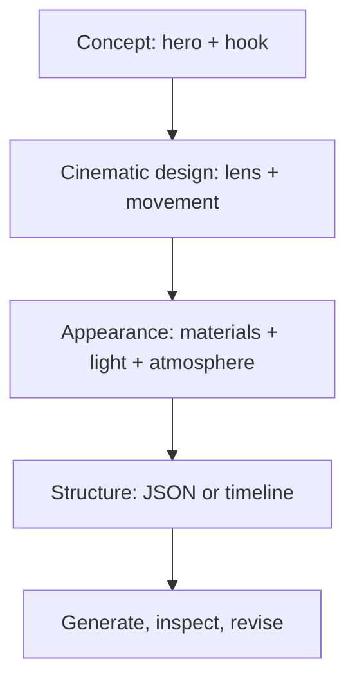

# Lecture Sheet: The Architecture of Cinematic AI Video

**Source deck:** `Class_3_crating_vid.pdf`  
**Deck title:** *The Architecture of Cinematic AI Video*  
**Author shown in deck:** Saad Ahmed  
**Prepared:** 2026-09-19  
**Audience:** Undergraduate learners and early practitioners exploring generative video, prompt design, JSON, and cinematic language  
**Central idea:** A strong AI-video prompt is easier to build and debug when it separates creative intent into a hero, a hook, camera language, material and lighting cues, motion, and a clear structure.

> **How to use this sheet:** Text marked **Deck content** records what the slides say. Text marked **Lecture interpretation** explains the idea, adds examples, or corrects an oversimplification. The source deck is practical and visual; this sheet makes its assumptions explicit so that the method can be implemented and tested.

## 1. Learning objectives

By the end of this lecture, you should be able to:

1. Distinguish narrative-prose, structured-JSON, and timeline-based prompting.
2. Turn a vague creative idea into a defined **hero**, **hook**, camera setup, material description, lighting setup, and motion sequence.
3. Use camera vocabulary such as macro, anamorphic, dolly-in, lateral sweep, fixed wide, depth of field, and slow motion with a clear purpose.
4. Explain how material, lighting, atmosphere, and texture cues affect the visual target of a generated shot.
5. Build a valid JSON object containing fields such as `shot`, `subject`, `scene`, `action`, and `lighting`.
6. Use objects, arrays, strings, commas, nesting, and validation correctly.
7. Represent a short temporal sequence without assuming that a video model will obey timestamps perfectly.
8. Test prompt changes systematically and evaluate visual consistency, action fidelity, camera behavior, and material fidelity.
9. Recognize the limits of prompt-only control: JSON is an organization format, not a universal control protocol for every video model.

## 2. Prerequisites

- Basic ability to describe a scene in plain language.
- Basic familiarity with a camera or with common film vocabulary.
- Basic JSON literacy is helpful, but the sheet teaches the required syntax.
- Access to a video-generation interface or a storyboard/animation tool for the practical exercise.

## 3. One-page summary

The deck presents a workflow for designing cinematic AI-video prompts.

### The three prompt styles

| Style | Main idea | Strength | Main risk |
|---|---|---|---|
| Narrative prose | Describe the whole shot as a paragraph | Fast and natural to write | Important details can blur together |
| Structured JSON | Separate the shot into named fields | Easier to scan, revise, and reuse | Some tools do not interpret raw JSON as a special control format |
| Timeline-based | Describe what changes across time intervals | Makes sequence and transformation explicit | Exact timestamps may not be enforced by the model |

### The four-phase creative workflow

1. **Conceptual core:** choose the hero and the hook.
2. **Cinematographer's rig:** choose lens, framing, movement, and motion style.
3. **Material science and lighting:** specify texture, light source, color, atmosphere, and reflections.
4. **Final polish:** validate structure, add constraints, generate, inspect, edit, and export.

### The JSON mental model

```text
one video brief
    -> named categories
        -> technical values
            -> nested details and lists
                -> a prompt that can be revised and tested
```

The useful principle is not "JSON magically makes the video high quality." The useful principle is **separation of concerns**: camera instructions should not be mixed accidentally with subject materials, and action instructions should be easy to change without rewriting the entire concept.

### The minimum cinematic prompt schema

```json
{
  "shot": {
    "framing": "Extreme macro close-up",
    "lens": "100mm macro",
    "movement": "Slow dolly-in",
    "depth_of_field": "Very shallow"
  },
  "subject": "A single drop of liquid mercury on black glass",
  "scene": "A dark studio surface with subtle reflections",
  "action": "The drop vibrates, grows crystalline spikes, and forms a crown",
  "lighting": {
    "key": "Single top-down spotlight",
    "fill": "Deep blue reflected edge light",
    "atmosphere": "Thin smoke catching the beam"
  }
}
```

This is valid JSON. Whether a specific AI-video tool accepts it as a structured input is a separate question.

## 4. Deck map

| Pages | Topic | Role in the lecture |
|---|---|---|
| 1 | Title and framing | Introduces cinematic AI video as an architecture problem |
| 2 | Three prompting styles | Gives three ways to express the same creative intent |
| 3 | Transition question | Moves from theory to implementation |
| 4 | Four phases | Provides the overall workflow |
| 5 | Hero and hook | Defines concept before technical detail |
| 6 | Cinematographer's rig | Replaces vague adjectives with film vocabulary |
| 7-8 | Material science and lighting | Adds surface, illumination, and atmosphere |
| 9 | Checklist | Compresses the visual design into five checks |
| 10 | JSON transition joke | Bridges the creative workflow to computer-science structure |
| 11-15 | Building a JSON prompt | Demonstrates initialization, keys, values, action, and nesting |
| 16 | Why JSON? | Explains organization as a way to reduce ambiguity |
| 17 | Brackets divider | Starts the syntax lesson |
| 18-20 | Curly brackets, square brackets, quotes | Teaches the three visible JSON building blocks |
| 21 | Competitive advantage | Summarizes the brackets and introduces comma discipline |
| 22 | End | Closes the presentation |

## 5. Core model: from idea to generated shot



The model is iterative. A generated result that has beautiful materials but the wrong transformation should send you back to the `action` field, not necessarily to the lighting field. A result with the right action but inconsistent object identity may require a simpler subject description, stronger references, shorter duration, or a different tool.

## 6. Page-by-page lecture notes

### Page 1 - The Architecture of Cinematic AI Video

**Deck content**

- Title: *The Architecture of Cinematic AI Video*.
- Author shown: Saad Ahmed.

**Lecture interpretation**

The word **architecture** suggests that cinematic prompting is not just a collection of attractive adjectives. It is a system of parts that should fit together:

- **Concept:** What is the viewer supposed to notice?
- **Camera:** From what optical and spatial viewpoint do we see it?
- **Appearance:** What should the surface, color, light, and atmosphere look like?
- **Action:** What changes, in what order, and with what physical character?
- **Structure:** How can the prompt be edited, validated, and reused?
- **Evaluation:** How will we decide whether the result is good?

The deck is therefore best understood as a design-and-debugging workflow for visual generation.

**Key takeaway**

Start with a visual intention, then expose the variables that control that intention.

### Page 2 - Three Styles of Prompting

**Deck content**

The deck introduces three styles.

#### 1. Narrative prose

Formula:

```text
[Cinematic Setup] + [Subject] + [Action] + [Atmospheric Details]
```

The slide jokes that the reason to use it is: "I feel lazy."

#### 2. Structured JSON

The prompt is divided into categories such as:

- `shot`
- `subject`
- `scene`
- `action`
- `cinematography`

The stated purpose is to reduce confusion between background and foreground information.

#### 3. Timeline-based prompting

The prompt assigns intervals such as:

```text
00:00-00:02
00:02-00:05
```

The stated purpose is to force the sequence: box opens -> pieces fly out -> product assembles.

**Lecture interpretation**

These styles are not mutually exclusive. A robust workflow often combines them:

- Use a short prose sentence to establish the overall creative intent.
- Use JSON to organize shot, subject, scene, light, and constraints.
- Use a timeline array inside the JSON to describe the action sequence.

The practical question is not "Which syntax is best?" It is "Which representation makes the next revision easiest?"

#### Comparison example

**Narrative prose**

```text
An extreme macro shot of a brushed rose-gold watch on black glass. The camera slowly moves closer while condensation gathers on the metal, then the watch separates into precise floating components under a soft blue rim light.
```

**Structured JSON**

```json
{
  "shot": "Extreme macro, 85mm lens, slow dolly-in",
  "subject": "Brushed rose-gold watch",
  "scene": "Black glass studio surface",
  "action": "The watch separates into precise floating components",
  "lighting": "Soft blue rim light with a warm key",
  "texture": "Fine metal grain and small condensation droplets"
}
```

**Timeline-based**

```json
{
  "timeline": [
    {"time": "00:00-00:02", "action": "The watch remains still on black glass"},
    {"time": "00:02-00:04", "action": "Condensation gathers on the metal"},
    {"time": "00:04-00:07", "action": "The watch separates into floating components"}
  ]
}
```

**Technical qualification**

JSON is a data format. A model may read a JSON object as text and use its structure as a helpful cue, but the braces do not automatically become an executable storyboard. Tools differ in whether they support structured fields, schemas, shot lists, keyframes, image references, or explicit duration controls.

### Page 3 - How Can I Create These?

**Deck content**

The page is a transition slide asking how the three prompt styles can be created.

**Lecture interpretation**

Creation should be treated as a repeatable pipeline:

1. Define the visual idea.
2. Choose a representation.
3. Write a minimal version.
4. Validate its syntax if it is JSON.
5. Generate a short clip or storyboard.
6. Inspect the result against explicit criteria.
7. Revise one variable at a time.

Do not start by adding every possible adjective. First establish whether the subject, camera, and main action are correct. Additional surface and lighting detail is useful only after the main visual relationship works.

### Page 4 - Phases

**Deck content**

The deck lists four phases:

1. The Conceptual Core.
2. The Cinematographer's Rig.
3. Material Science and Lighting.
4. The Final Polish.

**Lecture interpretation**

The phases form a dependency chain:

| Phase | Question | Typical output |
|---|---|---|
| Conceptual core | What is the central visual event? | Hero and hook statement |
| Cinematographer's rig | How should the viewer see it? | Framing, lens, movement, speed |
| Material and lighting | How should it look and react to light? | Texture, light source, atmosphere |
| Final polish | How will the brief be made reliable? | Valid structure, constraints, references, tests |

The final phase is only named in the deck, so this sheet expands it into a practical quality-control stage:

- Check JSON syntax or tool-specific input rules.
- Remove contradictory instructions.
- Add negative constraints where the tool supports them.
- Shorten the clip if the transformation is too complex.
- Preserve a stable subject description across iterations.
- Render, compare, and record the result.
- Finish with editing, sound, color, captions, and export settings.

### Page 5 - The Conceptual Core: Define the Hero and the Hook

**Deck content**

The slide asks the creator to define:

- **Hero:** What is the main object? Example: "A vintage camera."
- **Hook:** What is the impossible thing happening? Example: "It dissolves into a swarm of chrome butterflies."

The slide recommends specific brands or materials to lock in quality, such as a Leica-style camera or brushed obsidian.

**Lecture interpretation**

The hero is the identity anchor. The hook is the event that earns attention.

#### Hero checklist

- What object or character must remain recognizable?
- Which properties must remain stable: shape, color, material, logo, silhouette?
- Is there one hero or are there competing subjects?
- What is the camera's distance from the hero?

#### Hook checklist

- What transformation or contradiction occurs?
- Does the hook happen once or continuously?
- What is the beginning state and the end state?
- Can a viewer describe the change in one sentence?

#### Strong concept statement

```text
Hero: a vintage brass camera with worn black leather.
Hook: the camera opens and becomes a flock of reflective chrome birds.
```

#### Weak concept statement

```text
Make something cool, realistic, cinematic, high quality, and surprising.
```

The weak version contains mood words but no stable subject, transformation, or observable success condition.

**Brand and rights note**

Specific brands can act as style references, but use them carefully. A real logo, product design, or brand identity may introduce trademark, publicity, or commercial-use concerns. For practice, a fictional brand plus concrete material and design attributes is often safer and more controllable.

### Page 6 - The Cinematographer's Rig

**Deck content**

The slide says to stop using vague words such as "cool" or "realistic" and use film-set vocabulary. It highlights lens, movement, and frame rate.

#### Lens examples

- Macro / 85mm: detail and texture.
- Anamorphic / wide: epic cinematic sweeps.

#### Camera-motion examples

- **Dolly-in:** smoothly moving toward the subject.
- **Lateral sweep:** moving sideways.
- **Fixed wide:** keeping the camera still while a magic assembly occurs.

#### Frame-rate examples

- Slow motion.
- 60fps for fluid physics.

**Lecture interpretation**

Film vocabulary is useful because it maps a vague aesthetic goal to an observable camera behavior.

| Prompt term | What it should communicate | What to inspect in the result |
|---|---|---|
| Macro | Close viewing distance and high detail | Is the surface large in frame? |
| Wide | More environment and spatial context | Can we read the scene around the hero? |
| Anamorphic look | Wide cinematic composition, oval bokeh, flare-like character | Does the image feel horizontally expansive? |
| Dolly-in | Camera physically approaches | Does perspective change, rather than only zooming? |
| Lateral sweep | Camera travels sideways | Do foreground and background shift differently? |
| Fixed wide | Camera remains stable | Can the transformation be seen without framing drift? |
| Shallow depth of field | Narrow focus region | Does the model keep the intended object sharp? |

**Technical qualification**

Terms such as "85mm" or "60fps" may function as visual style cues. A prompt does not necessarily set a real lens or output frame rate. If exact camera parameters or frame rate matter, set them in the generation tool or in post-production when those controls are available.

**Useful camera specification**

```text
Extreme macro close-up, 100mm lens, camera locked on a tripod, shallow depth of field, subject centered, no handheld shake.
```

This is more testable than "a beautiful cinematic shot."

### Page 7 - Material Science and Lighting

**Deck content**

The slide says that material and lighting language tells AI how light should bounce off surfaces and helps create an "8K" look.

It recommends:

- **Textures:** glistening condensation, fine leather grain, iridescent oil slick.
- **Lighting sources:** 365nm UV backlight, volumetric god rays, bioluminescent glow, softbox ring light.
- **Atmosphere:** drifting dust particles or thin morning mist so light has something to hit.

**Lecture interpretation**

The slide is teaching a physically inspired vocabulary. A material is not just a color; it has properties that affect highlights, reflections, scattering, roughness, transparency, and how it changes under motion.

#### Material description dimensions

| Dimension | Questions to ask | Examples |
|---|---|---|
| Base color | What is the main hue and value? | Brushed rose gold, deep green glass |
| Roughness | Is the surface matte, satin, or mirror-like? | Powder-coated matte, polished chrome |
| Microtexture | What small-scale detail is visible? | Leather grain, pores, scratches |
| Reflectance | What does the surface reflect? | Sharp studio highlights, soft environment reflection |
| Transparency | Does light pass through it? | Frosted glass, liquid, translucent resin |
| State change | Does it melt, crack, inflate, dissolve, or crystallize? | Mercury forms spikes, wax softens |

#### Lighting description dimensions

| Dimension | Examples |
|---|---|
| Source | Softbox, ring light, spotlight, window light |
| Direction | Top-down, side-lit, backlit, rim-lit |
| Color | Warm amber key, cool blue fill |
| Hardness | Hard specular beam, soft diffuse illumination |
| Falloff | Rapid falloff in a dark studio, broad even light |
| Interaction | Highlights, translucency, caustics, glowing edges |
| Medium | Smoke, mist, dust, rain, haze |

**Technical qualification**

The phrase "8K look" is shorthand for visible detail and polished rendering. Texture and lighting cues can encourage detail, but they do not by themselves create an 8K file or guarantee true physical simulation. Output resolution, model capability, denoising, image-to-video references, upscaling, and post-processing also matter.

The 365nm UV example should be treated carefully. Ultraviolet light is mostly invisible to human vision; a visible result would typically come from fluorescence or a material that reacts visibly to UV. A clearer prompt is:

```text
Invisible 365nm UV source causing the fluorescent paint on the object to glow violet, with a dark studio background.
```

If the concept is being filmed in the physical world, UV exposure also raises safety concerns. The prompt should not be treated as a lighting safety instruction.

### Page 8 - Material Science and Lighting (continued)

**Deck content**

Page 8 repeats the page 7 title and content exactly. The repeated page reinforces the importance of material, light, and atmosphere in the proposed workflow.

**Lecture interpretation**

The repetition is useful as a teaching emphasis: a convincing shot depends on the relationship between an object and the light around it.

Consider the difference:

```text
A chrome sphere.
```

versus:

```text
A mirror-polished chrome sphere on wet black stone, reflecting a large softbox to the left and a narrow cyan rim light behind it; thin mist reveals the beam and small water droplets distort the reflections.
```

The second description supplies:

- Surface behavior: mirror-polished chrome.
- Environment: wet black stone.
- Key-light relationship: large softbox to the left.
- Edge separation: cyan rim light.
- Atmosphere: mist.
- Secondary detail: water droplets.

#### Avoid contradictory surface cues

Do not describe the same object as all of the following unless a state change is intended:

```text
mirror-polished chrome, matte chalk, transparent wood, completely non-reflective glass
```

Instead, specify a coherent state or a transition:

```text
The matte black shell gradually becomes mirror-polished chrome as the transformation begins.
```

#### Atmosphere is a visibility tool

Dust, mist, smoke, and rain are not only decorative. They create particles or droplets that can catch light and make beams visible. If the scene should be clean and product-like, omit atmospheric particles or state that the air is clear.

### Page 9 - Checklist

**Deck content**

The slide asks five questions:

1. Is there a specific lens, such as an 85mm macro?
2. Is there a specific light, such as golden-hour rim light?
3. Is there a specific texture, such as polished chrome?
4. Is there a specific motion, such as a slow-motion breach?
5. Is the structure clean, including quotes and commas if JSON is used?

**Lecture interpretation**

This is a compact preflight checklist. Expand it into a prompt review before generation.

| Check | Pass condition | Example |
|---|---|---|
| Lens or viewpoint | Camera behavior is observable | 100mm macro, fixed overhead wide |
| Light | Source, direction, or quality is named | Warm key with cool rim light |
| Texture | Surface behavior is concrete | Fine leather grain, wet chrome |
| Motion | The change is visible and bounded | Vibrates, cracks, unfolds, assembles |
| Structure | JSON parses and fields do not conflict | No trailing comma; unique keys |

Add three more checks for production use:

6. **Hero continuity:** Is the main object named consistently?
7. **Temporal clarity:** Is the order of events unambiguous?
8. **Success criteria:** What would make the output acceptable?

#### Five-minute prompt audit

Before you generate, underline one phrase for each category:

```text
Hero       -> vintage brass camera
Hook       -> dissolves into chrome birds
Camera     -> fixed wide, 35mm, centered composition
Material   -> worn black leather and brushed brass
Light      -> warm side key with cool rim light
Atmosphere -> faint dust in the beam
Action     -> opens, separates, dissolves, then reforms
```

If a category has no phrase, decide whether it is intentionally unspecified or accidentally missing.

### Page 10 - The JSON transition joke

**Deck content**

The page contains a humorous transition:

- "CSE student na bhai!"
- "JASON kamne?"

The intended topic is JSON, not a person named Jason. The joke connects the cinematic workflow to a computer-science audience.

**Lecture interpretation**

The correct technical term is **JSON**, pronounced in English approximately like "JAY-sun." It stands for **JavaScript Object Notation**, although JSON is language-independent and is used well beyond JavaScript.

The humor is useful because the next section changes the creator's mindset:

- A creative brief describes what should be seen.
- A structured object stores that brief as named fields.
- A parser can check whether the structure is valid.
- A generation tool may then consume the text, fields, or transformed API request.

### Page 11 - Step 1: Initialize the Container

**Deck content**

Every JSON prompt begins and ends with curly brackets. The empty example is:

```json
{
}
```

The slide explains that the brackets tell the AI everything is inside one command.

**Lecture interpretation**

In JSON terms, `{}` is an **object**. It can contain zero or more name-value pairs. The object is a useful top-level container for a video brief.

The slide's practical message is correct for a top-level JSON object, but the stronger wording needs qualification:

- A natural-language prompt does not need to begin and end with curly brackets.
- A JSON text can also be an array, number, string, boolean, or `null`, although a top-level object is usually easier for a structured brief.
- The brackets organize the data; they do not guarantee that a model will obey every field.

#### Top-level container pattern

```json
{
  "shot": "...",
  "subject": "...",
  "scene": "...",
  "action": "...",
  "lighting": "..."
}
```

### Page 12 - Step 2: Define Categories (the Keys)

**Deck content**

The deck asks the student to think like a film director and identifies standard keys:

- `shot`: camera angle and lens.
- `subject`: main focus.
- `scene`: where the action happens.
- `action`: motion or transformation.
- `lighting`: mood.

The page shows a JSON object with these keys and empty values.

**Lecture interpretation**

A **key** is the name used to identify a value. In a JSON object, a key must be a string, followed by a colon and its value.

```json
{
  "shot": "",
  "subject": "",
  "scene": "",
  "action": "",
  "lighting": ""
}
```

This is valid JSON, but it is not yet a useful prompt because the values are empty.

#### Recommended categories

The deck's categories are a good minimum. For more reliable work, add only the fields that you can actually define and evaluate:

```text
concept        hero and hook
shot           framing, lens, angle, movement
subject        identity, material, stable features
scene          environment, time, background
action         transformation or motion
timeline       ordered time intervals
lighting       source, direction, color, quality
atmosphere     mist, dust, rain, clear air
constraints     unwanted objects, camera behavior, continuity rules
output         duration, aspect ratio, resolution, fps if the tool supports them
```

Do not create keys simply to make the JSON look technical. A field helps only when it clarifies an instruction or supports a later comparison.

### Page 13 - Step 3: Fill in the Technical Values

**Deck content**

The slide recommends professional vocabulary such as macro, anamorphic, and god rays. Values should be inside quotation marks.

It gives examples:

```json
{
  "shot": "Extreme macro close-up, 100mm lens, shallow depth of field",
  "subject": "A single drop of liquid mercury on a black glass surface"
}
```

**Lecture interpretation**

At this stage, replace empty fields with concrete, visual, and testable values.

```json
{
  "shot": {
    "framing": "Extreme macro close-up",
    "lens_style": "100mm macro",
    "depth_of_field": "Very shallow",
    "movement": "Slow forward push"
  },
  "subject": {
    "identity": "A single drop of liquid mercury",
    "surface": "Reflective, silver, fluid metal"
  },
  "scene": "Black glass surface in a dark studio"
}
```

The first slide example uses a single string for `shot`; the expanded version uses a nested object. Both can be valid JSON. The expanded version is easier to edit, while the single-string version may be easier to paste into an interface that expects prose.

#### Technical values should answer observable questions

- What is the camera looking at?
- How near or far is it?
- Is the camera moving?
- What material cues should appear?
- What background should stay quiet?
- What part of the image should be sharp?

Avoid using technical words without a visible consequence. For example, "anamorphic" is less useful by itself than "wide anamorphic composition with horizontal flare-like highlights and shallow focus on the hero."

### Page 14 - Step 4: Craft the Action Sequence (the Physics)

**Deck content**

The slide says that the `action` or `motion` key should describe how things change over time. It recommends words that communicate force and fluidity.

Example from the deck:

```text
"action": "The mercury drop vibrates rapidly, then sprouts sharp, crystalline spikes that grow and interlock to form a complex geometric crown."
```

**Lecture interpretation**

Action is the most important field for a transformation shot. It should describe:

1. **Initial state:** what is true before the event.
2. **Trigger:** what starts the event.
3. **Intermediate motion:** how the change unfolds.
4. **Final state:** what the viewer sees at the end.
5. **Camera relation:** whether the camera follows, stays fixed, or changes focus.

#### Action grammar

```text
At first [initial state]. Then [trigger]. The subject [motion or transformation]. Finally [end state].
```

#### Expanded version of the deck example

```json
{
  "action": {
    "initial_state": "A single mercury drop rests motionless on black glass",
    "trigger": "The drop begins to vibrate rapidly",
    "transformation": "Sharp crystalline spikes grow outward and interlock",
    "final_state": "The liquid-metal drop becomes a geometric crown",
    "motion_quality": "Precise, controlled, fluid, physically grounded",
    "camera_relation": "The camera remains locked while the transformation stays centered"
  }
}
```

This makes the transformation easier to revise. If the spikes appear too fast, change the trigger or motion quality instead of rewriting the subject.

#### Useful action verbs

| Type | Verbs |
|---|---|
| Mechanical | opens, unfolds, rotates, locks, assembles |
| Fluid | ripples, flows, beads, stretches, splashes |
| Growth | sprouts, branches, expands, crystallizes, blooms |
| Destruction | cracks, shatters, erodes, collapses, disintegrates |
| Transformation | melts into, morphs into, dissolves into, re-forms as |
| Camera | pushes in, pans, tracks, orbits, racks focus |

**Technical qualification**

Descriptive verbs do not create a physics simulation automatically. The model may approximate the visual pattern, and complex sequences can drift, skip steps, or change object identity. For difficult transformations:

- Use a shorter clip.
- Reduce the number of sequential events.
- Start and end from explicit states.
- Use image references or keyframes if available.
- Generate separate shots and edit them together.

### Page 15 - Step 5: Leveling Up with Nesting

**Deck content**

The slide introduces **nesting**: placing a list or object inside a category using curly brackets inside the main prompt.

Example from the deck:

```json
{
  "lighting_setup": {
    "primary": "Single dramatic top-down spotlight",
    "secondary": "Deep blue fill lighting on the reflected edges",
    "atmosphere": "Subtle drifting smoke catching the light"
  }
}
```

**Lecture interpretation**

Nesting lets one category contain several related sub-fields. It improves locality: everything about lighting is kept under `lighting_setup`.

```text
top-level object
    -> lighting_setup object
        -> primary value
        -> secondary value
        -> atmosphere value
```

#### When to nest

Nest when the sub-fields belong together and are likely to be edited together. Good candidates include:

- `shot`: framing, lens, movement, depth of field.
- `lighting`: key, fill, rim, color, atmosphere.
- `subject`: identity, material, color, stable features.
- `output`: duration, aspect ratio, resolution, fps.

Do not nest every adjective. Excessive nesting makes a prompt harder to read and may not be understood by the generation tool.

### Page 16 - Why JSON?

**Deck content**

The slide says that the AI sees a database of instructions and does not have to guess whether "blue" refers to light or subject because each detail is placed in a separate box. It connects the method to ultra-high-quality results and mentions Maserati, Adidas, and Louis Vuitton examples.

**Lecture interpretation**

The useful explanation is **semantic separation**. If a prompt labels a value as `lighting.color`, the intended role is clearer to a human editor and may also be clearer to a language model than an isolated word such as "blue."

However, JSON is not literally a database in this context. It is a serialized text representation of structured data. The model may use the structure as a cue, while an API or application may parse it into fields. The quality improvement comes from clearer specification, less accidental contradiction, easier revision, and sometimes tool-level structured controls.

#### Ambiguous prose versus labeled structure

**Ambiguous**

```text
A blue object under a blue light in a blue room.
```

**Labeled**

```json
{
  "subject": {"color": "deep red lacquer"},
  "scene": {"background": "matte charcoal studio"},
  "lighting": {"color": "cool blue rim light"}
}
```

The second version is not guaranteed to work better in every model, but it gives the creator a more precise brief.

#### Brand examples and evidence

The deck names Maserati, Adidas, and Louis Vuitton as examples of high-quality use. The extracted slides do not include the underlying prompts, output comparisons, or measurements. Treat these as illustrative claims rather than as a demonstrated benchmark.

### Page 17 - The Brackets divider

**Deck content**

The page is a section divider titled **THE BRACKETS**.

**Lecture interpretation**

The lesson now moves from creative decomposition to syntax. The three visible bracket families in a basic JSON object are:

- Curly brackets: objects.
- Square brackets: arrays.
- Quotation marks: strings.

The colon `:` and comma `,` are equally important, even though they receive less visual emphasis.

### Page 18 - Curly Brackets `{ }`

**Deck content**

- Name: objects or containers.
- Rule: group related categories.
- Main container: the prompt starts with `{` and ends with `}`.
- Nested container: use another object for a sub-section.
- Example:

```json
{
  "camera": {
    "lens": "85mm",
    "movement": "Slow pan"
  }
}
```

**Lecture interpretation**

Curly brackets define an object. An object is a set of name-value pairs. The outer object is the video brief; the inner object groups camera properties.

#### Object anatomy

```json
{
  "key": "value"
}
```

- `{` opens the object.
- `"key"` is the property name.
- `:` separates the name from its value.
- `"value"` is the property value.
- `}` closes the object.

#### Multiple members

```json
{
  "lens": "85mm",
  "movement": "Slow pan",
  "locked_camera": true
}
```

The comma separates the first member from the next. The final member has no trailing comma.

**Technical qualification**

The slide says every prompt starts and ends with curly brackets. More precisely: every **top-level object prompt** starts and ends with curly brackets. A natural-language prompt or a JSON array may use a different top-level form.

### Page 19 - Square Brackets `[ ]`

**Deck content**

- Name: arrays or lists.
- Rule: use when a category contains multiple items.
- Analogy: a shopping list or a tray of props.
- Example:

```text
"props": ["LEGO box", "yellow throw blanket", "bedside lamp", "potted plant"]
```

**Lecture interpretation**

An array is an ordered collection of values. In the example, `props` is a list of four strings.

```json
{
  "props": [
    "LEGO box",
    "yellow throw blanket",
    "bedside lamp",
    "potted plant"
  ]
}
```

Arrays can contain objects, which is useful for timelines:

```json
{
  "timeline": [
    {"time": "00:00-00:02", "action": "The box is closed"},
    {"time": "00:02-00:04", "action": "The lid opens"},
    {"time": "00:04-00:07", "action": "The object assembles"}
  ]
}
```

#### Why order matters

In JSON, an array is ordered. That is why a timeline belongs in an array: the order of the elements expresses sequence. A generic object is mainly a collection of named members; do not rely on object member order to communicate chronology.

### Page 20 - Quotation Marks `" "`

**Deck content**

- Name: strings or labels.
- Rule: use quotation marks for each piece of text.
- Keys such as `"lighting"` are quoted.
- Text values such as `"neon blue"` are quoted.
- The slide says quotes tell AI that a word is descriptive rather than mathematical logic.

**Lecture interpretation**

In strict JSON:

- Object keys are strings and must be in double quotes.
- Text values are strings and must be in double quotes.
- Numbers are not quoted if they are meant to be numbers.
- `true`, `false`, and `null` are literals, not quoted strings.

```json
{
  "lighting": "neon blue",
  "duration_seconds": 8,
  "locked_camera": true,
  "reference_image": null
}
```

If `"8"` is used instead of `8`, the value is text rather than numeric data. A model may not care when the JSON is merely pasted as a prompt, but an API or validator may care.

#### Escaping quotes inside a string

```json
{
  "caption": "The label reads \"OPEN\""
}
```

The backslash tells the parser that the inner quote belongs to the string rather than ending it.

### Page 21 - Competitive Advantage: the bracket table and comma rule

**Deck content**

The page summarizes:

| Symbol | Meaning in the deck | Analogy |
|---|---|---|
| `{}` | Organization: groups different kinds of information | A room, such as a camera room |
| `[]` | Collection: a list of similar things | A tray of props |
| `""` | Definition: tells AI that this is a word | A label on a box |

It also gives a "comma rule": use a comma after a closing `}` or `]` or `"` if another line comes after it, but do not use a comma on the last line before the final `}`.

The right side includes humorous memory aids in Bangla:

- `{ } = "WIRE"`
- `[ ] = "SAAD BHAI."`
- `" " = "SAAD BHAI ER DARI"`

**Lecture interpretation**

The analogies are useful, but the comma rule should be stated precisely:

> A comma separates adjacent members of an object or adjacent elements of an array. It is not added after every quote or closing bracket automatically.

#### Correct comma placement

```json
{
  "camera": {
    "lens": "85mm",
    "movement": "Slow pan"
  },
  "props": ["camera", "tripod"],
  "locked_camera": true
}
```

There is a comma after the nested `camera` object because another top-level member follows. There is no comma after the last member, `locked_camera`.

#### Common invalid pattern: trailing comma

```text
{
  "lens": "85mm",
}
```

Many JSON parsers reject this. Some programming languages or relaxed configuration formats accept trailing commas, but strict JSON does not.

#### Common invalid pattern: missing comma

```text
{
  "lens": "85mm"
  "movement": "Slow pan"
}
```

The two members need a comma between them.

**Memory aid**

```text
object member, object member
array item, array item
last member or item has no trailing comma
```

### Page 22 - The End

**Deck content**

- "The End"
- "THANK YOU FOR LISTENING"

**Lecture interpretation**

The slide deck ends after the syntax lesson. In a production workflow, the end of the lecture is the beginning of a controlled practice cycle:

```text
design -> structure -> generate -> inspect -> record -> revise
```

The rest of this sheet turns the deck into that practice cycle.

## 7. Formal JSON foundations for this lecture

JSON is a lightweight, text-based format for serializing structured data. The standard JSON value types are:

| JSON value | Example | Use in a video brief |
|---|---|---|
| Object | `{ "shot": "..." }` | Group named fields |
| Array | `["mist", "dust"]` | Store an ordered list |
| String | `"Slow dolly-in"` | Store descriptive text |
| Number | `8` or `0.5` | Store duration, intensity, or a count |
| Boolean | `true` or `false` | Store a yes/no setting |
| Null | `null` | Explicitly represent no value |

### The six structural characters

```text
{ }   object boundaries
[ ]   array boundaries
:     name-value separator
,     value separator
" "   string boundaries
```

### Valid JSON example

```json
{
  "project": "Mercury Crown",
  "shot": {
    "framing": "Extreme macro close-up",
    "lens": "100mm macro",
    "movement": "Locked camera"
  },
  "subject": "A single drop of liquid mercury",
  "props": ["black glass surface", "subtle water droplets"],
  "duration_seconds": 7,
  "slow_motion_style": true
}
```

### Invalid JSON example and repair

```text
{
  shot: 'Extreme macro',
  "props": ["glass", "mist",],
}
```

Problems:

- `shot` is not quoted.
- Single quotes are not the standard JSON string delimiter.
- The array has a trailing comma.
- The outer object has a trailing comma.

Repair:

```json
{
  "shot": "Extreme macro",
  "props": ["glass", "mist"]
}
```

### Validation habit

Always validate JSON before using it in a pipeline that expects strict JSON. A syntax validator catches structural errors; it cannot decide whether the prompt is visually coherent or whether the model supports a field.

In Python:

```python
import json

with open("prompt.json", "r", encoding="utf-8") as file:
    brief = json.load(file)

print(brief["subject"])
```

For a quick in-memory check:

```python
import json

candidate = '{"shot": "Macro", "action": "The object opens"}'
brief = json.loads(candidate)
assert "shot" in brief
```

## 8. A complete cinematic AI-video brief

The following example combines the deck's ideas into one coherent, valid JSON object.

```json
{
  "concept": {
    "hero": "A vintage brass camera with worn black leather",
    "hook": "The camera opens and transforms into a flock of chrome birds"
  },
  "shot": {
    "framing": "Medium-wide product shot that preserves the full silhouette",
    "lens_style": "35mm anamorphic look",
    "angle": "Eye-level three-quarter view",
    "movement": "Slow lateral sweep followed by a brief hold",
    "depth_of_field": "Moderately shallow, keeping the hero readable"
  },
  "subject": {
    "identity": "Vintage brass camera",
    "materials": ["brushed brass", "worn black leather", "dark glass lens"],
    "continuity_rules": [
      "Keep the brass body shape stable until the transformation begins",
      "Keep the lens centered on the front face",
      "Do not add a second camera"
    ]
  },
  "scene": {
    "environment": "Dark studio tabletop",
    "background": "Charcoal gradient with no text or extra objects",
    "surface": "Black glass with a soft reflection"
  },
  "action": [
    {
      "time": "00:00-00:02",
      "event": "The camera rests still while the lateral sweep reveals the brass highlights"
    },
    {
      "time": "00:02-00:04",
      "event": "The top plate opens and the lens emits a narrow white glow"
    },
    {
      "time": "00:04-00:06",
      "event": "Brass panels separate into clean geometric pieces and become chrome birds"
    },
    {
      "time": "00:06-00:08",
      "event": "The birds make one controlled arc and settle above the original reflection"
    }
  ],
  "lighting": {
    "key": "Warm softbox from camera left",
    "rim": "Cool blue rim light behind the subject",
    "reflection": "Controlled highlight on the brass and black glass",
    "atmosphere": "Very faint dust visible only inside the rim-light beam"
  },
  "constraints": [
    "No handheld shake",
    "No random cuts",
    "No extra logos or readable text",
    "Preserve the center of the composition during the transformation"
  ],
  "output": {
    "duration_seconds": 8,
    "aspect_ratio": "16:9",
    "target_frame_rate": 24
  }
}
```

### Why this example is easier to debug

- If the camera is wrong, edit `shot`.
- If the surface is wrong, edit `subject.materials` or `scene.surface`.
- If the order is wrong, edit `action`.
- If the image is flat, edit `lighting` or `atmosphere`.
- If the model invents objects, edit `constraints`.
- If the output settings are unsupported, move them into the tool's actual controls rather than relying on prompt text.

## 9. Timeline prompting in practice

The deck's timeline idea becomes stronger when each event includes a beginning, an action, and an end state.

```json
{
  "duration": "8 seconds",
  "timeline": [
    {
      "time": "00:00-00:02",
      "state": "closed box",
      "action": "The box rests on a white table",
      "camera": "Fixed wide shot"
    },
    {
      "time": "00:02-00:04",
      "state": "open box",
      "action": "The lid opens slowly and catches a warm rim light",
      "camera": "Slow dolly-in"
    },
    {
      "time": "00:04-00:06",
      "state": "loose parts",
      "action": "Small polished components rise and orbit the box",
      "camera": "Camera remains centered"
    },
    {
      "time": "00:06-00:08",
      "state": "assembled product",
      "action": "The parts lock together into a clean finished object",
      "camera": "Brief hold on the final hero"
    }
  ]
}
```

### Timing qualifications

- Timecodes are a planning language unless the tool explicitly supports them.
- Generated motion may not align exactly with the requested boundaries.
- If the sequence is important, generate separate clips for each state and assemble them in an editor.
- Keep the number of events small enough that the model can maintain identity and continuity.

## 10. Implementation blueprint: Learn -> Implement -> Experiment -> Measure -> Analyze -> Record -> Improve

### Phase A - Learn

Read or review:

- JSON objects, arrays, strings, numbers, booleans, and null.
- Basic camera framing and movement.
- Material properties and light direction.
- The chosen video tool's prompt, reference-image, duration, resolution, and output controls.

**Completion criterion:** You can explain every field in your prompt without using a vague phrase as a substitute for a visual behavior.

### Phase B - Implement

Create a minimal brief with only five fields:

```json
{
  "shot": "Fixed wide shot",
  "subject": "A red paper box",
  "scene": "A clean white table",
  "action": "The box opens and a small object assembles inside it",
  "lighting": "Soft warm studio light"
}
```

Generate one short result. Do not add every detail yet.

### Phase C - Experiment

Change one factor at a time:

1. Prose versus JSON.
2. Fixed camera versus dolly-in.
3. Matte material versus polished material.
4. No atmosphere versus light mist.
5. One action event versus four timeline events.

Keep the hero and hook constant so the comparison is meaningful.

### Phase D - Measure

Use a small rubric from 0 to 3:

| Metric | 0 | 1 | 2 | 3 |
|---|---|---|---|---|
| Hero identity | Missing or unrecognizable | Partly recognizable | Mostly stable | Stable throughout |
| Hook fidelity | Does not happen | Hints at it | Mostly occurs | Clearly occurs as specified |
| Camera fidelity | Wrong or chaotic | Some resemblance | Mostly correct | Correct and controlled |
| Material fidelity | Wrong material | Generic material | Mostly right | Surface behavior is convincing |
| Temporal order | Events missing or shuffled | Partial order | Mostly ordered | Clear beginning-to-end sequence |
| Composition | Unreadable | Subject often lost | Usually readable | Hero is consistently legible |

Total possible score: 18.

### Phase E - Analyze

Ask:

- Which field changed between the best and worst result?
- Did the prompt become more precise or merely longer?
- Did adding atmosphere improve the light or distract from the hero?
- Did the action succeed because the sequence was simpler?
- Did the model treat technical terms as camera control or as general style?

### Phase F - Record

For each run, store:

```text
run_id
date
tool and model version
prompt file
reference images
seed or reproducibility setting, if available
duration and output settings
quality scores
observed failure modes
next change
```

### Phase G - Improve

Make the smallest revision that addresses the largest failure. If a transformation consistently fails after several prompt revisions, split it into shots or use a tool with stronger temporal or reference controls.

## 11. Failure modes and fixes

| Failure mode | Likely cause | Targeted fix |
|---|---|---|
| The video looks generic | Concept lacks a specific hero, material, or setting | Name the object, surface, environment, and one unusual hook |
| The subject changes identity | Too many transformations or unstable descriptions | Shorten the shot; repeat stable features; use a reference image |
| The camera drifts | Movement is underspecified or the model defaults to motion | Say `fixed camera`, `locked tripod`, or specify one movement only |
| The action happens in the wrong order | Long prose mixes events | Use an ordered timeline with initial and final states |
| The object looks flat | No light direction, surface, or atmosphere | Add key light, rim light, roughness, reflection, and a restrained medium |
| The scene is overdecorated | Too many props and adjectives compete with the hero | Remove all nonessential props; keep the background quiet |
| JSON fails to parse | Missing quote, colon, comma, or trailing comma | Validate before generation; inspect the first reported error |
| JSON parses but the model ignores fields | The interface treats JSON as ordinary prompt text | Use the tool's native controls or convert the brief into prose/fields |
| `60fps` does not change output | Frame rate is not a prompt-controlled parameter | Set FPS in the tool or in post-production |
| Exact timecodes are ignored | The model has no strict timeline control | Generate shorter shots or edit separate clips together |
| "8K" does not create detail | Resolution word is being used as a style adjective | Set resolution separately; improve lighting, references, and upscale pipeline |
| UV light looks physically wrong | Invisible UV is described as visible color | Specify fluorescence or a UV-reactive material |
| The result looks cinematic but not like the target | Aesthetic vocabulary replaced identity and action | Keep hero, hook, and end state explicit; add style after structure |
| A brand appears unexpectedly | Brand name is being treated as a visual shortcut | Use fictional branding and concrete design properties when appropriate |

## 12. Prompt design patterns

### Pattern A - The minimal five-field brief

Use when you are learning or comparing tools.

```json
{
  "shot": "Fixed wide shot",
  "subject": "A small red paper box",
  "scene": "A clean white table in a dark studio",
  "action": "The box opens and a tiny brass machine assembles inside it",
  "lighting": "Soft warm key light with a gentle blue rim"
}
```

### Pattern B - The product transformation brief

Use when material fidelity and brand-like presentation matter.

```json
{
  "concept": {
    "hero": "A fictional luxury watch",
    "hook": "The watch becomes a precise mechanical flower"
  },
  "shot": {
    "framing": "Hero product close-up",
    "lens": "85mm macro",
    "movement": "Slow dolly-in"
  },
  "subject": {
    "material": "Brushed titanium with black ceramic details",
    "surface_detail": "Fine machining marks and controlled specular highlights"
  },
  "action": "The crown turns, the case separates, and nested mechanical petals unfold",
  "lighting": "Large softbox key, narrow amber rim, dark gradient background"
}
```

### Pattern C - The clean magic-assembly shot

Use when the transformation should be easy to read.

```json
{
  "shot": {
    "framing": "Fixed wide composition",
    "camera": "Locked-off tripod",
    "background": "Simple neutral studio"
  },
  "subject": "A set of wooden pieces on the floor",
  "action": "The pieces lift one at a time and assemble into a small chair without cuts",
  "constraints": [
    "Keep the camera fixed",
    "Show every major assembly step",
    "No extra pieces appear",
    "The final chair remains centered"
  ]
}
```

### Pattern D - Tool-agnostic prose conversion

If the tool does not accept JSON, convert the same fields into a compact, ordered paragraph:

```text
Fixed wide product shot on a locked tripod. Hero: a small red paper box on a clean white table in a dark studio. The box opens, then a tiny brass machine assembles inside it. Use a soft warm key light and a gentle blue rim light. Keep the camera fixed, preserve the box shape, show the transformation without cuts, and keep the final machine centered.
```

The content is the same; only the representation changes.

## 13. Practical exercise

### Exercise - Design a seven-second cinematic transformation

Choose one ordinary object:

- A coffee cup.
- A school notebook.
- A bicycle lock.
- A desk lamp.
- A pair of headphones.

Write:

1. One hero sentence.
2. One hook sentence.
3. One camera specification.
4. One material specification.
5. One lighting specification.
6. A three-event timeline.
7. A valid JSON version.
8. A prose version for a tool that does not accept JSON.

Generate at least three variants:

- Variant A: minimal prose.
- Variant B: structured JSON or field-based prompt.
- Variant C: structured prompt with timeline and constraints.

### Recommended observation sheet

| Variant | Hero identity / 3 | Hook fidelity / 3 | Camera / 3 | Material / 3 | Temporal order / 3 | Notes |
|---|---:|---:|---:|---:|---:|---|
| A |  |  |  |  |  |  |
| B |  |  |  |  |  |  |
| C |  |  |  |  |  |  |

### Completion criteria

- The JSON parses.
- The hero is identifiable in the opening and closing frames.
- The hook is observable, not merely described.
- The camera behavior matches the intended movement.
- At least one revision is justified by an observed failure.
- The final report distinguishes a better prompt from a better tool setting.

## 14. Exam quick reference

### Short-answer questions

1. What is the difference between a hero and a hook?
2. Why might structured JSON be easier to revise than narrative prose?
3. What is the difference between a JSON object and a JSON array?
4. Why is a timeline often represented as an array?
5. Why does `"duration": "8"` differ from `"duration": 8`?
6. Why does a fixed wide shot help a magic-assembly transformation?
7. What does atmosphere contribute to a visible light beam?
8. Why does a prompt saying `60fps` not guarantee a 60fps file?
9. What is a trailing comma, and why can it break strict JSON?
10. Why is JSON structure not the same as an API schema or guaranteed model control?

### Design question

Design a JSON prompt for a seven-second video in which a ceramic teacup cracks, releases glowing blue vapor, and becomes a small glass tree. Include:

- Hero and hook.
- Shot and camera movement.
- Material and lighting.
- An ordered three-event timeline.
- At least two constraints.
- Valid JSON syntax.

### Debugging question

Given this prompt, identify at least four errors:

```text
{
  shot: {"lens": '85mm', "movement": "Slow pan",},
  "subject": "A glass cup",
  "action": ["cracks", "glows", "becomes a tree",],
}
```

Expected observations:

- `shot` is not quoted.
- The `lens` value uses single quotes.
- The nested object has a trailing comma.
- The action array has a trailing comma.
- The outer object has a trailing comma.
- The action is too compressed to guarantee a clear temporal order; it should be expanded into time-bounded events.

## 15. Assignment rubric

| Criterion | Excellent | Developing | Incomplete |
|---|---|---|---|
| Concept | Hero and hook are specific, memorable, and testable | One is clear but the other is vague | No stable hero or hook |
| Camera design | Lens, framing, and movement have observable consequences | Some camera terms are present but inconsistent | Generic or contradictory camera language |
| Material and lighting | Surface, light, and atmosphere work together | Details are present but disconnected | Mostly adjectives with no light-surface relationship |
| Structure | Valid, readable JSON with useful nesting and arrays | Minor errors or unnecessary complexity | Cannot be parsed or categories are missing |
| Temporal action | Beginning, transformation, and end are ordered | Order is partly understandable | Events are ambiguous or contradictory |
| Experimentation | One variable is changed at a time and results are recorded | Variants exist but comparisons are informal | No controlled comparison |
| Reflection | Explains what failed and why the next change was chosen | Describes results without reasoning | No analysis |

## 16. Necessary links and sites

These are grouped by the order in which they are useful. The first group is required for this lecture; the later groups are optional production references.

### A. JSON syntax and validation

- [IETF RFC 8259: The JSON Data Interchange Format](https://www.rfc-editor.org/rfc/rfc8259) - authoritative grammar, value types, objects, arrays, strings, commas, and parser behavior.
- [JSON.org](https://www.json.org/json-en.html) - compact visual introduction to JSON syntax.
- [MDN: Working with JSON](https://developer.mozilla.org/en-US/docs/Learn_web_development/Core/Scripting/JSON) - beginner-friendly explanation with JavaScript examples.
- [JSON Schema](https://json-schema.org/) - useful when a real application must validate required fields, types, and allowed values rather than merely checking syntax.

### B. Current video-generation documentation

Use the documentation for the exact tool you are using because prompt syntax, duration limits, aspect ratios, reference-image support, and output controls change.

- [OpenAI API: Video generation with Sora](https://developers.openai.com/api/docs/guides/video-generation) - official API documentation for creating, checking, downloading, and working with generated videos.
- [Google AI for Developers: Video generation in the Gemini API](https://ai.google.dev/gemini-api/docs/video) - official Gemini API documentation for video generation workflows.
- [Runway developer documentation](https://docs.dev.runwayml.com/) - API and developer reference for Runway workflows.

### C. Research background

- [Video Diffusion Models](https://arxiv.org/abs/2204.03458) - research paper on diffusion-based video generation.
- [Make-A-Video: Text-to-Video Generation without Text-Video Data](https://arxiv.org/abs/2206.01718) - early influential text-to-video research.
- [Sora: Video generation models as world simulators](https://arxiv.org/abs/2402.17177) - technical report describing a large-scale video-generation approach and its limitations.

### D. Production and post-processing

- [FFmpeg documentation](https://ffmpeg.org/documentation.html) - command-line tools for inspecting, converting, trimming, scaling, and assembling video.
- [FFprobe documentation](https://ffmpeg.org/ffprobe.html) - inspect actual duration, codecs, frame rate, dimensions, and metadata rather than trusting prompt text.
- [Blender manual](https://docs.blender.org/manual/en/latest/) - optional route for camera animation, keyframes, materials, lighting, and deterministic scene construction.
- [Physically Based Rendering: From Theory to Implementation](https://pbr-book.org/4ed/contents) - deeper reference for light transport, materials, cameras, and rendering concepts.

### E. Search terms for further study

Use these terms to find targeted tutorials or papers:

- `text-to-video prompt temporal consistency`
- `image-to-video reference subject consistency`
- `cinematic camera movement dolly lateral tracking`
- `physically based material roughness specular reflection`
- `JSON schema validation Python`
- `FFmpeg extract frame rate duration ffprobe`
- `storyboard shot list generative video`

## 17. Source fidelity, corrections, and verification notes

### What was transcribed

- All 22 pages of `Class_3_crating_vid.pdf` were reviewed.
- Text was extracted from the PDF and checked against rendered page images.
- The deck's repeated material-and-lighting page was preserved as a repeated teaching emphasis.
- The humorous `JASON` spelling was preserved as a source detail but corrected to `JSON` in technical explanations.

### Important corrections added in this lecture sheet

1. **JSON is not automatically a database or executable command.** It is a structured text format. A generation system may parse it, or a model may only read it as prompt text.
2. **Curly brackets are not required for every prompt.** They are required for a top-level JSON object, not for ordinary prose.
3. **Quotes are not required around every JSON value.** Strings use quotes; numbers, booleans, and `null` use their JSON literal forms.
4. **The comma rule is contextual.** Commas separate adjacent members or array items; they do not follow every closing quote or bracket automatically.
5. **Timeline timestamps are planning instructions unless the tool explicitly supports strict timing.**
6. **Prompt words such as `85mm` and `60fps` may be style cues rather than actual output controls.**
7. **Material and lighting language can suggest detail but does not itself guarantee an 8K file or physically correct simulation.**

### Visual and metadata notes

- The PDF contains 22 pages and is designed as a 16:9 slide deck.
- The PDF metadata identifies the title as `Video`, the author as `saad ahmed`, and Canva as the creator/producer.
- Some interior pages visibly carry a small page-number artifact such as `7` or `8`; those numbers are not used as the lecture-note page numbers.
- The named brand examples are not accompanied by benchmark data in the deck, so this sheet does not treat them as measured evidence.

## 18. Final takeaway

The deck's practical lesson is a disciplined way to move from imagination to a testable visual brief:

```text
Choose the hero.
Define the impossible hook.
Specify how the camera sees it.
Describe how material and light behave.
Describe the action as an ordered transformation.
Structure the brief so it can be validated and revised.
Generate, inspect, measure, and improve.
```

The strongest prompt is not the longest prompt. It is the prompt whose parts have distinct jobs, whose action can be observed, whose syntax can be checked, and whose result can be compared against a clear success criterion.
