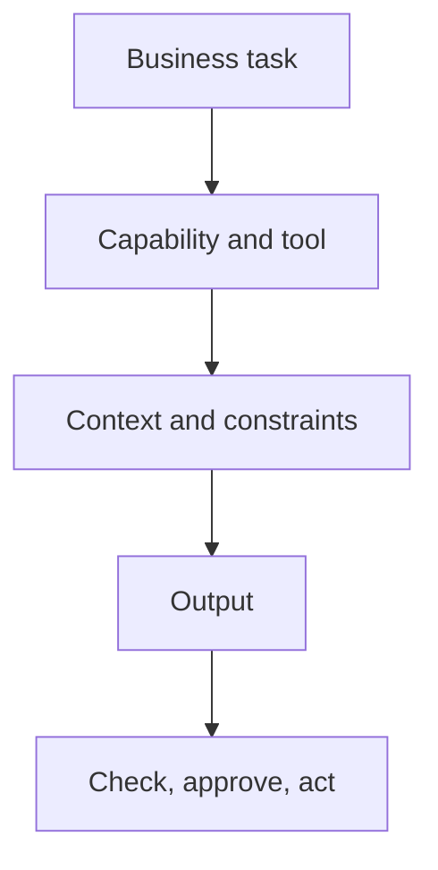
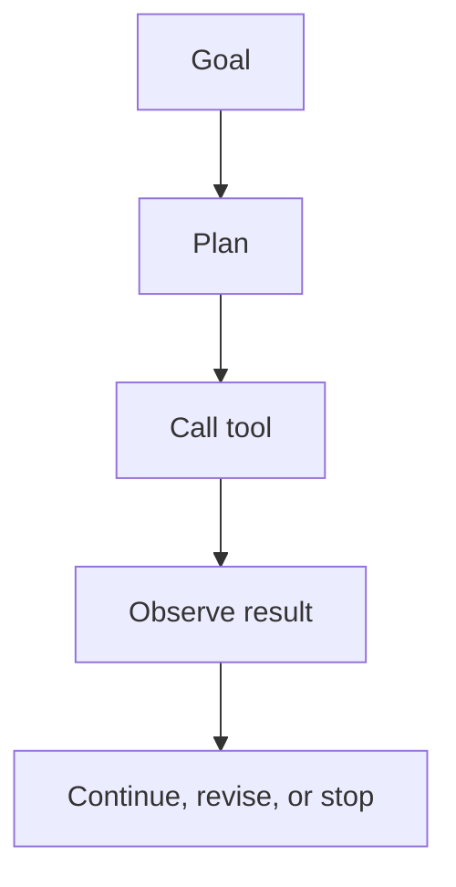
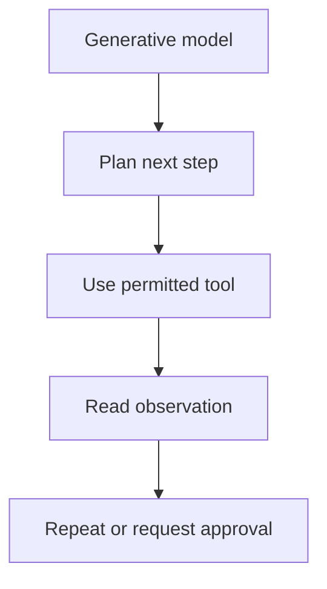

# Lecture Sheet: AI as a Business Tool

**Source deck:** `IUT APPLIED AI- BUSINESS CLASS 1.pptx`  
**Deck title:** *Class 1 - AI as a Business Tool*  
**Institution/context shown:** IUT Dhaka; Meghna Office Supplies workshop  
**Prepared:** 2026-09-19  
**Deck length:** 39 slides; 150 minutes including a 10-minute break  
**Audience:** IUT undergraduate students and early practitioners learning to use AI for business work  
**Central idea:** AI creates business value when a person chooses an appropriate capability and tool, supplies the right context, checks the output, and keeps the consequential decision under human control.

> **How to read this sheet:** **Deck content** records what the slides or speaker notes say. **Lecture interpretation** explains the mechanism, adds examples, or corrects a shortcut. **Verification note** marks claims that move quickly, rely on self-reporting, or need a source check before reuse.

## 1. Learning objectives

By the end of this lecture, you should be able to:

1. Explain the difference between artificial intelligence, generative AI, agentic AI, and computer-use systems.
2. Distinguish five business capabilities: Search, Reason, Generate, Analyze, and Automate.
3. Match a task to a tool using output requirements, source needs, privacy, checkability, cost, and human approval.
4. Explain why a fluent AI answer can contain a correct fact, a wrong calculation, an invented explanation, and an unsupported recommendation at the same time.
5. Write a useful business prompt that states the customer, problem, context, output, assumptions, constraints, and test.
6. Use prompt chaining or a prompt relay to move from research to brief to draft to critique to slides.
7. Design a single-purpose AI workspace with stable context, reusable instructions, an output format, a checking method, and a human approval point.
8. Separate facts, assumptions, estimates, recommendations, and claims that require verification.
9. Calculate and independently check a small sales update from supplied data.
10. Turn an idea into a hypothesis and design a low-cost test without pretending that AI-generated text is demand evidence.
11. Design a repeatable personal AI work stack with clear inputs, outputs, verification, and approval.
12. Identify privacy, permission, security, bias, source-quality, and automation risks before using AI on a real task.

## 2. Prerequisites

- Ability to describe a real or fictional business task in plain language.
- Basic arithmetic with percentages and currency.
- Familiarity with at least one AI chat or search tool is helpful but not required.
- Access to a spreadsheet, calculator, or paper for independent checking.
- A commitment to use fictional, public, or safely anonymized information during practice.

## 3. One-page summary

### The main business loop

```text
Choose the task
    -> choose the capability
        -> choose the tool
            -> supply context and constraints
                -> inspect the output
                    -> verify important claims
                        -> approve or revise
                            -> act and record what changed
```

The deck is not teaching that one AI platform is best. It is teaching judgment: choose the tool that fits the job, then check the result.

### The five ways AI helps

| Capability | What it does | Typical example | Main check |
|---|---|---|---|
| Search | Finds information or sources | Locate official warranty terms | Does the source actually support the claim? |
| Reason | Works through options, constraints, or explanations | Compare supplier trade-offs | Did the reasoning begin from correct assumptions? |
| Generate | Produces a draft, structure, or variation | Draft a customer email | Did it invent facts, promises, or commitments? |
| Analyze | Examines supplied data for patterns or metrics | Calculate completed sales | Are inputs, exclusions, formulas, units, and period correct? |
| Automate | Runs a defined process through connected tools | Notify a team when a form arrives | Are permissions, triggers, errors, and approvals safe? |

One task can use several capabilities. A sales report may search for a definition, analyze a spreadsheet, generate a summary, and automate delivery. The capabilities should still be evaluated separately.

### The central distinction

```text
AI can make production easier.
AI does not make a claim true.
AI does not turn a hypothesis into demand evidence.
AI does not transfer accountability away from the human decision-maker.
```

### The five labels for business claims

| Label | Meaning | Example |
|---|---|---|
| Fact | Supported by the supplied data or a credible source | Completed sales total BDT 57,000 in the provided table |
| Assumption | A condition treated as true for planning but not established | Students will prefer a scheduled lunch pickup |
| Estimate | An illustrative quantity, not a measured result | Estimated setup cost BDT 5,000 |
| Recommendation | A proposed action or judgment | Test a small preorder before buying equipment |
| Requires verification | A claim that may be true but cannot be judged from the current material | A supplier's current delivery time |

The deck foregrounds the first four labels. This sheet adds **requires verification** because it prevents an important confusion: a claim can be unsupported by the supplied data without being proven false.

### The human approval rule

The riskier the action, the earlier and stronger the approval point should be.

| Risk level | Example | Appropriate control |
|---|---|---|
| Low | Reformat private notes into headings | Review before sharing |
| Medium | Send a customer-facing draft or update | Human edits and approves before sending |
| High | Change a payment, medical, hiring, or inventory decision | Independent evidence, domain owner approval, and logged decision |
| Very high | Autonomous action across accounts or systems | Restricted permissions, sandbox, staged rollout, monitoring, emergency stop |

## 4. Workshop map

| Slides | Topic | Learning function |
|---|---|---|
| 1 | Title, workbench, privacy | Establishes purpose and safety boundary |
| 2-5 | Adoption, frontier developments, sectors, investment | Creates context while modeling source skepticism |
| 6-8 | AI, generative AI, agentic AI, computer-hosted AI | Builds a usable vocabulary |
| 9-13 | Tools and startup case studies | Shows different tool fits and business patterns |
| 14-16 | Learner baseline and toolbox inventory | Connects the topic to personal tasks |
| 17-18 | Capability and tool selection | Teaches matching rather than ranking |
| 19-22 | AI for Good image examples | Shows possible applications and their risks |
| 23 | Tool-building activity | Practices product judgment and user value |
| 24 | Prompt Relay | Practices chained work across tools |
| 25-26 | Workspace design and sales analyst | Shows context, checking, and approval |
| 27 | Demand hypothesis | Separates interesting ideas from validation |
| 28 | Free tools | Compares access and plan limitations |
| 29 | One idea through six stages | Demonstrates a repeatable research-to-slides pipeline |
| 30 | Break | Protects attention and timing |
| 31 | First business concept | Produces a labeled, testable concept |
| 32-34 | Thread roles, sales update, confident wrong | Shows role separation and verification |
| 35 | Reality check | Audits assumptions and designs a test |
| 36 | Personal AI Work Stack | Turns learning into repeatable workflows |
| 37 | Homework | Requires one checked real-world result |
| 38-39 | Exit ticket and close | Captures individual next action and accountability |

## 5. Workshop timing

The deck's speaker notes define a 150-minute session. The current statistics and tool profiles are context; the practical work is the center of gravity.

| Time | Activity | Output |
|---|---|---|
| 0-2 | Opening, safety, partner setup | Privacy rule understood |
| 2-6 | Introductions and confidence baseline | Current AI-use snapshot |
| 6-10 | Toolbox inventory | Personal task categories and frustrations |
| 10-15 | Five ways AI helps | Capability classification |
| 15-20 | Tool-fit discussion | One tool to test and a reason |
| 20-30 | Which tool do you want to make? | Pair idea with user-value scores |
| 30-40 | One idea visits four tools | Research-to-check pipeline |
| 40-50 | Prompt Relay | One improved prompt and one checked output |
| 50-60 | Workspace and weekly sales analyst | Context, rules, metrics, checking, approval |
| 60-65 | AI for Good examples | Application and risk discussion |
| 70-80 | Demand hypothesis | One problem, one customer, one solution hypothesis |
| 80-90 | Break | Recharge |
| 90-105 | First business concept | Labeled concept, assumptions, low-cost test |
| 105-120 | Thread roles and sales update | Independently checked management update |
| 120-130 | Confidently Wrong and reality check | Claim audit and qualified concept |
| 130-140 | Personal AI Work Stack | Three repeatable workflows |
| 140-145 | Homework | One real task and verification plan |
| 145-149 | Exit ticket | Individual next move and confidence |
| 149-150 | Close | One action, human accountability |

## 6. Core model: an AI-enabled business workflow



### A task is not a capability

"Make a sales report" is a task. It may require:

- Analysis of the sales table.
- Reasoning about what the metrics mean.
- Generation of a short update.
- Search for an external definition if a metric is unfamiliar.
- Human approval before circulation.

### An AI response is not an approved business result

The output becomes usable only after the appropriate checks. The check depends on the task:

- A source claim needs source inspection.
- A calculation needs recomputation.
- A customer email needs factual and commitment review.
- An automation needs permission and failure-path testing.
- A business idea needs evidence about customer behavior, not only a polished description.

## 7. Formal definitions

### Artificial intelligence

**Artificial intelligence** is the broad field of building systems that perform tasks commonly associated with human intelligence, such as pattern recognition, prediction, language understanding, decision support, and planning.

The term is broad enough to include both machine-learning systems and rule-based systems. A spam filter, a map's arrival-time estimate, and a credit-risk score may all be AI applications even though they do not generate language.

### Machine learning

**Machine learning** is a family of methods in which a system learns patterns or a mapping from data rather than being explicitly programmed with every rule.

The deck does not teach machine-learning mathematics, but this distinction matters because:

- A generated answer is not the same thing as a learned prediction.
- Training data, evaluation data, and deployment conditions affect reliability.
- A business workflow still needs task-specific tests.

### Generative AI

**Generative AI** is AI that produces new content such as text, images, audio, video, code, or structured outputs.

The model does not retrieve truth automatically merely because it can produce fluent text. Generation is an output capability, not a guarantee of factuality.

### Agentic AI

**Agentic AI** is a practical label for systems that pursue a goal through multiple steps, often using planning, memory or state, tool calls, and repeated interaction with an environment.

An agent often has this loop:



The label is not a perfectly standardized scientific category. A system can be autonomous without using a generative model, and a generative model can answer once without being an agent.

### Computer-hosted AI

The deck uses **computer-hosted AI** for software that runs with access to a computer environment and can take actions through files, terminals, browsers, or connected applications.

This is a useful workshop label, not a universally settled technical term. The important risk is not the label; it is the permission boundary.

### Tool

A **tool** is an external capability that a model can call or that a person can use around the model, such as web search, file reading, a spreadsheet, a browser, a code interpreter, an email system, a database, or a presentation editor.

### Workflow

A **workflow** is an ordered set of actions with defined inputs, outputs, checks, and responsibility. A workflow can contain AI without being autonomous.

### Automation

**Automation** is the execution of a defined process in response to a trigger or schedule. An AI can help decide or draft inside an automated process, but the process still requires:

- A trigger.
- A permitted action.
- A success condition.
- An error path.
- A human escalation path.

### Verification

**Verification** is the process of checking whether an output is supported, calculated correctly, complete enough for its use, and suitable for the decision it will inform.

Verification is not the same as asking another AI whether the first AI is correct. Independent checking should use the original source, manual calculation, a spreadsheet, a test case, or a qualified human.

### Human approval

**Human approval** is an explicit decision by an accountable person before a generated or automated output causes a consequential action. Approval should be assigned to someone with the authority and knowledge to judge the result.

## 8. The first-principles rule

The deck's most important operational sentence can be rewritten as:

> Choose well. Check carefully. Keep the decision human.

This is not an argument against AI. It is a design rule for using AI safely and effectively.

### Why fluent language is dangerous

Language fluency operates at the level of presentation. Business correctness operates at the level of evidence, calculation, context, and authority. A single paragraph can combine:

| Component | Possible state |
|---|---|
| Fact | Correct |
| Arithmetic | Wrong |
| Explanation | Invented |
| Recommendation | Unsupported |

The sentence can still sound confident. Therefore, the unit of checking should be the individual claim, number, or action, not the overall impression of the paragraph.

## 9. Page-by-page lecture notes

### Slide 1 - Your AI Workbench

**Deck content**

- Class 1: AI as a Business Tool.
- Main title: **Your AI Workbench**.
- Subtitle: a business concept, a checked update, and your own workflow.
- Five capability symbols: Search, Reason, Generate, Analyze, Automate.
- Workshop length: 150 minutes, break included.
- Safety statement: use fictional or anonymized information only. Do not use passwords, real customer data, financial data, or identification data. Removing a name alone may not make information safe.

**Speaker-note content**

The instructor is expected to state the privacy rule before students open a laptop. The intended outputs are:

- A record of current AI use and a learning goal.
- One improved prompt transferred between tools where access permits.
- A business concept with labeled assumptions.
- A checked management update for Meghna Office Supplies.
- A three-task personal AI Work Stack.
- A homework assignment.

**Lecture interpretation**

The workbench metaphor means that AI is a set of tools around a person's work, not a replacement for the person. A workbench has:

- Inputs: information, files, goals, constraints.
- Tools: search, language models, spreadsheets, browsers, automation systems.
- Procedures: prompts, formulas, workflows, review steps.
- Outputs: drafts, analyses, decisions, or actions.
- Safety equipment: privacy rules, permission limits, validation, and approval.

The privacy rule is not a formality. Business data can remain identifying even when a name is removed. A combination of dates, locations, order values, phone fragments, job titles, or rare events can re-identify a person or organization.

### A safe practice hierarchy

1. Use the deck's fictional Meghna Office Supplies data.
2. Use public information with links.
3. Use synthetic records that resemble the real structure but are not real records.
4. Use safely anonymized information only after considering whether combinations of fields can identify someone.
5. Keep passwords, access tokens, personal identification numbers, confidential contracts, private health data, and customer records out of general-purpose tools unless an approved system and policy explicitly allow them.

**Key takeaway**

Before asking what AI can do, decide what data it is allowed to see and what action it is allowed to take.

### Slide 2 - You Are Not Early to This

**Deck content**

The slide presents two figures:

- 72% of organizations use AI in at least one business function.
- 65% regularly use generative AI specifically, described as nearly double the share from about a year earlier.

The slide attributes the numbers to a McKinsey Global Survey on AI, worldwide respondents, early 2024. It states that the figures are measured survey results, not forecasts, and should be rechecked before reuse.

The discussion question is whether students will use AI at work and whether they will use it well.

**Speaker-note content**

The notes identify the source as McKinsey's *The State of AI in Early 2024*, based on an online survey of more than 1,363 respondents worldwide. The numbers are self-reported, not independently audited. The instructor is encouraged to model source checking and explain that a newer McKinsey release may supersede the figures.

**Lecture interpretation**

The point is not to memorize 72% and 65%. The point is to distinguish:

- A survey percentage from an audited operational measurement.
- Adoption from impact.
- Use of AI from good use of AI.
- A dated statistic from a timeless principle.

The workshop's stronger claim is the last one: widespread access increases the value of judgment. When many people can generate an output, advantage shifts toward choosing the right problem, supplying better context, checking results, and redesigning the workflow around the tool.

**Verification note**

The deck's numbers should be treated as historical context. McKinsey's 2025 survey reports 88% regular AI use in at least one business function among respondents, with most organizations still in experimentation or piloting. Use the latest report when presenting current adoption rather than quoting this slide without its date.

### Slide 3 - What AI Discovered This Year

**Deck content**

The slide presents three shifts:

1. **Reasoning caught up to real engineering work.** SWE-bench Verified scores reportedly moved from about 60% to near 100% within one year. The slide also mentions performance on PhD-level science questions and international mathematics competitions. Source shown: Stanford HAI, AI Index Report 2026.
2. **AI began doing science, not only summarizing it.** Google DeepMind's GNoME reportedly mapped more than 2.2 million candidate crystal structures, described as roughly 800 years of conventional materials research compressed into months. The slide also says well over 100 AI-designed drug candidates are in human clinical trials. Source shown: Google DeepMind and industry research, early 2026.
3. **Agents stopped waiting for step-by-step instructions.** 2026 model releases are described as shipping computer use as a standard capability, with agents opening browsers and completing multi-step tasks. The slide also mentions context windows above one million tokens.

**Speaker-note content**

The notes explicitly say to recheck the claims before class. They describe the drug-candidate count as the least centrally audited and say that computer-use and context-window claims should be checked against current release notes.

**Lecture interpretation**

This slide models a useful pattern: a capability headline should be decomposed into:

| Question | Example |
|---|---|
| What changed? | Benchmark score, tool availability, or scientific discovery scale |
| On what test or dataset? | SWE-bench Verified, a particular science exam, or a materials database |
| Compared with what baseline? | Earlier model, human baseline, or previous computational method |
| What does the number not prove? | Real-world reliability, economic value, or safety |
| What must a user still check? | Scope, source, conditions, failure rate, and current product availability |

#### Important date correction

GNoME's widely cited announcement about 2.2 million new crystals was published by Google DeepMind in 2023, not newly discovered in 2026. The deck's phrase "this year" is therefore a presentation framing issue. The underlying example is still valuable, but the date and discovery claim should be separated.

#### Benchmark caution

Near-perfect performance on one benchmark does not mean an agent is near-perfect in business work. A benchmark can be:

- Narrower than the workplace.
- More structured than the workplace.
- Easier to reproduce.
- Evaluated without the cost of a wrong action.

Use benchmark results to describe a tested capability, not to skip task-specific evaluation.

### Slide 4 - Where Industry Is Already Using It

**Deck content**

The slide gives six sectors and example use cases:

| Sector | Figure on slide | Examples shown |
|---|---:|---|
| Marketing and advertising | 47% | Ad copy, creative variants, segmentation, localization, campaign analysis |
| Financial services | 70% | Fraud detection, credit-risk scoring, algorithmic research, compliance checks |
| Healthcare | 68% | Imaging support, clinical note drafting, drug discovery, patient-triage chat |
| Manufacturing | 69% | Predictive maintenance, visual inspection, demand forecasting, robotic scheduling |
| Customer service | 1B+ | Tier-1 support, triage, refunds, order actions, response drafting |
| Software and IT | About 100% benchmark result | Bug fixing, code review, alert triage, build-test-deploy runs |

The slide frames these as live use cases rather than pilots.

**Speaker-note content**

The notes say the percentages are compiled industry-adoption figures, should be treated as directional, and must be refreshed. The 1B+ customer interactions figure is linked to one bank's AI agent, and the SWE-bench figure is a benchmark result rather than sector adoption.

**Lecture interpretation**

The slide mixes several measurement types:

- Adoption percentage.
- Pilot concentration.
- Strategy presence.
- Number of interactions.
- Benchmark performance.

They should not be compared as if they were the same variable. A good reader asks: "What exactly is the denominator?"

#### Business-process lens

For each sector, ask four questions:

1. What decision or process is being supported?
2. What data does the system need?
3. What happens when the output is wrong?
4. Where is the human approval point?

For example, a manufacturing visual-inspection system may be useful as a screening tool, but a human or a validated downstream process may still decide whether a product is rejected. A customer-service agent may draft or route a refund, but refund authority and audit logging matter.

**Verification note**

Do not repeat these sector percentages without the original report, sample, year, definition of "using," and geographic scope. "Live AI strategy" does not necessarily mean autonomous decision-making or positive business impact.

### Slide 5 - The Numbers Behind the Shift

**Deck content**

The slide gives three figures:

- 88% of organizations use AI in at least one business function.
- $581.7B in global corporate AI investment in 2025, more than double the year before.
- 40% of enterprise applications are expected to run task-specific AI agents by the end of 2026, up from under 5% in 2025.

The slide attributes the figures to McKinsey State of AI 2025, Stanford HAI AI Index Report 2026, and a Gartner enterprise-agent forecast. It says the figures move fast and should be confirmed.

The takeaway is that adoption is no longer the main debate; judgment about which output to trust and check is the differentiator.

**Lecture interpretation**

The slide is stronger when read as a measurement lesson:

- **88%** is an adoption survey result.
- **$581.7B** is an investment estimate or aggregation whose definition must be inspected.
- **40%** is a forecast, not an observed current fact.

Adoption, investment, and forecast penetration answer different questions. A forecast should never be taught with the same grammatical certainty as an observed measurement.

**Verification note**

Stanford HAI's 2026 AI Index page independently presents an 88% organizational adoption figure and the rise from about 60% to near 100% on SWE-bench Verified. McKinsey's 2025 survey also reports 88% regular AI use in at least one business function, but survey populations and question wording matter. Keep the source and date beside the number.

### Slide 6 - Three Words You Will Hear Constantly

**Deck content**

The slide defines:

#### AI

The umbrella field: systems designed to perform tasks that normally require human intelligence, such as recognizing patterns, making predictions, understanding language, and making decisions.

Examples include spam filters, map arrival-time estimates, recommendations, and credit-risk scores. Summary: it thinks or predicts.

#### Generative AI

A subset of AI that creates new text, images, audio, video, or code by learning patterns from large datasets and producing output on request.

Examples include drafting an email, creating an image, or writing code. Summary: it creates.

#### Agentic AI

AI that plans and carries out multi-step tasks toward a goal using tools such as browsers, file systems, or apps. It does not only answer; it acts.

Examples shown include a system drafting and sending a weekly report or researching a topic and delivering a finished document. Summary: it acts.

**Speaker-note content**

The notes warn that the three terms do not form a strict nesting of AI > generative AI > agentic AI. Generative and agentic describe overlapping capabilities within the broader AI field. A Roomba is suggested as a discussion case: autonomous action does not automatically mean generative AI.

**Lecture interpretation**

The three definitions answer different questions:

| Term | Primary question |
|---|---|
| AI | What kind of task is the system designed to perform? |
| Generative AI | Does it create new content? |
| Agentic AI | Does it pursue a goal through multiple steps and actions? |

They can overlap. A customer-service agent may use a generative model to draft language and an agentic loop to retrieve account information, check policy, and route a case. A predictive-maintenance model may be AI without being generative or agentic.

### Taxonomy correction

Avoid explaining agentic AI as simply "more intelligent generative AI." A practical agent system adds:

- A goal or task specification.
- A policy for choosing actions.
- Tools and permissions.
- State or memory.
- A loop for observing results and continuing.
- Stop conditions and error handling.
- Often, human approval.

### Slide 7 - How They Actually Fit Together

**Deck content**

The slide states that most AI agents are a generative model wrapped in a loop.

- Artificial intelligence is the umbrella.
- Generative AI creates content from a prompt and acts as the "brain."
- Agentic AI adds planning, memory, and tool use as the "hands."
- Together, the model understands and produces language while the agentic loop plans, remembers, and acts.

**Speaker-note content**

The instructor is encouraged to write:

```text
Agentic system = generative model + planning + memory or state + tool use + autonomy loop
```

The notes call this a teaching simplification rather than a formal taxonomy.

**Lecture interpretation**

The "brain and hands" metaphor is useful but incomplete. A real system also needs:

- **Eyes:** observations from tools, files, web pages, sensors, or APIs.
- **Rules:** authorization, policies, validation, and safety constraints.
- **Memory:** state that is relevant, current, and allowed to persist.
- **A stop button:** timeout, approval, rollback, and escalation.



The most important engineering question is not "Can it act?" but "What exactly can it act on, with which permissions, and how do we know when it is wrong?"

### Slide 8 - What Is a Computer-Hosted AI?

**Deck content**

The slide introduces a newer category: software that runs on a machine and takes real action, not only chat.

- A chatbot talks; the human still copies, pastes, and clicks.
- A computer-hosted AI acts with access to files, terminals, browser sessions, and sometimes logged-in accounts.
- It may run on the user's machine or in a cloud virtual computer.
- The same permissions that let an agent book a flight can let it delete a file or send an unintended email.
- The slide recommends sandboxing, limiting access, and reviewing work before trusting the system unsupervised.

**Speaker-note content**

The notes connect this slide to the next slide's self-hosted and cloud-hosted tools.

**Lecture interpretation**

The access boundary is the core concept. A text-only answer has one risk profile. An agent with a browser, terminal, and logged-in account has another.

| Access level | Possible action | Required control |
|---|---|---|
| Read-only public web | Summarize public pages | Source checking and citation inspection |
| Read-only local files | Summarize a folder | Data minimization and access control |
| Write local files | Create a report or code | Sandbox, version control, review |
| Browser with login | Fill forms or send messages | Confirmation before submission |
| Terminal or production API | Change systems or data | Restricted credentials, staging, logs, rollback |

#### Safety pattern for computer-use systems

1. Give the agent the smallest necessary permission.
2. Use a separate account or sandbox for experiments.
3. Block access to secrets and unrelated folders.
4. Require approval before external communication, purchases, deletion, or irreversible changes.
5. Log tool calls and outputs.
6. Test failure cases before broadening permissions.

### Slide 9 - Six Tools Worth Knowing First

**Deck content**

The slide profiles six platforms by useful fit and limitation:

| Tool | Good for | Watch for |
|---|---|---|
| ChatGPT | Conversation, drafting, file-based work | Available tools vary by account and mode |
| Claude | Long-form writing, structured revision | Web search must be enabled to browse |
| Perplexity | Source-visible web answers | Research limits vary by plan |
| Gemini | Google-connected research and Canvas documents | Features vary by account and rollout |
| Microsoft Copilot | Office-embedded writing, analysis, and slides | Depth depends on the Microsoft 365 plan |
| NotebookLM | Answers grounded in supplied sources | It will not reach beyond what was uploaded |

The slide says no tool is universally best. Match the task, then check the result.

**Speaker-note content**

The notes add:

- A plain answer is not proof that web search happened.
- Claude's search must be explicitly enabled where applicable.
- Perplexity is convenient for source-visible web answers, but allowances differ.
- Gemini's research, multimodal, or Workspace features vary.
- Microsoft Copilot depends heavily on licensing.
- NotebookLM is a source-grounded assistant and deliberately answers from supplied material.

**Lecture interpretation**

The correct selection process is not "Which platform is smartest?" It is:

```text
Required output
    -> source requirement
        -> data sensitivity
            -> tool and feature availability
                -> checking method
                    -> approval point
```

### Tool-fit comparison

| Need | Strong first candidate | Why | What still needs checking |
|---|---|---|---|
| Explore a public topic with visible links | Source-visible search tool | Fast source discovery | Whether each source supports each claim |
| Revise a long document against a brief | Long-context writing tool | Structure and consistency across many passages | Fidelity to the brief and source material |
| Work from a supplied packet | Source-grounded notebook | Keeps the evidence boundary explicit | Whether the packet itself is accurate and complete |
| Work inside Office files | Office-connected assistant | Lower friction for existing workflows | License, permissions, formulas, and output changes |
| Draft a general message | Conversation-oriented assistant | Flexible context and revision | Factual accuracy, tone, and commitments |
| Create a presentation | Presentation tool after approval | Converts structure into slides | Whether the evidence and assumptions survived |

**Verification note**

Product capabilities, free tiers, names, and model availability change quickly. A tool card should be dated and linked to current documentation rather than treated as permanent knowledge.

### Slide 10 - Self-Hosted AI Agents

**Deck content**

The slide presents four tools described as putting computer-hosted AI into practice:

| Tool | Positioning shown |
|---|---|
| OpenClaw | Open-source, runs on the user's computer; can be controlled through messaging apps and operate files, browser, and terminal |
| Perplexity Computer | Cloud-hosted, described as a paid product for Max subscribers; orchestrates multiple models in an isolated sandbox |
| Claude Cowork | Anthropic desktop agent; works across local files and apps with safety guardrails |
| Manus | Cloud sandbox agent; plans and executes through browser, terminal, and file system; returns reports, spreadsheets, or web apps |

**Speaker-note content**

The notes identify public articles, product listings, and company pages as sources, and warn that pricing figures conflict and change. The suggested classroom question is which tool students would trust with their email inbox.

**Lecture interpretation**

The slide is not asking students to memorize four brands. It is presenting a spectrum of deployment models:

| Deployment model | Benefit | Risk |
|---|---|---|
| Local or self-hosted | More control over environment and files | User must manage security, models, updates, and permissions |
| Desktop sandbox | Works near local workflows | May still reach sensitive files or apps if permissions are broad |
| Cloud sandbox | Isolates work from the user's main machine | Data leaves the local environment; provider and account controls matter |
| Messaging-controlled agent | Low-friction access | A chat command can trigger high-impact actions unless approvals are strong |

#### Technical qualification

"Self-hosted" can mean different things. A tool may run its orchestration process locally while sending prompts to a cloud model. That is not the same as running the model locally. Ask:

- Where are prompts processed?
- Where are files stored?
- Which credentials are visible?
- Which actions are permitted?
- Can the provider retain or use the data?
- Can the user audit and revoke access?

### Slide 11 - Case Study: Base44

**Deck content**

The slide describes Base44 as a case in which one founder built software that builds software:

- A solo founder started a side project in late 2024.
- A plain-language description could generate an interface, database, logins, and hosting.
- Wix acquired Base44 for $80 million in cash by June 2025.
- The slide reports that it later ran at roughly $100 million per year in revenue with more than 250,000 users.
- Built on Claude, later adding GPT and Gemini as options.

**Speaker-note content**

The notes cite TechCrunch, Calcalistech, WebsitePlanet, and an Anthropic customer story. They say the revenue figure is self-reported and should be flagged as such.

**Lecture interpretation**

The business lesson is **distribution plus abstraction**. A platform can turn a difficult technical stack into a natural-language interface. The user is not only buying a model; the user is buying:

- Product scaffolding.
- Authentication.
- Data storage.
- Hosting.
- A workflow for iteration.
- A target user's path from idea to prototype.

The case is not evidence that any plain-language request will produce reliable production software. It is evidence that an entrepreneur can package AI capabilities into a focused workflow.

#### Questions to ask about an AI app builder

1. Can the generated code be inspected and exported?
2. Who owns the data and generated assets?
3. How are authentication and secrets handled?
4. What happens when the model generates a security bug?
5. Is the product a prototype tool, a production system, or both?
6. Can a human developer test, patch, and maintain the result?

**Verification note**

Acquisition price, user count, revenue, and timeline should be treated as reported case-study claims. Keep the source, date, and whether the number is audited or self-reported.

### Slide 12 - Case Study: Chatbase

**Deck content**

The slide describes Chatbase as a weekend-style project that reached more than $1 million in annualized revenue within roughly four months of launch:

- Founder Yasser Elsaid lost a new-graduate job offer during layoffs.
- He experimented with the newly released GPT API.
- In about two weeks, he built a system that could use a PDF or website as the basis of a chatbot.
- It reached roughly $60,000 per month by May 2023 and later grew past $8 million per year with fewer than 20 people.
- Built on OpenAI GPT models through an API.

**Speaker-note content**

The notes cite founder interviews, customer stories, and company profiles, and warn that early figures are self-reported.

**Lecture interpretation**

The business pattern is **model plus customer-specific knowledge plus a delivery surface**.

```text
foundation model
    + retrieval over customer content
        + conversation interface
            -> a focused business product
```

#### Technical correction: "training" versus retrieval

The slide says a chatbot is trained on a PDF or website. In many modern systems, the main operation is retrieval-augmented generation (RAG):

1. Split source documents into chunks.
2. Create representations for search.
3. Retrieve relevant chunks for a question.
4. Give the retrieved text to the language model.
5. Ask for an answer grounded in those chunks.

This is different from fine-tuning. Fine-tuning changes model parameters using examples; RAG supplies external knowledge at query time. A product may combine both, but do not assume that "trained on a PDF" means the model learned the PDF permanently.

#### Business lesson

Generic AI becomes more useful when it is packaged around:

- A specific customer problem.
- A bounded data source.
- A repeatable output.
- A clear embedding or delivery channel.
- An evidence or citation boundary.

### Slide 13 - Case Study: HeadshotPro

**Deck content**

The slide presents HeadshotPro as a one-person business built on an image model:

- The founder turned the ordinary problem of professional headshots into a product.
- Users upload selfies and receive studio-style corporate photos.
- The slide reports more than $10 million in total revenue, more than 17 million headshots across more than 200,000 shoots, and use by sales teams including HubSpot.
- Built on Stable Diffusion with custom training.

**Speaker-note content**

The notes cite the company's own About page and interviews or profiles from 2023-2026.

**Lecture interpretation**

The business lesson is **specific use case plus specialized output**. The product is not selling "image generation" in the abstract. It is selling a target outcome: usable professional headshots without a photographer or studio.

#### Productization checklist

- Input is simple enough for the target customer.
- Output is recognizable and valuable.
- Quality criteria are domain-specific.
- The workflow hides unnecessary model complexity.
- The customer can judge the result quickly.
- The service has a clear privacy and consent policy for images.

#### Technical and ethical questions

- How are uploaded faces stored and deleted?
- Are customers allowed to use the generated image commercially?
- Does the model preserve identity or alter age, skin tone, or features unfairly?
- Can it generate misleading professional credentials or a fabricated identity?
- What happens if a customer uploads another person's image without consent?

**Verification note**

The metrics are case-study claims. Company claims about revenue, output volume, and customer use should be labelled as reported rather than independently established unless a reliable external source confirms them.

### Slide 14 - Meet Your Co-Pilot

**Deck content**

Students are asked to tell a partner:

- Their name.
- Their role or study area.
- One task they do repeatedly.
- Which category describes their AI experience: never used AI, tried it occasionally, use it regularly, or use multiple tools.
- Their confidence from 1 to 5.

The slide says all experience levels are welcome and that learners do their own work while partners help each other check.

**Speaker-note content**

Keep the introduction brief. Normalize never having used AI and record the confidence baseline for comparison with the exit ticket.

**Lecture interpretation**

This is an instructional diagnostic, not a competition. It separates:

- Exposure: whether someone has used an AI tool.
- Frequency: how often they use it.
- Breadth: whether they use multiple tools.
- Confidence: how capable they feel.
- Skill: whether they can define a task, check an output, and take responsibility.

High confidence is not proof of high skill. The later verification exercises are designed to measure judgment rather than familiarity with brand names.

### Slide 15 - Which AI Platform Do You Use on an Everyday Basis?

**Deck content**

The slide asks which platforms students use, including Gemini, Manus, Canva, Claude, Perplexity, ChatGPT, DeepSeek, and Cursor. It asks how long they have used AI: under six months, six to twelve months, one to one and a half years, or longer. It also asks students to rate themselves from 1 to 5 in each platform.

**Speaker-note content**

This slide is part of the same baseline activity as slide 14.

**Lecture interpretation**

The important learning signal is not the platform count. It is what students do with each platform. A useful follow-up is:

```text
For one tool, what task do you perform?
What input do you provide?
What output do you receive?
How do you check it?
What decision do you still make?
```

If a student says they use a tool every day, ask whether the use is intentional and evaluated. Repeated use can build fluency, but it can also build unexamined habits.

### Slide 16 - What's in Your Toolbox?

**Deck content**

Students identify tools, frustrations, and what would make the session useful. Categories include:

- General searching.
- Research and deep research.
- Writing or rewriting.
- Summarizing.
- Presentations.
- Images or videos.
- Coding or apps.
- Data analysis.
- Business planning.
- Translation.
- Study support.

**Speaker-note content**

The instructor should ask what learners use, what frustrates them, and what would help today. The slide warns against putting names or discovery records into AI tools.

**Lecture interpretation**

This is a task inventory. A tool inventory asks "Which apps do you know?" A task inventory asks "Where does work slow down or become error-prone?" The second question is more useful for responsible adoption.

#### Frustration categories

| Frustration | Likely cause | Useful response |
|---|---|---|
| It gives wrong facts | No source boundary or weak verification | Require sources, inspect them, and label uncertainty |
| It gives generic writing | Goal, audience, and examples are unclear | Supply a brief, audience, constraints, and an example |
| It cannot use my files | Tool or account lacks file capability | Choose a file-capable tool or convert the data safely |
| It makes mistakes in numbers | Language generation is being used as a calculator | Use a spreadsheet or calculator and ask AI to explain the checked result |
| It forgets context | Long or conflicting conversation | Use a clear workspace, a short context record, and repeated instructions |
| It cannot take action | No integration or permission | Use a defined workflow or automation with approval and failure handling |

### Slide 17 - Five Ways AI Helps

**Deck content**

The slide introduces five capabilities and one warning for each:

| Capability | Definition on slide | Warning |
|---|---|---|
| Search | Find relevant information or sources | A result may not support the claim |
| Reason | Work through options, constraints, and explanations | Plausible reasoning can begin from false assumptions |
| Generate | Produce a new draft or structure | A polished draft may invent commitments |
| Analyze | Examine supplied information for patterns | Check inputs, exclusions, formulas, and units |
| Automate | Run a defined process through connected tools | Needs permissions, testing, and failure handling |

The slide says one task can draw on more than one capability.

**Speaker-note content**

The instructor is expected to use supplier comparison as a running example:

- Search official warranty terms.
- Reason through trade-offs.
- Generate a customer email.
- Analyze completed sales.
- Automate a notification when a form arrives.

The notes emphasize that describing an automation in a chat does not mean the automation is connected or running.

**Lecture interpretation**

These categories are practical ways to decompose a workflow. They are not mutually exclusive model types.

#### Example: comparing two suppliers

```text
Search: retrieve each supplier's official warranty and delivery policy.
Analyze: compare price, delivery time, minimum order, and return terms.
Reason: state which option fits a stated business constraint.
Generate: draft a short procurement recommendation with evidence labels.
Automate: notify the manager when a new supplier quote enters the approved table.
```

Each stage has a distinct verification method. The automation is not safe merely because the language model described it clearly.

### Slide 18 - Different Tools, Different Fits

**Deck content**

The slide says the workshop is not trying to crown one AI winner. It distinguishes:

- Ordinary search: the person assembles the answer.
- AI-assisted search: the system synthesizes an answer with linked sources.
- Deep research: multi-step research that still needs checking.
- Drafting: explaining or writing, not necessarily researching.
- File or data analysis: works from supplied material.
- Presentation creation: turns an approved structure into slides.
- Coding or app creation: a prototype still needs testing.
- Workflow automation: executes actions on triggers.

Selection rule: start with the required output, sources, privacy, and how the result will be checked. Then pick the tool.

The slide gives examples:

- Perplexity for source-visible web answers.
- ChatGPT for conversation, drafting, and file work.
- Claude for long-form writing and structured revision.
- Gemini for Google-connected and multimodal work.
- Presentation tools when the output is a deck.

**Speaker-note content**

The notes say the examples are task-fit suggestions, not rankings. They recommend using official documentation for capability summaries and matching a tool to the output.

**Lecture interpretation**

The selection rule can be turned into a seven-question gate:

1. What exact output is required?
2. What sources or files must be used?
3. Is current web access required?
4. Is the data public, fictional, anonymized, or confidential?
5. What integrations or actions are required?
6. How will accuracy be checked?
7. Who approves the result before use?

### Tool selection worksheet

| Requirement | Answer |
|---|---|
| Task |  |
| Required output |  |
| Evidence or source requirement |  |
| Data sensitivity |  |
| Must the tool act or only advise? |  |
| Available integrations |  |
| Cost or plan limit |  |
| Verification method |  |
| Human approval point |  |

### Slide 19 - AI for Good and Image-Heavy Examples: From Data to Safer Roads

The four slides contain little extractable text and rely on rendered images, screenshots, and QR codes. They need to be read visually rather than treated as ordinary text slides.

**Visible content**

- Title: *From Data to Safer Roads*.
- A traffic-engineering presentation image and road maps.
- A table of crash patterns and safety strategies.
- Credit shown: Saumik Masud, Traffic Engineer EI.

Visible rows include:

| Crash pattern | Safety strategies shown |
|---|---|
| Daytime, lower-severity crashes, including intersection-related conflicts | Improve traffic-signal visibility; upgrade signs and pavement markings; enhance intersection warning treatments |
| Roadway-departure crashes involving younger drivers and motorcycles | Install shoulder and centerline rumble strips; improve curve delineation and clear zones; conduct young-driver and motorcycle-safety outreach |
| Winter-weather crashes involving older drivers | Strengthen snow and ice removal; apply proactive winter treatments; improve pavement markings; provide older-driver accommodations |

**Lecture interpretation**

This is a good AI-for-good pattern because the system can help connect data to interventions:

```text
observed crash pattern
    -> likely contributing conditions
        -> candidate intervention
            -> implementation
                -> measured safety outcome
```

The model must not jump directly from a pattern to a causal claim. A correlation in crash data can guide investigation, but it does not prove that a particular intervention will reduce crashes. A public-safety decision needs domain experts, local context, ethical review, and post-deployment measurement.

### Slide 20 - AI for Good: MedLens medicine interface

**Visible content**

The slide shows an image-based medicine-information interface called MedLens. Visible screens include:

- Ranitidine medicine profile.
- Diclofenac restrictions and safety-history screen.
- A search interface that asks the user to confirm the active ingredient on the pack.
- Statements that historical withdrawal, restriction, recall, and country-wide ban are not interchangeable.
- A visible source link for an EMA diclofenac safety review.
- A product-specific status and withdrawal or later-approval label.

**Lecture interpretation**

The strongest design choice is the refusal to collapse all regulatory events into one label. Medicine information needs:

- Exact active ingredient.
- Formulation and strength.
- Country or market.
- Manufacturer or product.
- Date of the regulatory event.
- Source type and current status.

The interface also models calibrated wording: a historical event does not automatically describe every current formulation. That is a useful pattern for any business knowledge tool.

**Safety boundary**

This type of interface should support questions and source discovery, not replace a clinician, pharmacist, official product label, or emergency service. Medical outputs require a higher approval threshold than ordinary drafting.

### Slide 21 - AI for Good: MedLens risks and evidence boundaries

**Visible content**

The screenshot shows:

- A Bangladeshi market focus and global context.
- Omeprazole or a branded product search.
- Manufacturer and active-ingredient mapping.
- A statement that the mapping source was checked on a dated day and that the exact pack must be confirmed.
- Indications such as reflux, peptic ulcers, and part of H. pylori eradication regimens.
- Side effects including headache, abdominal pain, nausea, and serious risks such as acute interstitial nephritis, low magnesium, and C. difficile-associated diarrhoea.
- A warning that selected effects are a demonstration summary and frequencies are not quantified.
- A link to DailyMed product labels with a reminder to choose the exact formulation.

**Lecture interpretation**

This slide demonstrates three high-quality uncertainty patterns:

1. **Source boundary:** what was checked and when.
2. **Product boundary:** which formulation or pack is being discussed.
3. **Evidence boundary:** selected risks are not equivalent to frequency estimates.

The same patterns apply to business tools:

- "We checked the official product page on this date" is stronger than "the model knows the product."
- "This estimate uses the supplied sample" is stronger than presenting it as a market fact.
- "The source lists a feature; it does not prove real-world reliability" is a necessary qualification.

#### Privacy and liability checklist for health-related tools

- Do not upload identifiable patient data into an unapproved tool.
- Require exact medication and formulation identification.
- Separate information retrieval from medical advice.
- Show dated sources and limitations.
- Escalate uncertain or urgent cases to a qualified professional.
- Do not infer safety from missing information.

#### QR-code note

The slide includes QR-code imagery, but the PPTX stores the codes as images rather than explicit hyperlink relationships. The targets cannot be established from the slide text alone. This lecture sheet therefore describes the visible interface and links to general authoritative resources instead of guessing the QR destinations.

### Slide 22 - AI for Anything: Bangla and Arabic prayer or health-support interface

**Visible content**

The slide shows a mobile interface with Bengali and Arabic text, a searchable guide, categories, and a prayer or supplication screen. The screenshots appear to present a localized religious or wellbeing information experience.

**Lecture interpretation**

This example illustrates localization and cultural fit:

- A useful interface may need multiple languages and scripts.
- Translation should preserve meaning, not only literal words.
- Religious or health-related content requires source authority and respectful presentation.
- AI-generated text should not silently alter quotations, pronunciation guidance, or attribution.

The same product principle applies to business software in Bangladesh: language, market, local regulation, currency, and user expectations are part of the problem definition, not decorative features.

### Slides 19-22 as a combined lesson

The four slides show a progression from data to public benefit:

| Example | Data or content | Possible AI role | Human responsibility |
|---|---|---|---|
| Safer roads | Crash patterns and maps | Find patterns, propose interventions, visualize evidence | Establish causality, prioritize safety, measure outcomes |
| MedLens | Product labels and regulatory records | Retrieve, summarize, compare, surface uncertainty | Confirm exact product, avoid medical overreach |
| Localized prayer or wellbeing guide | Multilingual religious or health content | Translate, search, organize, personalize presentation | Preserve meaning, sources, cultural respect, and safety |

The principle is consistent: useful AI systems make evidence easier to access, but they do not remove domain accountability.

### Slide 23 - Which Tool Do You Want to Make?

**Deck content**

This is a pair activity. Students choose a tool idea, explain it, check it, and own the decision. Each pair contributes an idea. For every product, students rate:

- How innovative it seems.
- Who it can help.
- Whether they would use it every day.
- What they do not like about it.

The rating scale runs from 0-1 through 5, where 0-1 means no useful appeal and 5 means strong usefulness and willingness to use it frequently.

**Speaker-note content**

The activity uses cards or prompts such as:

- Warranty terms.
- Supplier comparison.
- Customer email.
- Recent statistics.
- Five-slide pitch.
- Spreadsheet analysis.
- Landing-page prototype.
- Form-triggered notification.

The instructor gives points for explanation, verification method, and identified human decision, not merely for naming a favorite platform.

**Lecture interpretation**

The exercise is a lightweight product-discovery game. It intentionally combines usefulness, user fit, and dislike. An idea can be innovative but not useful; useful but difficult to build; easy to build but not worth paying for.

#### Improve the scoring model

The slide's 0-5 rating is a conversation starter, not a validated product score. A stronger assessment separates the dimensions:

| Dimension | Question | Score |
|---|---|---:|
| Problem severity | Does the user have a costly or frequent problem? | 0-5 |
| User reach | Can we reach the target user? | 0-5 |
| Output value | Is the result better than the current workaround? | 0-5 |
| Feasibility | Can the team build and operate it safely? | 0-5 |
| Evidence | What is already known about demand? | 0-5 |
| Risk | What could go wrong, and how serious is it? | 0-5 |

Do not sum these into a false precision score unless the weights are justified. Use the table to identify which question needs a low-cost test.

### Slide 24 - Prompt Relay

**Deck content**

The activity asks students to make their own business concept and improve the brief:

1. Choose a business idea with a partner and generate a deep-research prompt.
2. Use one tool and its basic research prompt to develop the thread.
3. Transfer the improved prompt and context to a second tool to create a presentation.
4. Polish and improve the output with a partner and check one another's work.
5. Record one improvement, one problem, one verification step, and launch.

Minimum success: one useful prompt improvement and one checked output.

**Speaker-note content**

Suggested improvement instruction:

```text
Improve this prompt so it specifies the customer, problem, fictional constraints, required output, assumptions, and a low-cost test. Do not invent missing context. Ask for it or use clearly labeled placeholders.
```

If only one tool is available, use two separate conversations and describe the substitution honestly rather than pretending it was a cross-platform comparison.

**Lecture interpretation**

Prompt Relay teaches **context transfer**. The key failure is context loss: the second tool may not know what the first tool knew, which assumptions were fictional, or which sources were approved.

#### Prompt relay packet

Transfer these fields, not only the final paragraph:

```text
Business idea:
Target customer:
Problem:
What is known:
What is assumed:
What is still unknown:
Sources and URLs:
Required output:
Constraints:
Verification method:
Human approval point:
```

#### Good relay behavior

- Preserve source links.
- Preserve assumptions as assumptions.
- Keep a change log.
- Tell the second tool which information is supplied and which is still unknown.
- Do not allow a polished second output to silently turn a hypothesis into a fact.

### Slide 25 - One Workspace, One Purpose

**Deck content**

The slide describes an AI workspace as a temporary working partner for one objective. It lists six components:

1. One workspace, one purpose.
2. Clear role.
3. Stable background context.
4. Reusable instructions.
5. Repeated output format.
6. Human approval point.

It warns that a project, thread, workspace, or document can still misunderstand, lose context, invent, or overgeneralize. It does not become the user's brain. Start a new workspace when the project, client, audience, data sensitivity, objective, instructions, writing style, or output format changes materially.

**Speaker-note content**

The notes add a verification checklist and say important instructions may need repeating. A long conversation is not automatically better, and sensitive information should not be added merely to preserve context.

**Lecture interpretation**

The workspace is a context-control device. It reduces repeated setup but introduces a risk of stale or conflicting instructions.

#### Workspace specification

```text
Purpose: one sentence describing the job
Role: what the AI should and should not do
Background: stable context, definitions, audience, units, currency
Input boundary: which files or sources are allowed
Output format: headings, length, tables, fields, or schema
Quality rules: what must be cited, calculated, or left uncertain
Approval point: who checks and what they must confirm
Reset condition: when to start a new workspace
```

### When to start a new workspace

- New client or audience.
- New privacy or data-sensitivity level.
- Conflicting objective.
- Different output format.
- Different unit, currency, time period, or definition.
- Old context contains assumptions that no longer apply.
- The workspace has grown so large that important instructions are difficult to locate.

### Slide 26 - Your Weekly Sales Analyst

**Deck content**

The slide provides a worked example of one workspace and one purpose:

| Field | Specification |
|---|---|
| Purpose | Produce a checked weekly sales update |
| Background | Fictional office-supplies business; currency BDT; completed orders count toward target |
| Required output | Five metrics, a 100-word update, missing information, proposed next steps |
| Rules | Use supplied data only; exclude pending and cancelled orders; never invent causes, profit, or forecasts |
| Checking method | Recalculate totals and percentages; inspect row inclusion and reporting period |
| Human approval | Manager approves the update and any action before circulation |

**Speaker-note content**

Students write their own short version containing a purpose, two rules, a checking method, and an approval point. A single named conversation is acceptable if a full project feature is unavailable.

**Lecture interpretation**

This is a compact specification for a reliable business assistant. Notice the separation of:

- **Scope:** weekly sales update.
- **Data policy:** supplied data only.
- **Eligibility rule:** completed orders count.
- **Exclusions:** pending and cancelled orders.
- **Output contract:** five metrics plus a short narrative.
- **Prohibitions:** no invented causes, profit, or forecasts.
- **Verification:** recalculate and inspect rows.
- **Authority:** manager approves.

#### Why exclusions matter

The total of all rows can sound persuasive while being wrong for the target metric. Data analysis must define the inclusion rule before calculating.

#### Reusable system-style instruction

```text
You are a weekly sales analyst for a fictional office-supplies business.
Use only the supplied sales table. Currency is BDT. Count only completed
orders toward the target. Exclude pending and cancelled orders from completed
sales. Report five metrics, then write a 100-word update. State missing
information separately. Do not invent causes, profit, forecasts, or customer
preferences. Recalculate the totals independently and show the formula for
each percentage. A manager must approve the update before it is circulated.
```

### Slide 27 - Would Anyone Want This?

**Deck content**

The slide says the class is developing a hypothesis, not proving that a business will succeed. It gives three ideas:

1. Campus lunch preorder: a scheduled collection point for a limited menu.
2. Stationery replenishment: a simple restock service for office supplies.
3. Tutoring coordination: matching students who need help with students who can give it.

The slide emphasizes that AI generates hypotheses, not demand evidence. "Interesting" is not the same as "validated."

**Speaker-note content**

Students generate short options, choose one problem, one customer, and one possible solution, and give pair feedback.

**Lecture interpretation**

An AI-generated idea is a candidate explanation of a customer problem. Validation asks whether real people:

- Experience the problem.
- Care enough to change behavior.
- Can be reached.
- Will provide time, data, money, or commitment.
- Prefer the proposed solution to an existing workaround.

#### Hypothesis template

```text
We believe [target customer] experiences [specific problem]
when [context]. We propose [solution] because [mechanism].
We will test this by [low-cost test]. We will consider the result
promising if [observable threshold].
```

#### Example: campus lunch preorder

```text
We believe students who have a short lunch break experience long queues
near campus. We propose scheduled pickup for a limited menu. We will test
the idea with a one-week interest form and a small prepaid pilot. We will
consider it promising if at least 30 students request a slot and 10 complete
a paid trial without heavy manual follow-up.
```

The numbers in this example are planning thresholds, not observed facts. Label them as estimates or proposed decision rules.

### Slide 28 - Free Tools, Real Differences

**Deck content**

The slide compares five everyday platforms and their free plans:

- ChatGPT: general conversation, drafting, web search and image generation, limited deep research and coding features.
- Claude: current Sonnet and Haiku access, web search, file creation, projects, memory, connectors, and skills.
- Perplexity: cited AI search, browser access, and limited deep research.
- Manus: small daily credits, agent mode for browsing, files, and data, one task at a time on the free tier.
- Canva: a limited number of AI credits, templates, storage, background removal, and editing.

The slide says badges use brand-adjacent colors, not official logos. It gives a "best for" description for each tool.

**Speaker-note content**

The notes warn that free-tier terms change often, that Manus credit numbers conflict across sources, and that the exact intended tool should be confirmed if the name is ambiguous.

**Lecture interpretation**

The important idea is not the exact number of credits. It is that a free plan is a changing product constraint. Tool selection should record:

- Current plan and account type.
- Model or feature actually available.
- File size and format limits.
- Web or connector access.
- Data retention and privacy terms.
- Whether the output can be exported.
- Whether the tool can take action or only draft.

#### Capability matrix

| Capability | Free-plan question |
|---|---|
| Search | Does it browse live sources, and are links shown? |
| Reason | Is the context window sufficient for the task? |
| Generate | What output types and quotas exist? |
| Analyze | Can it read spreadsheets or calculate reliably? |
| Automate | Are integrations, triggers, and actions available? |
| Verify | Can the user inspect sources, formulas, logs, or revisions? |

**Verification note**

The model names, plan names, quotas, and feature lists are time-sensitive. Treat this slide as a snapshot and use the official product pages in the resource section before making a purchasing or workflow decision.

### Slide 29 - One Idea Visits Four Tools

**Deck content**

The fictional case is a campus lunch preorder concept. It is explicitly a hypothesis, not proven demand. The idea passes through six stages:

1. **Research:** find an official source; note the claim and gaps.
2. **Brief:** separate facts, verified information, and assumptions.
3. **Draft:** write a concise concept under 180 words.
4. **Critique:** check against the brief; add no new facts.
5. **Slides:** create a five-slide outline while preserving assumptions.
6. **Check:** label evidence versus hypothesis.

**Speaker-note content**

The suggested research task is to ask about a tool such as Google Forms for an interest survey, capture a URL and supported claim, and list business questions that the source cannot answer. The final five-slide structure is:

1. Customer problem as a hypothesis.
2. Proposed service and customer.
3. Revenue model and resources.
4. Assumptions and unanswered questions.
5. Low-cost test and human decision.

**Lecture interpretation**

This is a source-aware multi-tool chain. It should not be implemented as "ask the next tool to make everything better." Each stage has a contract.

#### Stage contracts

| Stage | Input | Output | Forbidden shortcut |
|---|---|---|---|
| Research | Question and scope | Sources, supported claims, gaps | Treating search snippets as proof |
| Brief | Sources and supplied facts | Fact-assumption map | Smuggling assumptions into facts |
| Draft | Approved brief | Concise concept | Adding new statistics or claims |
| Critique | Draft plus brief | Corrections and missing evidence | Rewriting by adding unsupported facts |
| Slides | Approved structure | Five-slide outline | Polishing away uncertainty |
| Check | Draft and evidence | Labels, corrections, decision | Equating fluent writing with validation |

#### A reusable handoff record

```text
Source URL:
Claim supported by the source:
Exact evidence or quotation location:
What the source does not establish:
Assumption introduced by the team:
Next low-cost test:
Person responsible for approval:
```

### Slide 30 - Human Recharge

**Deck content**

The slide is a 10-minute break with a blank return time.

**Speaker-note content**

The instructor should display the exact return time before stepping away and resume at minute 90.

**Lecture interpretation**

This is part of the workshop's control system. A timed break protects attention and makes the later exercises possible. In a real AI workflow, an equivalent pause is a **review gate**: do not let the system continue into a higher-risk stage merely because the previous stage finished.

### Slide 31 - Your First Business Concept

**Deck content**

The slide asks students to build a concept using four labels:

- **Fact:** from their own input.
- **Assumption:** unverified and possibly wrong.
- **Estimate:** illustrative and not measured.
- **Recommendation:** a suggestion, not proof.

The concept template includes:

- Concept.
- Target customer.
- Problem and proposed solution.
- Value proposition.
- Revenue model.
- Costs and resources.
- Marketing channel.
- Two assumptions or risks.
- One low-cost test.
- Three questions only the student can answer.

The slide instructs students not to present assumptions as facts and not to invent statistics, prices, or profits. It suggests about 350 words and peer review.

**Speaker-note content**

Students ask the AI clarifying questions, tag each line while writing, refine to a concise concept, and have a partner identify one unsupported claim. No single business idea is considered correct; coherence and honest uncertainty matter.

**Lecture interpretation**

The four labels create a boundary between knowledge and planning. A business concept should be readable as a set of claims with different evidence statuses.

#### Example concept with labels

```text
[FACT] The university has students who need lunch during the academic day.
[ASSUMPTION] Some students will pay for a scheduled pickup slot.
[ESTIMATE] A pilot can serve 30 orders per day.
[RECOMMENDATION] Test one limited menu for five days before buying equipment.
[REQUIRES VERIFICATION] Food-safety, payment, and pickup permissions from the campus.
```

The fifth label is added by this sheet because it keeps institutional or regulatory questions visible.

#### Peer-review questions

1. Which claim sounds factual but lacks evidence?
2. Which number is an estimate rather than a measurement?
3. Which assumption could invalidate the idea?
4. Is the test cheaper and safer than launching?
5. Who can approve the next action?

### Slide 32 - The Threads Have a Job

**Deck content**

The slide shows thread or role labels such as:

- CEO.
- CBO.
- CFO.
- Remaining organization roles.

Each role has a question mark. The slide says: "Make your Agents. Put your Idea into reality."

**Speaker-note content**

The workshop uses this section for the management-update task. Students generate five metrics and a management update from the Meghna data, independently check the figures, use a follow-up prompt to correct or refine the update, and record what changed.

**Lecture interpretation**

The role labels are a prompt-organization technique. Separate threads can reduce role confusion, but they do not create independent expertise or independent evidence. A "CFO thread" is still a language model unless it has an explicit data source, formulas, instructions, and a checking process.

#### Role contract example

```text
Role: CFO-style checker for a fictional office-supplies business.
Input: supplied sales table only.
Job: calculate totals, percentages, and remaining gap.
Do not: invent causes, forecasts, profit, or customer preferences.
Output: formula table, uncertainty notes, and questions for the manager.
Approval: manager checks the numbers before circulation.
```

The useful separation is between different jobs, not theatrical titles.

### Slide 33 - Confidently Wrong

**Deck content**

The slide warns against asking a CEO to do a CFO's job or a CFO to do a designer's job without a defined program. Students classify claims across contexts such as school, business, social good, NGO, and government.

The central warning is that fluent language can combine a correct fact, a wrong calculation, an invented explanation, and an unsupported recommendation in one convincing paragraph.

**Speaker-note content**

The flawed management statement is approximately:

```text
There is one cancelled order. Meghna has achieved BDT 108,000
in completed sales, reaching 90% of its target. Sales are growing
strongly because customers prefer its lower prices. All pending
orders will complete tomorrow, so the company will exceed its target
this month. Management should increase inventory by 30%.
```

The answer key says:

- One cancelled order: supported.
- BDT 108,000 and 90%: incorrect because all statuses were added.
- Growth claim and customer price preference: not established.
- Pending orders completing tomorrow: not established.
- Exceeding the target: not established and contradicted by the correct conditional arithmetic.
- Increasing inventory by 30%: unsupported recommendation.

Corrected version:

```text
Meghna has BDT 57,000 in completed sales, achieving 47.5% of its
BDT 120,000 target. Pending orders total BDT 39,000, and one cancelled
order totals BDT 12,000. The current gap is BDT 63,000. Even if all
pending orders complete, a BDT 24,000 gap remains. Growth, customer
preferences, completion timing, and inventory requirements cannot be
established from this table.
```

**Lecture interpretation**

The slide teaches claim decomposition. Do not classify the whole paragraph as simply true or false. Split it into atomic claims, then assign an evidence status to each.

### Claim audit table

| Claim | Status | Reason | Fix |
|---|---|---|---|
| There is one cancelled order | Supported by supplied table | Row status and count are visible | Preserve, with row reference |
| Completed sales are BDT 108,000 | Incorrect | Includes non-completed statuses | Recalculate from eligible rows |
| Completed sales equal 90% of target | Incorrect | Numerator is wrong; target fraction is wrong | Show formula |
| Sales are growing strongly | Not established | One period or table cannot establish a trend | Compare periods |
| Customers prefer lower prices | Not established | No customer research or experiment | Ask users or analyze choice data |
| Pending orders complete tomorrow | Not established | No completion schedule | Check operational records |
| Inventory should increase 30% | Recommendation unsupported | No demand, stock, lead-time, or cost evidence | Design a stock test and approval rule |

**Important distinction**

- **Incorrect:** supplied evidence contradicts the claim.
- **Not established:** supplied evidence is insufficient to judge the claim.
- **Requires verification:** an external or authoritative check is needed.

### Slide 34 - Everything Is About Algorithm

**Deck content**

The slide says "Combine all the Human Parts" and presents a sequence:

1. Know what you want.
2. Think about what you need to train on and generate the prompt.
3. Choose the right platform to place it.
4. Train and retrain your model based on the requirement.
5. Prompt and execute.

The confident-wrong warning is repeated.

**Lecture interpretation**

The slide is using "algorithm" broadly to mean a repeatable system of human and AI decisions. It should not be read as a claim that every business user needs to train or retrain a model.

### A technically safer workflow

```text
Define the desired decision or output
    -> collect and clean the relevant context
        -> choose the simplest suitable tool
            -> write and test the prompt or workflow
                -> measure errors and human correction
                    -> decide whether retrieval, fine-tuning, or automation is justified
                        -> deploy with permissions, monitoring, and approval
```

In many business cases, the order of intervention is:

1. Clarify the task.
2. Improve the input data.
3. Improve the prompt or output format.
4. Add retrieval or approved references.
5. Select a better model or tool.
6. Add validation and workflow logic.
7. Fine-tune only if repeated evidence shows it is needed.

Fine-tuning does not make a model truthful by itself. It changes behavior for a defined training distribution and must be evaluated against the actual use case.

### Slide 35 - Your Idea Gets a Reality Check

**Deck content**

The slide asks two groups of questions.

#### What do we know?

- Which claims came from the user's input?
- Which claims did AI introduce?
- Which numbers are estimates, not facts?

#### What are we assuming?

- Which claims need external research?
- Which assumptions could invalidate the idea?
- What should be tested before spending money?

Required: two labelled assumptions, one claim removed or qualified, and one low-cost test.

**Speaker-note content**

The instructor should focus on the two most important uncertainties and remind students that a claim supplied by the student is not automatically true.

**Lecture interpretation**

This is a pre-launch audit. It turns a vague idea into a test plan.

#### Assumption table

| Assumption | Why it matters | Cheapest useful test | Decision threshold |
|---|---|---|---|
| Students will pay | Determines revenue possibility | Preorder or deposit request | Number of paid commitments |
| Pickup timing is convenient | Determines repeat use | Pilot at two time slots | Completion and repeat rate |
| Suppliers can fulfil the menu | Determines operational feasibility | Confirm capacity and lead times | Written supplier confirmation |
| The price covers costs | Determines unit economics | Build a cost sheet | Positive contribution margin |

A survey response saying "sounds interesting" is weaker evidence than a paid preorder, but each test has cost and ethical constraints. Use the lowest-risk test that can meaningfully discriminate between outcomes.

### Slide 36 - Your Personal AI Work Stack

**Deck content**

Students create three repeatable tasks with:

```text
Task -> Input -> Tool -> Required output -> How I will check -> Approval
```

The sample row is a business task that produces five metrics and a 100-word update, with pair approval. Students are asked to build three rows and have a partner check whether someone else can tell exactly what goes in, what comes out, and who checks.

**Speaker-note content**

The notes recommend rejecting vague tasks. Examples of better task definitions include:

- "Find three official sources about this product category and summarize evidence and gaps."
- "Turn this week's sales table into five verified metrics and a 100-word update."
- "Turn this approved concept into five slides while preserving assumptions and source links."
- "Turn anonymized meeting notes into decisions, owners, deadlines, and unresolved items."

**Lecture interpretation**

The work stack is a personal operating model. It prevents the vague instruction "use AI more" and replaces it with a set of observable workflows.

### Three-task template

| Field | Task 1 | Task 2 | Task 3 |
|---|---|---|---|
| Task |  |  |  |
| Input |  |  |  |
| Primary capability |  |  |  |
| Tool or category |  |  |  |
| Required output |  |  |  |
| How I will check |  |  |  |
| Human approval point |  |  |  |
| Failure or escalation path |  |  |  |

### Bad-to-good task conversion

| Vague task | Operational version |
|---|---|
| Do marketing | Find three official sources about the product category, summarize evidence and gaps, and propose two questions for customer research |
| Manage my business | Convert this week's sales table into five verified metrics and a 100-word manager update |
| Make a presentation | Convert this approved concept into five slides while preserving assumptions and source links |
| Handle meetings | Convert anonymized notes into decisions, owners, deadlines, and unresolved items |

### Slide 37 - Homework: One Real Win

**Deck content**

Students choose a real task using public, fictional, or safely anonymized input. Suggested options:

- Turn public study material into a checked summary.
- Compare official product specifications.
- Create a routine automated system.
- Refine a business idea and flag what needs testing.

The slide estimates 45-60 minutes including verification and says to confirm the actual deadline in class.

The 10-point rubric allocates:

| Criterion | Points |
|---|---:|
| Make the business or task useful | 2 |
| Useful input and clear output | 2 |
| Meaningful verification | 2 |
| Follow-up and refinement | 2 |
| Reflection and approval point | 2 |

Submission items:

- Task and outcome.
- Tool and reason for choosing it.
- Prompts and outputs.
- Verification and corrections.
- Time spent.
- Human approval point.

The slide says not to claim time savings without a reasonable comparison; actual elapsed time is sufficient.

**Speaker-note content**

The full submission should also include input used, first response, at least one follow-up prompt, final output, what AI helped with, what still required human work, whether the same tool would be used again, and why.

**Lecture interpretation**

The assignment is an experiment, not a demonstration of perfect AI output. A strong submission can show that the system failed, as long as the student identified the failure and improved the process.

### Recommended homework report

```text
1. Task and desired outcome
2. Input and privacy decision
3. Tool and why it fit
4. First prompt and response
5. Follow-up prompt and response
6. Verification method
7. Errors or corrections
8. Actual elapsed time
9. What AI helped with
10. What still required human work
11. Approval point
12. Whether the workflow should be reused
13. One improvement for next time
```

### Slide 38 - Your Next Move

**Deck content**

The individual exit ticket asks:

- **Task:** What specific task will you try next?
- **Tool:** Which tool or category, and why?
- **Check:** What will you check before using the output?
- **Human decision:** Which decision stays yours?
- Confidence now from 1 to 5.

**Speaker-note content**

The full handout adds what is still unclear and compares the final confidence rating with the opening rating. Responses should be individual, not pair answers.

**Lecture interpretation**

The exit ticket tests whether students can convert a general intention into an operational plan. "I will use AI for business" is not a task. "I will compare official specifications for two laptops, record the source URLs, calculate the price difference, and decide which model to buy" is a task.

### Slide 39 - Choose Well. Check Carefully. Keep the Decision Human.

**Deck content**

The final slide gives four closing lines:

- Choose well.
- Check carefully.
- Keep the decision human.
- State one next action before you leave.

It repeats the five capability symbols.

**Speaker-note content**

The instructor should connect tool choice to responsibility. The tool changes what is easy to produce; it does not change who is accountable for the result.

**Lecture interpretation**

This is the complete workshop thesis. AI adoption should be measured by the quality of the resulting workflow, not by the amount of text or the number of tools used.

## 10. Worked example: Meghna Office Supplies weekly sales analyst

The speaker notes provide the answer key but not the full original row-level dataset in extractable slide text. The following calculation uses the figures supplied in the notes and treats the business as fictional.

### Given values

```text
Target:    BDT 120,000
Completed: BDT 57,000
Pending:   BDT 39,000
Cancelled: BDT 12,000
```

### Metric 1: completed sales

Only completed orders count toward the target:

```text
Completed sales = BDT 57,000
```

### Metric 2: target achievement

```text
Target achievement = completed sales / target
                   = 57,000 / 120,000
                   = 0.475
                   = 47.5%
```

### Metric 3: current gap

```text
Current gap = target - completed sales
            = 120,000 - 57,000
            = BDT 63,000
```

### Metric 4: pending order value

```text
Pending value = BDT 39,000
```

Pending value is not completed sales. It is a conditional future amount, not a realized result.

### Metric 5: conditional scenario if all pending orders complete

```text
Conditional completed value = 57,000 + 39,000
                           = BDT 96,000

Conditional target achievement = 96,000 / 120,000
                               = 0.80
                               = 80%

Conditional remaining gap = 120,000 - 96,000
                         = BDT 24,000
```

This is a scenario calculation, not a forecast. It assumes all pending orders complete, but the table does not establish that they will.

### What the data does not establish

- Why sales are at the current level.
- Whether customers prefer lower prices.
- Whether pending orders will complete tomorrow.
- Whether the business will exceed its target.
- Whether inventory should increase by 30%.
- Profit, margin, cash flow, or demand trend.

### Correct management update

```text
Meghna Office Supplies has completed sales of BDT 57,000 against a
BDT 120,000 target, achieving 47.5%. Pending orders total BDT 39,000
and cancelled orders total BDT 12,000. The current gap is BDT 63,000.
If every pending order were completed, total completed sales would reach
BDT 96,000, or 80% of target, leaving a conditional gap of BDT 24,000.
The table does not establish the causes of sales, completion timing, or
inventory requirements. A manager should confirm the reporting period,
order status definitions, and next operational action before circulation.
```

## 11. Practical implementation blueprint

Use the workshop's learning loop for any task:

```text
Learn -> Implement -> Experiment -> Measure -> Analyze -> Record -> Improve
```

### Phase A - Learn

- Define the task and success condition.
- Identify the five capabilities involved.
- Read the selected tool's current limits and privacy terms.
- Identify what data is allowed.
- Decide who owns the final decision.

**Completion criterion:** You can explain the workflow without saying only "make it better."

### Phase B - Implement

Write a minimum viable workflow:

```text
Input -> Tool -> Output -> Check -> Approval
```

Example:

```text
Sales table -> spreadsheet + AI explanation -> five metrics and 100-word update
-> recalculate totals and percentages -> manager approval
```

### Phase C - Experiment

Change one variable at a time:

- Different task wording.
- Different source boundary.
- Different output format.
- Different model or tool.
- With and without examples.
- With and without a verification instruction.

Keep the task, input, and success criteria constant when comparing tools.

### Phase D - Measure

Use metrics that matter to the task:

| Metric | Definition |
|---|---|
| Accuracy | Fraction of checked claims or calculations that are correct |
| Source support | Fraction of factual claims supported by the cited source |
| Completeness | Required fields or steps present |
| Correction rate | Fraction of outputs needing human correction |
| Time to approved output | Elapsed time including verification |
| Rework | Number of follow-up cycles before approval |
| Action safety | Number and severity of unauthorized or harmful actions |
| User value | Whether the output improves the user's actual task |

Do not claim time savings from output length. Measure elapsed time before and after the workflow, including review.

### Phase E - Analyze

Ask:

- Did the tool fail because the task was unclear, the data was incomplete, or the model was unsuitable?
- Did the prompt add useful constraints or only more words?
- Which errors were caught by the checking method?
- What would happen if the output were wrong and nobody noticed?
- Is there a simpler non-AI method that is safer or cheaper?

### Phase F - Record

For each run, record:

```text
Run ID
Date and tool version
Task and success criteria
Input and privacy classification
Prompt or workflow version
Output
Sources used
Verification method
Corrections
Human approver
Time spent
Decision
Next change
```

### Phase G - Improve

Fix the largest failure first. If the issue is a wrong formula, improve the data or calculation layer rather than endlessly polishing the prose. If the issue is stale context, revise the workspace structure. If the issue is an unsafe action, reduce permissions or add approval before changing the model.

## 12. Prompt templates

### Template A - General business task

```text
Role: You are helping with [specific business task].

Goal: Produce [exact output].

Context: [fictional or approved background, audience, units, currency, time period].

Inputs: Use only [files, sources, or supplied information].

Rules: [include/exclude rows, source requirements, privacy limits, word limit].

Do not: invent facts, causes, prices, forecasts, or commitments that are not
supported by the input.

Output format: [table, bullets, fields, formulas, or word count].

Uncertainty: label facts, assumptions, estimates, recommendations, and claims
that require verification.

Check: explain what should be independently verified.

Approval: [person or role] reviews the output before [action].
```

### Template B - Source-aware research prompt

```text
Research [question] using official or primary sources where possible.
For each important claim, provide the source URL, date, and the exact point
that supports it. Separate:

1. Directly supported facts.
2. Interpretations or synthesis.
3. Unknowns and evidence gaps.
4. Proposed next questions.

Do not convert a forecast, marketing claim, or self-reported number into an
audited fact. If the source is unavailable or outdated, say so.
```

### Template C - Critique prompt

```text
Audit the draft against the supplied brief.
Do not add new factual claims.
For every issue, classify it as:
supported, incorrect, not established, requires verification, unclear,
or recommendation.
Check calculations, source support, assumptions, omitted constraints,
and whether any recommendation exceeds the evidence.
Return a correction table and a revised draft that preserves uncertainty.
```

### Template D - Automation design prompt

```text
Design a workflow for [task].
Specify the trigger, inputs, permitted tools, output, success condition,
failure paths, duplicate handling, logging, data retention, and human approval.
Do not claim the workflow is connected or running. Separate a description
from the implementation steps and the permissions required.
```

## 13. Failure modes and fixes

| Failure mode | Likely cause | Fix |
|---|---|---|
| Tool selected by popularity | No output or checking requirement | Use the selection worksheet |
| Search result treated as evidence | Link visibility confused with support | Open the source and map claim to evidence |
| Polished draft contains invented details | Generation used as research | Separate research, brief, draft, critique, and check |
| AI calculation is wrong | Language model used as calculator | Recalculate in a spreadsheet or calculator |
| Pending value counted as completed | Eligibility rule omitted | Define status inclusion before calculating |
| AI-generated business idea treated as demand | Idea generation confused with validation | Conduct interviews, an interest test, a preorder, or a pilot |
| Prompt Relay loses context | Only final prose transferred | Transfer the full context packet and source links |
| Workspace becomes contradictory | Old instructions and new tasks mixed | Start a new workspace or rewrite the active brief |
| Automation described but not implemented | No integration or trigger exists | Verify connection, permissions, logs, and test events |
| Agent can act too broadly | Excessive permissions | Use least privilege, sandboxing, approvals, and rollback |
| Health tool gives overconfident advice | Product identity or source boundary unclear | Require exact formulation, dated sources, and professional escalation |
| Tool comparison uses old plan details | Free tiers and features changed | Verify official product pages before choosing |
| Case-study revenue treated as audited | Self-reported figures repeated as fact | Label it as reported and inspect the source |
| Role-play threads mistaken for independent experts | Human-like labels create false trust | Give each role a written contract and use independent checking |
| "Train the model" used as a default solution | Prompt, data, and workflow problems not separated | Try clearer inputs, retrieval, rules, and evaluation before fine-tuning |

## 14. Safety and privacy checklist

### Before entering data

- Is the data public, synthetic, fictional, anonymized, or confidential?
- Could combinations of fields re-identify someone?
- Is the tool approved for this data type?
- Where will the data be stored and for how long?
- Are files, prompts, outputs, and logs visible to other users or providers?

### Before using an output

- Which claims need source support?
- Which numbers need independent recomputation?
- Which recommendations depend on assumptions?
- Which parts could create legal, financial, medical, employment, or reputational harm?
- Who has authority to approve the action?

### Before granting agent permissions

- Does the agent need read or write access?
- Does it need the browser to be logged in?
- Can it send messages, purchase, delete, or publish?
- Is there a sandbox or staging environment?
- Are tool calls logged?
- Is there a stop or rollback mechanism?
- What happens if the agent repeats an action or misunderstands a page?

## 15. Exam quick reference

### Short-answer questions

1. What is the difference between AI, generative AI, and agentic AI?
2. Why is a benchmark result not the same as business reliability?
3. What are the five ways AI helps in the deck?
4. Why does a source-visible answer still need checking?
5. What is the difference between a fact, an assumption, an estimate, and a recommendation?
6. Why is "all pending orders will complete tomorrow" not a valid conclusion from a sales table?
7. What is the difference between a workflow and an automation?
8. What permissions should a computer-use agent receive by default?
9. Why can a role-based AI thread fail to act like an independent CFO or CEO?
10. Why does "trained on a PDF" often describe retrieval rather than fine-tuning?
11. Why is an AI-generated business idea not demand evidence?
12. What must a good prompt relay preserve?

### Calculation question

Given:

```text
Target = BDT 120,000
Completed = BDT 57,000
Pending = BDT 39,000
Cancelled = BDT 12,000
```

Calculate:

1. Target achievement percentage.
2. Current gap.
3. Conditional achievement if all pending orders complete.
4. Two claims that cannot be established from the table.

Expected answer:

```text
57,000 / 120,000 = 47.5%
120,000 - 57,000 = BDT 63,000
(57,000 + 39,000) / 120,000 = 80%
Examples not established: causes of sales; customer price preference;
completion tomorrow; inventory requirement.
```

### Design question

Design a personal AI workflow for comparing two official product specifications. Include:

- Required input.
- Tool category.
- Output format.
- Source requirement.
- Checking method.
- Human approval point.
- One failure path.

### Debugging question

Classify every statement in this paragraph:

```text
Our students like healthy food, so a campus lunch preorder will succeed.
AI research found that demand is high, the average price should be BDT 120,
and we will sell 100 meals on the first day. We should buy a refrigerator.
```

Expected response:

- Student preference: assumption unless supported by research.
- Demand is high: requires verification or not established, depending on the source.
- BDT 120 average price: estimate unless based on observed price data.
- 100 meals on the first day: estimate or forecast, not a fact.
- Buy a refrigerator: recommendation that needs demand, cost, capacity, and safety evidence.

## 16. Assignment rubric

| Criterion | Excellent | Developing | Incomplete |
|---|---|---|---|
| Useful task | Clear task with a meaningful outcome | Task is partly defined | Vague intention only |
| Input and privacy | Input is appropriate, public, fictional, or safely anonymized | Privacy decision is unclear | Sensitive or prohibited data used |
| Tool fit | Tool chosen for output, source, privacy, and checking needs | Tool chosen with limited justification | Tool chosen by popularity |
| Prompt or workflow | Clear role, context, rules, output, and uncertainty labels | Some constraints are missing | Generic request with no contract |
| Verification | Independent check catches or confirms important details | Some checking performed | Trusts the output without evidence |
| Follow-up | Revision responds to an observed failure | Revision exists but reasoning is unclear | No iteration |
| Reflection | States what AI helped with, what required human work, and approval point | Describes results but not responsibility | No reflection |

## 17. Necessary links and sites

### A. Current AI adoption and capability claims

- [McKinsey: The state of AI in 2025](https://www.mckinsey.com/capabilities/quantumblack/our-insights/the-state-of-ai-2025) - survey results on organizational AI use, agents, scaling, workflow redesign, and enterprise impact.
- [Stanford HAI: 2026 AI Index Report](https://hai.stanford.edu/ai-index/2026-ai-index-report) - benchmark, economy, science, medicine, education, and responsible-AI context.
- [Google DeepMind: GNoME materials discovery](https://deepmind.google/blog/millions-of-new-materials-discovered-with-deep-learning/) - primary source for the 2.2 million crystal and 380,000 stable-material figures; note that the announcement is from 2023.
- [SWE-bench](https://www.swebench.com/) - benchmark context for software-engineering agent claims.

### B. Official tool documentation

- [ChatGPT](https://chatgpt.com/) - general-purpose AI workspace; check the current account and tool availability before relying on web, file, coding, or agent features.
- [Claude](https://claude.com/product/overview) - official product overview.
- [Anthropic prompt-engineering overview](https://platform.claude.com/docs/en/build-with-claude/prompt-engineering/overview) - success criteria, empirical tests, prompt improvement, and evaluation.
- [Perplexity](https://www.perplexity.ai/) - source-visible search and research product; verify current plan limits.
- [Gemini API documentation](https://ai.google.dev/gemini-api/docs) - official documentation for models, multimodal inputs, agents, tools, structured outputs, and video.
- [Google Gemini Notebook help](https://support.google.com/gemininotebook/) - source-grounded notebook features and current limits.
- [Microsoft 365 Copilot](https://www.microsoft.com/en-us/microsoft-365-copilot) - official product overview for Office-connected work.
- [Manus](https://manus.im/) - official product site; verify current pricing and agent capabilities.
- [Perplexity Computer](https://www.perplexity.ai/computer) - check current availability and account requirements.
- [Canva AI](https://www.canva.com/ai-image-generator/) - official AI and design entry point; plan limits change.
- [GitHub Copilot](https://github.com/features/copilot) - coding-assistance product page.
- [Cursor](https://www.cursor.com/) - coding environment and AI assistant product page.

### C. Responsible AI, security, and privacy

- [NIST AI Risk Management Framework](https://www.nist.gov/itl/ai-risk-management-framework) - risk-management framework for governing, mapping, measuring, and managing AI risks.
- [NIST Privacy Framework](https://www.nist.gov/privacy-framework) - privacy-risk management principles useful for handling customer and student data.
- [OWASP Top 10 for Large Language Model Applications](https://owasp.org/projects/top-10-for-large-language-model-applications) - practical security risks for LLM applications and agents.
- [NIST AI RMF resources](https://www.nist.gov/itl/ai-risk-management-framework/ai-risk-management-framework-resources) - includes the current Generative AI Profile and related risk-management resources.
- [FTC guidance: Keep your AI claims in check](https://www.ftc.gov/business-guidance/blog/2023/02/keep-your-ai-claims-check) - useful reminder not to make unsupported performance or business claims about AI products.

### D. Business validation and workflow practice

- [Google Forms](https://www.google.com/forms/about/) - a low-cost tool for an interest survey or structured feedback test; a form response is not automatically proof of willingness to pay.
- [Google Sheets](https://www.google.com/sheets/about/) - useful for independently checking AI-generated calculations.
- [Zapier](https://zapier.com/), [Make](https://www.make.com/), and [n8n](https://n8n.io/) - workflow-automation references; test triggers, permissions, duplicate events, and failure paths.
- [Strategyzer](https://www.strategyzer.com/) - business-model and value-proposition tools; treat frameworks as planning aids, not demand evidence.
- [Lean Startup](https://theleanstartup.com/) - background on hypothesis-driven experimentation and validated learning.

### E. Case-study entry points

- [Base44](https://base44.com/) - official product site; use independent reporting for acquisition and revenue claims.
- [Wix](https://www.wix.com/) - official company and product context for the acquisition story; confirm the current Base44 relationship.
- [Chatbase](https://www.chatbase.co/) - official product site; distinguish retrieval over customer content from model fine-tuning.
- [HeadshotPro](https://www.headshotpro.com/) - official product site; treat performance, revenue, and output-volume claims as company-reported unless independently confirmed.

### F. Search terms for further study

- `AI workflow human approval point`
- `agentic AI tool permissions sandbox rollback`
- `retrieval augmented generation versus fine tuning`
- `AI business idea demand validation low cost test`
- `claim evidence matrix AI generated content`
- `source supported answer citation verification`
- `human in the loop automation design`
- `AI privacy data minimization business workflow`
- `AI benchmark performance versus real world reliability`

## 18. Source fidelity, corrections, and verification notes

### What was inspected

- All 39 slides of `IUT APPLIED AI- BUSINESS CLASS 1.pptx` were inspected.
- Slide text and speaker notes were extracted from the PPTX package.
- The deck was rendered to PDF and visually reviewed as a 39-page contact sheet.
- Image-heavy slides 19-22 were inspected at higher resolution.
- The deck contains screenshots and QR-code images without explicit hyperlink targets in the slide relationships. QR destinations were not guessed.

### Source-faithful claims that need a date label

- McKinsey adoption percentages.
- Stanford AI Index benchmark and investment figures.
- Gartner agent-application forecast.
- Sector-specific percentages.
- Free-plan features, credits, model names, and prices.
- Base44, Chatbase, and HeadshotPro revenue, user, and acquisition figures.
- Product names and availability for computer-hosted agents.

### Corrections and qualifications added in this lecture sheet

1. GNoME's 2.2 million crystal discovery announcement is from 2023, so it should not be presented as a 2026 discovery without a newer source.
2. A high benchmark score does not prove general workplace reliability.
3. Adoption, investment, and forecast percentages are different measurement types.
4. AI, generative AI, and agentic AI overlap but are not a strict nested taxonomy.
5. "Computer-hosted AI" is a useful deck label, not a universally standardized category.
6. A chatbot with file access is not automatically an agent; an agent needs an action loop, tools, and permissions.
7. "Trained on a PDF" often means retrieval-augmented generation rather than fine-tuning.
8. Health information interfaces require exact product identity, dated sources, and professional escalation.
9. A business idea generated by AI is a hypothesis, not demand evidence.
10. Role-based threads are organization patterns, not independent executives or independent validation.
11. Describing an automation is not the same as connecting and testing an automation.
12. Fine-tuning is not the default fix for unclear tasks, bad data, or missing verification.
13. Human approval is part of the workflow design, not an optional final courtesy.

## 19. Final takeaway

The class is teaching a practical discipline for using AI at work:

```text
Define the task.
Choose the capability.
Choose the tool.
Supply only appropriate context.
Separate facts from assumptions.
Ask for a clear output.
Check the important claims and calculations.
Limit permissions.
Keep a human approval point.
Measure what changed.
```

The goal is not to produce more AI-generated text. The goal is to build a better decision process around the work: useful inputs, appropriate tools, visible evidence, explicit uncertainty, safe permissions, and a responsible human who can approve or reject the result.
