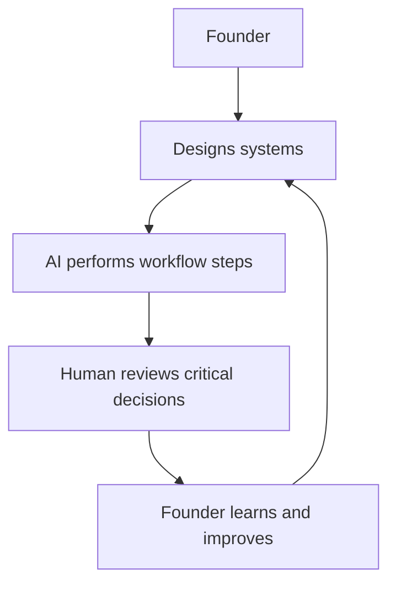
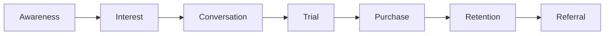
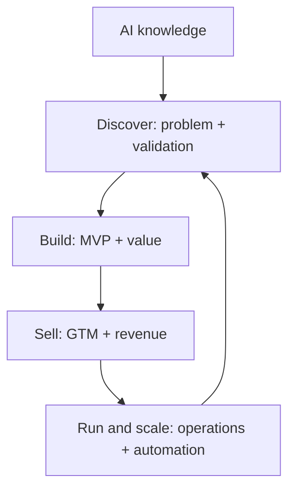
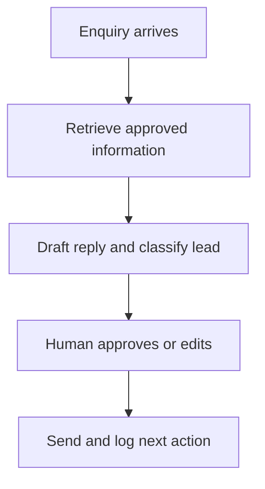

# Lecture Sheet: AI Venture Studio — From MCP to Market

**Source deck:** `AI_Venture_Studio_IUT.pptx`  
**Deck title:** *AI Venture Studio — From MCP to Market: Building and Launching a Business with AI*  
**Institution/context shown:** Islamic University of Technology; Industrial Training on AI; fourth-year students  
**Prepared:** 2026-09-20  
**Deck length:** 65 slides  
**Audience:** IUT undergraduate students and early practitioners building an AI-enabled business in Bangladesh  
**Central idea:** AI increases the speed and leverage of entrepreneurial work, but it does not decide which problem matters, prove that customers care, or remove human accountability.

> **How to read this sheet:** **Deck content** records what the slide or speaker note teaches. **Lecture interpretation** explains the mechanism and gives a practical example. **Verification note** flags claims that are self-reported, time-sensitive, or dependent on local infrastructure.

## 1. Learning objectives

By the end of this lecture, you should be able to:

1. Explain the course premise: moving from connecting AI to tools through MCP to building and launching a real business.
2. Use the AI Venture Loop: reach, problem, evidence, solution, MVP, offer, distribution, revenue, system, scale.
3. Identify commercially meaningful problems among people you can actually reach.
4. Use AI to generate hypotheses and research plans without confusing AI output with evidence.
5. Design customer interviews around past behavior rather than hypothetical enthusiasm.
6. Separate verified facts, estimates, assumptions, and unknowns requiring primary research.
7. Calculate bottom-up TAM, SAM, and SOM and challenge every assumption in the calculation.
8. Choose the smallest MVP capable of proving the core promised outcome.
9. Map an AI-enabled workflow with tools, data, human responsibilities, failure risks, quality checks, and approval points.
10. Explain how MCP turns AI from an isolated chatbot into a connected business-system component.
11. Write a clear value proposition and position it against alternatives without unsupported superiority claims.
12. Design a 90-day go-to-market plan and a 14-day launch experiment.
13. Measure a funnel from awareness to referral and diagnose the current bottleneck.
14. Classify recurring work as human-only, AI-assisted, automatable, or potentially agentic.
15. Define read, write, approval, and prohibited permissions for an AI-connected system.
16. Adapt an AI business to Bangla, English, Banglish, local workflows, local pricing, and local payment infrastructure.
17. Prepare the fifteen capstone deliverables and explain why learning from a failed assumption can be a successful experiment.

## 2. Prerequisites and working rules

- Basic arithmetic with percentages, revenue, cost, and margins.
- Ability to describe a real customer group and a real workflow in plain language.
- Access to at least one AI tool, a spreadsheet or calculator, and a way to contact potential users.
- Use fictional, public, or safely anonymized data during practice.
- Treat every AI-generated market claim as a hypothesis until a source or customer behavior supports it.
- Never connect an AI agent to live financial, customer, or communication systems before testing permissions and approvals in a safe environment.

## 3. One-page summary

### The AI Venture Loop

```text
Reach -> Problem -> Evidence -> Solution -> MVP -> Offer -> Distribution -> Revenue -> System -> Scale
  ^                                                                                              |
  |--------------------------- customer feedback and new evidence -------------------------------|
```

This is a loop, not a one-way startup checklist. If customers reject the offer, return to the problem or evidence stage. If the product works but nobody discovers it, return to distribution. If demand exists but delivery is expensive, return to system design and economics.

### The ten questions

| Stage | Question | What counts as progress? |
|---|---|---|
| Reach | Who can I realistically reach? | A named group and a path to ten conversations |
| Problem | What painful problem repeats? | Specific behavior, cost, delay, risk, or frustration |
| Evidence | Can I prove it exists? | Sources, interviews, observation, behavior, or payment |
| Solution | What is the smallest useful solution? | One core outcome, not a feature catalogue |
| MVP | Can I make it usable quickly? | A testable workflow within roughly 7–14 days |
| Offer | Why should someone pay? | A clear outcome, price hypothesis, and alternative |
| Distribution | How will people discover it? | A realistic channel and first experiment |
| Revenue | Can attention become customers? | Measured conversion and workable unit economics |
| System | Can delivery become repeatable? | SOPs, quality checks, and safe permissions |
| Scale | What should happen next? | A next experiment justified by evidence |

### The evidence ladder

| Level | Evidence | Example | Strength |
|---|---|---|---|
| 1 | AI hypothesis | “Restaurants might struggle with inventory forecasting.” | Exploration only |
| 2 | Public evidence | Reports, competitor sites, reviews, pricing, government data | Useful context |
| 3 | Customer evidence | Interviews, surveys, observations | Direct problem evidence |
| 4 | Behavioral evidence | Waitlist, demo request, data submission, trial | Stronger demand signal |
| 5 | Commercial evidence | Someone pays | Strongest early signal |

### The five rules to remember

1. AI output is not evidence.
2. Talk to customers before building too much.
3. Build the smallest thing that can prove value.
4. Distribution is part of the product; a product nobody discovers is not a business.
5. Automate only after understanding the process; automating a broken process produces mistakes faster.

## 4. Course roadmap

| Module | Focus | Main deliverable |
|---|---|---|
| 1 | Mindset & Opportunity | Reachable Market Map |
| 2 | Finding a Problem Worth Solving | Problem statement and validation experiment |
| 3 | Market Research & Validation | Evidence file, interviews, market model, scorecard |
| 4 | Building the Smallest Useful MVP | Usable MVP or credible manual/concierge test |
| 5 | Value Proposition & Positioning | Value proposition and landing-page message |
| 6 | Go-to-Market | 90-day plan, 14-day launch, first-customer plan |
| 7 | Operations, Automation & Scale | SOP, automation classification, permission map |
| 8 | Building in Bangladesh | Local adaptation and payment/infrastructure plan |
| Capstone | Launch, not merely pitch | Fifteen deliverables plus a seven-minute presentation |

## 5. Core concepts

### AI-native entrepreneurship

An AI-native company is not simply a conventional company that has added a chatbot. It is a company in which the founder deliberately designs workflows where AI performs parts of repeatable work, while humans supervise critical decisions.



The founder becomes an **AI orchestrator**. The job is to:

- Give context.
- Define objectives.
- Connect tools and information.
- Design workflows.
- Evaluate outputs.
- Decide when to intervene.

### MCP in one sentence

The Model Context Protocol (MCP) is an open standard for connecting AI applications to external systems such as files, databases, search engines, calendars, and business software. The official MCP documentation describes it as a standard connection layer rather than a model itself. See the [MCP introduction](https://modelcontextprotocol.io/introduction).

MCP can make an AI system more useful because it can access context and tools. It also makes the system more consequential because it may read sensitive data or take actions. More capability must therefore be paired with narrower permissions, approval gates, logging, and recovery procedures.

### AI output versus evidence

An AI answer may be coherent and still be wrong. The deck's operating rule is:

```text
AI generates a hypothesis.
Research gathers sources.
Customers reveal behavior.
Experiments create evidence.
The founder makes the decision.
```

### Unit economics vocabulary

| Term | Formula or meaning |
|---|---|
| Revenue | Customers × average revenue per customer |
| Gross profit | Revenue − direct delivery cost |
| Contribution margin | Revenue per customer − variable cost per customer |
| CAC | Customer acquisition cost; acquisition spending divided by acquired customers |
| LTV | Approximate lifetime value; expected contribution from a customer over the relationship |
| Break-even customers | Fixed costs ÷ contribution margin per customer |

The formulas are only useful if the period, exclusions, direct costs, and customer definition are explicit.

## 6. Suggested teaching sequence

This deck is structured as a course rather than a single explanatory lecture. A useful delivery sequence is:

1. Establish the premise and the human-accountability rule.
2. Start with reachable customers, not an AI product idea.
3. Turn a problem into assumptions and cheap tests.
4. Build only the smallest useful MVP.
5. Connect the MVP to an honest offer and a measurable channel.
6. Systemize only the process that has already shown value.
7. Adapt the venture to Bangladesh's language, workflows, payment systems, and trust conditions.
8. Launch and report what was learned, including failed assumptions.

## 7. Detailed slide-by-slide lecture notes

### Slides 1–5 — Course premise, outcomes, framework, and roadmap

#### Slide 1 — AI Venture Studio

**Deck content:** The course title is *From MCP to Market: Building and Launching a Business with AI*. The journey is summarized as Find, Research, Validate, Build, Position, Sell, Operate, and Scale.

**Lecture interpretation:** The title makes an important transition. MCP is not the destination. Connecting an AI model to tools matters only when the connection helps a real customer receive a valuable outcome.

**Ask students:** What could an AI system do for a customer if it could read the right business data and take an approved action?

#### Slide 2 — Course premise

**Deck content:** The previous stage asked how AI connects to tools, data, workflows, and external systems. This course asks what can actually be built with ChatGPT, Claude, Gemini, Perplexity, and other tools across the entrepreneurial cycle.

**Lecture interpretation:** Tool knowledge is a means, not a business model. The course should end with the beginnings of a real business rather than a hypothetical startup deck.

**Checkpoint:** Ask students to distinguish “I know how to call an AI tool” from “I can create and deliver a valuable customer outcome.”

#### Slide 3 — Course outcomes

**Deck content:** Outcomes are grouped into discover and validate; build and position; sell and measure; operate and scale.

**Lecture interpretation:** The outcome groups form a complete entrepreneurial capability stack. A technically strong MVP can still fail if the customer is unclear, evidence is weak, distribution is missing, or delivery economics do not work.

**Study prompt:** Choose one outcome from each group and write how you would prove you achieved it.

#### Slide 4 — The AI Venture Loop

**Deck content:** Ten questions run from reachable customer through problem, evidence, solution, MVP, offer, distribution, revenue, system, and scale. Customer feedback sends the entrepreneur back to earlier stages.

**Lecture interpretation:** Each arrow is a learning loop. The entrepreneur is not rewarded for moving forward mechanically; they are rewarded for reducing uncertainty.

**Common mistake:** Treating “scale” as a reward for a polished prototype. Scale should follow repeatable value, positive economics, and a process that can be delivered reliably.

#### Slide 5 — Course roadmap

**Deck content:** Eight modules lead to the AI Venture Challenge. The course starts with mindset and opportunity, moves through problem, validation, MVP, positioning, GTM, operations, and Bangladesh context, then ends with launch.

**Lecture interpretation:** The sequence delays scale until after evidence and repeatability. That is deliberate: premature scale multiplies an unproven problem, weak offer, or broken process.

### Module 1 — Mindset & Opportunity

#### Slide 6 — Module 1 title

**Deck content:** Mindset & Opportunity; why AI changes entrepreneurship.

**Lecture interpretation:** AI changes the entrepreneur's production capacity and the cost of trying an idea. It does not eliminate customer discovery, judgment, trust, or the need to sell.

#### Slide 7 — What one capable person can now do

**Deck content:** A small startup previously needed researchers, designers, developers, copywriters, analysts, support staff, marketers, salespeople, and operations staff. AI can increase how much one capable person accomplishes across these functions.

**Lecture interpretation:** The useful claim is leverage, not total replacement. AI can draft, classify, summarize, generate alternatives, search, prototype, and route work. The founder still supplies goals, domain context, quality standards, and accountability.

| Function | AI can assist with | Human remains responsible for |
|---|---|---|
| Research | Competitor scans, market maps, interview drafts | Source quality and interpretation |
| Product | Prototypes, coding, tests, documentation | Product trade-offs and user value |
| Marketing | Copy variations, content, SEO research | Truthfulness, brand, and positioning |
| Sales | Prospect research, outreach drafts, qualification | Trust, relationship, and commitments |
| Operations | Reports, SOP drafts, routing, data analysis | Permissions, exceptions, and consequences |

#### Slide 8 — The AI-native company

**Deck content:** Traditional companies hire people to perform tasks. AI-native companies have founders design systems, AI perform parts of workflows, and humans supervise critical decisions. MCP helps AI connect to external tools and information through a common standard.

**Lecture interpretation:** This is an organizational change, not only a software change. The founder's leverage increases when work is represented as a workflow with inputs, transformations, quality checks, outputs, and escalation rules.

**Permission principle:** If the AI can write to a system, define exactly what it can change, who approves it, how the change is logged, and how it can be undone.

#### Slide 9 — Four mindset shifts

**Deck content:** Replace “I need developers,” “I need a marketing department,” “build the full product first,” and “AI gave me the answer” with prototype-before-hiring, AI-assisted marketing, validate–prototype–test–learn, and evidence-seeking.

**Lecture interpretation:** The fourth shift is the foundation of the entire course: AI output is a hypothesis. Students should be able to say what evidence would change their mind.

**Exercise:** Rewrite a personal technology-first idea as a customer–pain–cost statement.

#### Slide 10 — Real-world examples

**Deck content:** Examples include TypingMind, Photo AI, Base44, and Designjoy. The slide states that revenue figures are founder-reported or company-reported and not independently audited.

**Lessons:**

- A specific frustration can be a better starting point than a broad “next big AI company” ambition.
- A narrow consumer use case can become a business when the outcome is clear.
- AI changes who can build software and how quickly.
- A one-person service business can innovate through workflow and business model, not only technology.

**Verification note:** Revenue, acquisition price, profit, and growth figures should be treated as case-study claims, not as independently verified market benchmarks. Use the company or founder's primary announcement, then look for independent reporting before repeating the number.

#### Slide 11 — Class exercise: Your reachable world

**Deck content:** Identify three groups you already understand or can contact this week. For each group, ask whether you understand them, can contact ten people, observe problems, and know whether they spend money solving them. Deliverable: *My Reachable Market Map*.

**Lecture interpretation:** Reachability is a constraint that improves learning speed. A student with direct access to ten clinic administrators may learn more quickly than a student targeting a huge but inaccessible global market.

| Reachable group | How I know them | Can I contact 10? | Observed recurring problem | Current alternative | Spending evidence |
|---|---|---|---|---|---|
| | | | | | |

#### Slide 12 — Master prompt: Reachable Market

**Deck content:** Ask AI to explore opportunities among groups you can realistically reach. For each problem, request who experiences it, frequency, consequences, current solution, willingness to pay, and evidence required. Do not assume that a plausible problem is real.

**Reusable prompt:**

```text
I want to explore business opportunities among people I can realistically reach.
My background: [describe experience, access, and constraints].
Groups I can contact this week: [list groups].

For each group, identify 10 recurring problems. For every problem show:
1. Who experiences it.
2. How often it occurs.
3. What happens if it is ignored.
4. How people currently solve it.
5. Whether they already spend money or time on alternatives.
6. The evidence I need before believing this is a business opportunity.

Separate plausible hypotheses from evidence. Do not invent evidence.
```

### Module 2 — Finding a Problem Worth Solving

#### Slide 13 — Module 2 title

**Deck content:** Start with problems, not products.

**Lecture interpretation:** Technology-first ideas tend to describe a capability. Problem-first ideas describe a customer, a repeated pain, and a cost. The second form is more testable.

#### Slide 14 — Start with problems, not products

**Deck content:** “I want to build an AI chatbot” is contrasted with a specific problem: private tutoring centres lose potential students because Facebook and WhatsApp enquiries are answered slowly.

**Lecture interpretation:** The second statement suggests who to interview, what workflow to observe, what failure costs, and what a first manual solution might be. AI is now one possible mechanism.

**Problem statement template:**

```text
[Customer group] repeatedly experiences [specific situation/problem],
which causes [measurable cost, delay, risk, or frustration].
Today they use [current alternative], but it fails because [limitation].
```

#### Slide 15 — The Problem Quality Test

**Deck content:** Evaluate pain, frequency, urgency, existing spending, accessibility, and AI leverage.

| Dimension | Diagnostic question | Weak signal | Strong signal |
|---|---|---|---|
| Pain | How frustrating or costly is it? | “It would be nice” | Lost revenue, wasted hours, error, risk |
| Frequency | How often does it happen? | Once a year | Daily or weekly |
| Urgency | How quickly must it be solved? | No consequence for delay | Time-sensitive or escalating cost |
| Existing spending | Do alternatives already receive money? | Nobody acts | Budget, labor, software, or workaround exists |
| Accessibility | Can we reach customers? | Unknown decision-maker | Direct path to users and buyers |
| AI leverage | Can AI make it faster, cheaper, or better? | AI added as decoration | AI changes the economics or experience |

**Interpretation:** A high AI-leverage score cannot rescue a problem with no pain, urgency, spending, or access.

#### Slide 16 — Three prompts for exploring problems

**Deck content:** Use separate prompts for problem discovery, solution exploration, and riskiest assumptions. Generate problem categories such as revenue, cost, time, convenience, risk, information, and emotional burden. Explore software, done-for-you service, automation, and education/content solutions. Ask for cheap tests that could prove the concept wrong.

**Why separate the prompts:** Combining discovery and solution design too early encourages confirmation bias. First describe the problem. Then compare solution types. Then attack the assumptions.

**Assumption table:**

| Assumption | Why it matters | Cheapest falsifying test | Failure threshold | What changes if it fails? |
|---|---|---|---|---|
| The problem occurs weekly | Determines urgency | Interview plus observation | Fewer than 4 of 10 report it | Choose a different segment |
| Current alternatives are inadequate | Creates room to enter | Ask what they use and why | Most are satisfied | Differentiate or drop |
| Buyer can be reached | Determines GTM cost | Contact attempt to named buyer | No response after defined attempts | Change channel or ICP |
| Customer will pay | Determines business viability | Preorder, deposit, or paid pilot | No paid commitment | Change offer or problem |

#### Slide 17 — The ৳1,000 validation challenge

**Deck content:** You have ৳1,000 and cannot build the product. Test demand through interviews, landing pages, a Facebook post, fake-door test, waitlist, WhatsApp form, prototype demo, pre-order, manual service, or cold outreach. Stronger evidence usually follows the order money > commitment > action > opinion.

**Lecture interpretation:** The constraint forces students to test behavior rather than seek compliments. A friend saying “good idea” is an opinion. A target customer sharing data, booking a demo, accepting a pilot, or paying is stronger evidence.

**Experiment card:**

```text
Customer: [specific group]
Problem: [observed behavior and cost]
Hypothesis: [if we offer X, Y customers will do Z]
Test: [what we will do without building the full product]
Metric: [observable behavior]
Deadline: [date]
Pass threshold: [number or percentage]
Failure response: [what we change or stop]
Budget: ৳[amount]
```

### Module 3 — Market Research & Validation

#### Slide 18 — Module 3 title

**Deck content:** AI is highly useful for research and highly capable of producing convincing-looking unsupported information.

**Lecture interpretation:** AI reduces the cost of forming research questions and organizing material. It does not remove the need to inspect sources, perform calculations, or speak to customers.

#### Slide 19 — The Evidence Ladder

**Deck content:** Five levels progress from AI hypothesis to public evidence, customer evidence, behavioral evidence, and commercial evidence.

**Teaching distinction:** Evidence is not one binary category. It has strength, relevance, recency, and proximity to the decision. A public report may support market context but not prove that your specific customer will pay.

**Research log:**

| Claim | Evidence level | Source or person | Exact support | Confidence | Next check |
|---|---|---|---|---|---|
| | | | | | |

#### Slide 20 — A better AI research prompt

**Deck content:** Ask AI to research market structure, customer segments, direct and indirect competitors, pricing, complaints, demand indicators, trends, and regulatory considerations. Separate verified facts, estimates, assumptions, and unknowns. Cite sources and show calculations.

**Reusable prompt:**

```text
Act as a rigorous market researcher.
Business concept: [idea]
Geography: [location]
Customer: [specific ICP]

Research:
1. Market structure
2. Customer segments
3. Direct competitors
4. Indirect alternatives
5. Competitor pricing
6. Customer complaints and unmet needs
7. Demand indicators
8. Market trends
9. Regulatory or operational considerations

Separate the output into:
- Verified facts, each with a source link
- Estimates, with the calculation shown
- Assumptions
- Unknowns that require primary research

Never invent a market-size number. If data is missing, say so.
```

#### Slide 21 — TAM, SAM, and SOM

**Deck content:** TAM is everyone who could theoretically buy; SAM is the part the product can realistically serve; SOM is the part the early-stage company can realistically acquire. The deck recommends bottom-up sizing, for example: 2,000 businesses × ৳60,000 per year = ৳120,000,000 potential annual market.

**Lecture interpretation:** Bottom-up sizing exposes assumptions. Students must specify how many customers exist, what segment is included, what price is realistic, and what acquisition capacity is plausible.

```text
TAM = all theoretically relevant customers × possible annual spend
SAM = customers inside the chosen geography, segment, and service capability
SOM = customers you can actually win in the first period given channels and capacity
```

**Challenge every term:** Are the 2,000 businesses real? Are they in the reachable geography? Will they spend ৳60,000 annually? Can the team serve them? How many can the chosen channel reach?

#### Slide 22 — Interview about the past, not the future

**Deck content:** Ask about the last time the problem happened, how it was solved, how much time and money it took, what was frustrating, and whether anything was purchased. Avoid “Would you buy my app?” and other leading or flattering questions.

**Interview guide:**

1. Tell me about the last time this happened.
2. What triggered it?
3. Walk me through what you did, step by step.
4. What took the most time or created the most risk?
5. What did you use instead?
6. What did the workaround cost in money, time, or missed opportunity?
7. Who else was involved in the decision?
8. Have you tried to improve this before?
9. What prevented a better solution?
10. What would make you change the current process?

**Rule:** Do not pitch the solution until the interview has revealed the current workflow.

#### Slide 23 — B2B: map the buying committee

**Deck content:** Distinguish economic buyer, champion, technical evaluator, end user, and potential blocker. Map what each cares about, fears, evidence requirements, objections, and appropriate messaging.

| Role | Main question | Typical proof |
|---|---|---|
| Economic buyer | Is the outcome worth the budget? | ROI, risk reduction, payback |
| Champion | Can this succeed internally? | Workflow fit and visible benefit |
| Technical evaluator | Is it secure and feasible? | Architecture, permissions, reliability |
| End user | Will it make daily work easier? | Usability and time saved |
| Blocker | What could go wrong? | Safeguards, compliance, support, exit plan |

**Lecture interpretation:** “The customer” is often a committee. Messaging that persuades a user may not persuade the budget owner.

#### Slide 24 — The validation scorecard

**Deck content:** Ask whether you spoke with real customers, heard the problem repeatedly, observed alternatives, measured cost or frustration, can reach customers, received solution requests, got test commitments, and obtained payment commitments.

**Interpretation:** The goal is not eight “yes” answers. The goal is to know what is evidence and what is still assumption.

| Question | Evidence collected | Strength | Still unknown |
|---|---|---|---|
| Did real customers report it? | | | |
| Did it repeat across interviews? | | | |
| Are alternatives already used? | | | |
| Is there measurable cost or frustration? | | | |
| Can I reach the buyer? | | | |
| Did anyone request a solution? | | | |
| Did anyone agree to test? | | | |
| Did anyone agree to pay? | | | |

#### Slide 25 — Economics checkpoint

**Deck content:** Review revenue, gross profit, CAC, contribution margin, and approximate LTV. A product people want can still be a bad business if acquiring or serving customers costs too much.

**Worked logic:**

```text
Revenue = number of paying customers × average revenue per customer
Gross profit = revenue − direct delivery costs
Contribution margin = revenue per customer − variable cost per customer
CAC = acquisition spending ÷ new customers
```

**Do not hide labor:** If the founder manually reviews every AI output, the labor is a real delivery cost even if no salary is paid yet.

### Module 4 — Building the Smallest Useful MVP

#### Slide 26 — Module 4 title

**Deck content:** Ask “what must work?” rather than “what features would be cool?”

**Interpretation:** An MVP is a learning instrument. It should expose whether the customer receives the core promised outcome, not merely demonstrate technical ambition.

#### Slide 27 — MVP is not a bad product

**Deck content:** An AI recruitment assistant's full product might include an ATS, candidate profiles, scoring, scheduling, video interviews, analytics, and HR integrations. The MVP uploads 50 CVs and produces candidate summaries, a skills matrix, a shortlist, and interview questions.

**Lecture interpretation:** The MVP is narrow in workflow but serious about the promised result. “Minimum” refers to scope, not carelessness.

**MVP test:** Can a real customer experience the result? Can the team observe time saved, quality, error rate, and willingness to continue?

#### Slide 28 — Six MVP formats

| Format | What the customer sees | What the team learns |
|---|---|---|
| Concierge | A human delivers the service manually | Whether the outcome is valuable before automation |
| Wizard of Oz | The interface looks automated; work is partly manual | Whether users value the experience |
| Landing page | A clear offer and call to action | Whether people click, sign up, or request information |
| Prototype | Clickable interface or demo | Whether the workflow is understandable |
| AI workflow | Multiple tools connected through automation | Whether the process can produce value reliably |
| Functional software | Small working product for one job | Whether users can complete the core task |

**Selection rule:** Choose the format that proves the core value with the least build.

#### Slide 29 — Scope the first 7–14 days

| Category | Test |
|---|---|
| Must have | Without it, the promised outcome fails |
| Nice to have | Improves experience but does not prove value |
| Later | Useful after core value is proven |
| Do not build yet | Tempting, premature, or unrelated to the test |

**Interpretation:** An MVP deadline is a learning deadline. It is not a promise that a complete company will be built in fourteen days.

#### Slide 30 — The AI MVP stack

**Deck content:** Tool categories include research, reasoning/documentation, coding/prototyping, landing pages, visual design, forms, databases, automation, communication, analytics, documentation, and Bangladesh-oriented payments such as bKash, Nagad, and payment gateways.

**Lecture interpretation:** Tools change. Functions persist. Learn to ask what role a tool plays, what data it needs, what it can output, how it fails, and how much human review is required.

| Function | Example categories | Selection question |
|---|---|---|
| Research | AI search and web research | Can I inspect source quality? |
| Forms | Tally, Google Forms, Typeform | Can I collect only the data I need? |
| Database | Airtable, Notion, Supabase | Who can read and write? |
| Automation | n8n, Make, Zapier | What happens when a step fails? |
| Communication | Email, Messenger, WhatsApp Business | Who approves outbound messages? |
| Analytics | Spreadsheets, GA, platform analytics | Are definitions and periods consistent? |
| Payments | Local wallet or gateway | Is the provider available for this entity and use case? |

#### Slide 31 — Design the build workflow

**Deck content:** Map the path from customer arrival to input, system processing, AI tasks, human review, customer outcome, and feedback. For every stage identify tool, AI responsibility, human responsibility, data required, automation opportunity, failure risk, and quality-control step.

**Workflow template:**

| Stage | Tool | Input/data | AI role | Human role | Failure risk | Quality check |
|---|---|---|---|---|---|---|
| Customer arrives | | | | | | |
| Customer provides input | | | | | | |
| System processes input | | | | | | |
| AI performs task | | | | | | |
| Review or approval | | | | | | |
| Customer receives outcome | | | | | | |
| Feedback collected | | | | | | |

#### Slide 32 — Using MCP in the business

**Deck content:** An AI sales assistant with integrations could retrieve CRM information, read previous communication, identify deal status, draft a personalized follow-up, recommend next action, and update systems after approval. AI moves from chatbot to business infrastructure.

**Lecture interpretation:** The value is context plus action. Without connected systems, the assistant drafts generic text. With approved access to CRM, email, calendar, files, and analytics, it can support a workflow.

**Safety boundary:** “Can do” is not the same as “should do automatically.” Reading a CRM record, drafting an email, sending it, changing a deal stage, and issuing a discount are different permission levels.

### Module 5 — Value Proposition & Positioning

#### Slide 33 — Module 5 title

**Deck content:** Customers buy outcomes, not features.

**Interpretation:** Features describe the mechanism. Outcomes describe why the customer should care. A strong value proposition links a customer, desired result, painful alternative, and distinctive mechanism.

#### Slide 34 — Value proposition formula

**Deck content:** “We help [customer] achieve [outcome] without [painful alternative] through [unique mechanism].” The example helps small restaurants turn transaction data into daily management reports without manually updating spreadsheets.

**Template:**

```text
We help [specific customer] achieve [measurable or observable outcome]
without [painful current alternative]
through [specific mechanism].
```

**Quality test:** A person with no technical knowledge should understand it. Remove phrases such as “next-generation,” “AI-powered,” or “revolutionary” unless they add concrete meaning.

#### Slide 35 — Positioning: three questions

**Deck content:** Why this? Why you? Why now?

| Question | Meaning | Evidence to seek |
|---|---|---|
| Why this? | Why solve the problem at all? | Cost, risk, delay, missed opportunity |
| Why you? | Why choose this solution over alternatives? | Fit, proof, distribution, trust, capability |
| Why now? | Why act today? | Deadline, rising cost, new opportunity, limited pilot |

**Caution:** “Why now?” should not become artificial urgency. A real deadline or changing condition is stronger than a manufactured countdown.

#### Slide 36 — Compare competitors, then stress-test

**Deck content:** Compare price, speed, ease of use, customization, customer segment, geography, language, support, trust, and AI capabilities. Test the message as a skeptical customer, competitor salesperson, and finance manager.

**Interpretation:** Competitors include manual work, spreadsheets, internal staff, WhatsApp, “do nothing,” and adjacent services. A comparison is useful only if the underlying information is current and sourced.

**Objection table:**

| Objection | Who raises it? | Evidence needed | Message revision |
|---|---|---|---|
| “We already use a spreadsheet.” | User or buyer | Time/error comparison | Show the outcome, not AI novelty |
| “I do not trust the answers.” | User, technical evaluator | Accuracy, review, escalation | Make human approval visible |
| “This is too expensive.” | Economic buyer | Cost avoided and payback | Test pricing and scope |
| “We cannot share the data.” | Technical evaluator | Data handling and permissions | Minimize data and offer safe mode |

#### Slide 37 — From value proposition to landing page

**Deck content:** Landing page sections: hero headline, subheadline, problem, solution, how it works, benefits, proof, FAQ, and call to action. Prompt inputs include product, ICP, problem, outcome, proof, and desired action.

**Landing-page test:** Every section should help the reader answer:

1. Is this for me?
2. What outcome will I get?
3. How does it work?
4. Why should I trust it?
5. What is the next low-friction action?

### Module 6 — Go-to-Market

#### Slide 38 — Module 6 title

**Deck content:** Go-to-market asks how to move systematically from no customers to customers.

**Interpretation:** Product answers what is being built. GTM answers who discovers it, why they engage, how they experience value, why they pay, and why they return or refer.

#### Slide 39 — The first-customer funnel

**Deck content:** Awareness → interest → conversation → trial → purchase → retention → referral.



**Funnel discipline:** Do not describe a funnel only with adjectives such as “strong interest.” Record counts and rates.

| Stage | Count | Conversion from prior stage | Main question |
|---|---:|---:|---|
| Awareness | | — | Did the right people see it? |
| Interest | | | Did they investigate? |
| Conversation | | | Did they engage with a real problem? |
| Trial | | | Did they experience value? |
| Purchase | | | Did they pay? |
| Retention | | | Did value continue? |
| Referral | | | Would they risk their reputation to recommend it? |

#### Slide 40 — The 12-week plan

**Deck content:** Weeks 1–4 find early users before the product is finished. Weeks 5–8 launch the offer, learn from users, and generate early revenue. Weeks 9–12 measure what actually worked, diagnose the bottleneck, and run focused experiments.

| Period | Main work | Evidence produced |
|---|---|---|
| Weeks 1–4 | Interviews, waitlist, problem content, founder outreach, prototype demos, partnerships | Access and problem signals |
| Weeks 5–8 | Launch, users, feedback, early revenue, 14-day campaign | Trial, conversion, and objections |
| Weeks 9–12 | Measure end-to-end funnel and run three experiments | Bottleneck diagnosis and next decision |

#### Slide 41 — Pick channels, plan content

**Deck content:** Recommend at most three realistic channels based on customer presence, cost, time, feedback speed, measurability, and scalability. Content mix: 50% problem education, 20% practical advice, 15% customer stories/proof, 10% founder perspective, 5% direct promotion.

**Interpretation:** The percentage mix is a planning heuristic, not a law. Every piece of content should have a business objective: learn, attract, build trust, activate, convert, or retain.

**Channel experiment table:**

| Channel | Why customers are there | Low-cost test | Metric | Stop/continue rule |
|---|---|---|---|---|
| | | | | |

#### Slide 42 — The 14-day launch

**Deck content:** Days −7 to −1 build anticipation; Day 0 goes live; Days 1–7 show proof and teach the problem; Days 8–14 push conversion. For each day specify activity, channel, message, CTA, and metric.

**Launch calendar:**

| Day | Activity | Channel | Message | CTA | Metric |
|---|---|---|---|---|---|
| −7 to −1 | Problem observation or teaser | | | | |
| 0 | Offer goes live | | | | |
| 1–7 | Demo, proof, education | | | | |
| 8–14 | Objection handling and conversion | | | | |

#### Slide 43 — Founder-led outbound

**Deck content:** Use cold email, LinkedIn/Facebook direct messages, WhatsApp, and warm introductions. The first message should be short, lead with the customer's problem, and never fake familiarity.

**Ethical first-message template:**

```text
Hi [name]. I am speaking with [customer group] about [specific problem].
I am not trying to sell you a finished product. Could I ask how you handled
the last time this happened? A 15-minute conversation would help me test
whether the problem is real. If this is not relevant, no need to reply.
```

Do not scrape or misuse personal data. Give the recipient a clear reason, a small request, and an easy way to decline.

#### Slide 44 — Measure, then make assumptions killable

**Deck content:** Measure leads, response rate, meetings, trials, activation, conversion, acquisition cost, revenue, retention, repeat purchases, and referrals. For five important assumptions, define assumption, metric, test, deadline, failure threshold, and response if wrong.

**Killable-assumption format:**

```text
Assumption: [what must be true]
Metric: [observable measurement]
Test: [small experiment]
Deadline: [date]
Failure threshold: [number]
Response if wrong: [specific change, pause, or stop]
```

#### Slide 45 — Diagnose the bottleneck

**Deck content:** Feed results such as traffic, leads, trials, sales, acquisition spending, and customer feedback into an analysis. Separate product, offer, messaging, pricing, channel, and trust causes. Recommend three experiments rather than immediately changing the entire strategy.

**Interpretation:** The same low-sales outcome can have different causes. Low traffic is not fixed by changing the product. High trial but low purchase may indicate pricing, trust, onboarding, or missing value.

| Symptom | Possible cause | First experiment |
|---|---|---|
| Low traffic | Channel or message mismatch | Test a different customer community or problem angle |
| Traffic but few conversations | Weak relevance or CTA | Rewrite around a specific pain and ask for a small action |
| Many trials but low activation | Onboarding or workflow failure | Observe three trials end to end |
| Activation but low purchase | Offer, price, trust, or buyer mismatch | Test a paid pilot with explicit outcome |
| Purchase but poor retention | Value does not recur or delivery is costly | Interview churned users and inspect delivery |

### Module 7 — Operations, Automation & Scale

#### Slide 46 — Module 7 title

**Deck content:** Once something works, systemize it. Automating a broken process produces mistakes faster.

**Interpretation:** First understand the process manually. Then document it. Then assist it. Then automate predictable steps. Only then consider agentic choices and human-by-exception operation.

#### Slide 47 — The Automation Ladder

**Deck content:**

1. Manual — human performs everything.
2. AI-assisted — human uses AI for individual tasks.
3. Workflow automation — systems pass information between tools automatically.
4. AI workflow — AI interprets information inside the automated process.
5. Agentic workflow — AI chooses among predefined actions.
6. Human-by-exception — routine work runs automatically and humans intervene when needed.

**Interpretation:** Higher levels are not automatically better. Move upward only when the process is stable, errors are observable, permissions are safe, and the value of automation exceeds its supervision cost.

#### Slide 48 — Level 6: humans by exception

**Deck content:** Humans intervene when confidence is low, financial approval is needed, legal issues arise, sensitive data is involved, customers escalate, or strategic judgment is required.

**Exception matrix:**

| Trigger | Automatic behavior | Human action |
|---|---|---|
| Low confidence | Pause or draft only | Review source and decide |
| Financial approval | Prepare recommendation | Approve amount and recipient |
| Legal issue | Route to specialist | Interpret and decide |
| Sensitive data | Restrict or mask | Confirm permitted use |
| Customer escalation | Stop routine reply | Take over relationship |
| Strategic judgment | Summarize options | Make final decision |

#### Slide 49 — The AI business operating system

**Deck content:** A founder sets direction, approves critical actions, reviews quality, and makes decisions. Supporting agents may research markets, prepare sales outreach, create content, classify customer enquiries, draft responses, and summarize performance.

**Lecture interpretation:** Think of agents as role-specific workflow components, not magical employees. Every agent needs a clear input, output, tool scope, quality standard, escalation rule, and owner.

#### Slide 50 — Sort the work, then write the SOP

**Deck content:** Classify recurring work as A human-only, B AI-assisted, C automatable, or D potentially agentic. For automated and agentic work, define remaining approval or monitoring. The SOP prompt should include purpose, trigger, input, steps, AI role, human role, quality check, failure conditions, escalation, output, and KPI.

**SOP template:**

```text
Process name:
Purpose:
Trigger:
Input:
Preconditions:
Steps:
AI role:
Human role:
Quality check:
Failure conditions:
Escalation rule:
Output:
KPI:
Owner:
Version/date:
```

#### Slide 51 — MCP system design exercise

**Deck content:** Draw an AI host connected to email, calendar, CRM, Drive, database, analytics, customer support, and financial data. Define READ, WRITE, APPROVAL, and PROHIBITED actions.

| Permission class | Question | Example |
|---|---|---|
| Read | What can AI see? | Read a deal record and prior support messages |
| Write | What can AI change? | Add a draft note or update a non-critical status |
| Approval | What requires a human? | Send external message or offer a discount |
| Prohibited | What must AI never do automatically? | Transfer money, delete records, or make a legal commitment |

**Important:** An MCP connection is not automatically safe. Authentication, authorization, data minimization, prompt-injection resistance, logging, and rollback are separate design concerns.

### Module 8 — Building in Bangladesh

#### Slide 52 — Module 8 title

**Deck content:** Do not blindly copy US startup playbooks. Think locally.

**Interpretation:** A business model depends on infrastructure, language, trust, payment behavior, purchasing power, and access to decision-makers. Localization is not only translation.

#### Slide 53 — Four opportunity areas

**Deck content:**

- SME digital transformation: Facebook, Messenger, WhatsApp, calls, Excel, paper, customer response, lead management, reporting, inventory, and sales support.
- Education: tutoring, exam preparation, teacher assistants, careers, admissions, corporate training, and Bangla/English content.
- Commerce: seller analytics, product descriptions, customer service, recommendations, returns, and demand forecasting.
- Local professional services: accountants, lawyers, architects, clinics, agencies, and other repetitive information-processing work.

**Caution:** Regulated or high-stakes professional areas require stronger human oversight, privacy controls, professional review, and domain-specific compliance.

#### Slide 54 — Bangla + English as an advantage

**Deck content:** Bangladesh businesses often work across Bangla, English, and Banglish. Local advantage can come from language, local workflows, payment systems, support, pricing, and cultural understanding.

**Lecture interpretation:** Language is part of the workflow. Test whether customers want Bangla output, English output, code-switching, voice messages, or different language choices for different steps.

**Localization checklist:**

| Layer | Question |
|---|---|
| Language | Can users speak, type, and receive results in their preferred form? |
| Workflow | Does the product fit Messenger, WhatsApp, calls, spreadsheets, or paper processes? |
| Payment | Can customers pay through a method they already trust? |
| Support | Can they get help in the language and channel they use? |
| Pricing | Does the price fit local purchasing power and billing habits? |
| Culture | Does the product reflect local expectations and trust signals? |

#### Slide 55 — Payments: use what customers use

**Deck content:** The slide contrasts Stripe with Bangladesh-oriented options such as bKash, Nagad, SSLCOMMERZ, and aamarPay. It notes that Stripe availability should not be assumed for a locally based Bangladesh business.

**Verification note:** Payment eligibility, merchant onboarding, APIs, supported instruments, fees, settlement, and legal requirements change. Check the provider's current official documentation before promising a payment method. The [Stripe global availability page](https://stripe.com/global) and the official [bKash business page](https://www.bkash.com/en/business) are useful starting points. The official [Nagad site](https://nagad.com.bd/) and [SSLCOMMERZ](https://sslcommerz.com/) should also be checked for current merchant and integration terms.

**Design principle:** Payment is part of the customer experience and business model. If the customer cannot pay easily, the product is not fully usable.

#### Slide 56 — Three Bangladesh business examples

**Deck content:**

1. SME AI sales assistant: process Messenger/WhatsApp enquiries, retrieve product information, draft a response, capture the lead, and alert a human when needed. Revenue hypothesis: subscription or managed-service fee.
2. AI career preparation: upload CV and job description, receive gap analysis, CV suggestions, mock interview, and improvement plan. Later features may include matching and personalized learning.
3. Business intelligence for small retailers: start with daily sales, inventory, and expense spreadsheets; produce summaries, alerts, inventory warnings, and weekly owner reports.

**Lecture interpretation:** All three ideas start with existing workflows and data. A first version could be manual or spreadsheet-backed. The local advantage is not “AI” alone; it is fit with the customer's actual channel, language, and operating reality.

### Capstone — The AI Venture Challenge

#### Slide 57 — The final capstone

**Deck content:** Students must launch, not merely pitch.

**Interpretation:** The capstone shifts assessment from presentation polish to customer contact, testable evidence, a usable MVP, and a real next decision.

#### Slide 58 — Fifteen deliverables

| # | Deliverable | What a strong version shows |
|---:|---|---|
| 1 | Customer definition | A clear ICP, not “everyone” |
| 2 | Problem evidence | Genuine primary research |
| 3 | Market evidence | Competitors, alternatives, pricing |
| 4 | Validation record | Assumptions tested and outcomes |
| 5 | MVP | Instructor can experience the core result |
| 6 | Business model | How money is made |
| 7 | Pricing | A price or pricing hypothesis |
| 8 | Value proposition | Clear customer-facing message |
| 9 | Landing page | Working or realistic prototype |
| 10 | GTM strategy | First 90 days |
| 11 | First-10-customers plan | Exactly where they will come from |
| 12 | AI work stack | Which tools perform which jobs |
| 13 | MCP/integration architecture | How AI connects to systems |
| 14 | Automation roadmap | What becomes automated after validation |
| 15 | Metrics dashboard | What shows that it is working |

#### Slide 59 — Capstone presentation

**Deck content:** Seven minutes presenting and five minutes of questions. Suggested sequence: customer and problem; evidence; solution and MVP demo; business model and economics; GTM; AI + MCP architecture; what was tested and what happens next.

**Presentation rule:** The demo should be a real interaction or a credible, clearly labelled prototype. Do not present a mock screen as if it were a deployed system.

#### Slide 60 — Assessment rubric

| Criterion | Weight |
|---|---:|
| Customer/problem understanding | 15% |
| Real-world evidence and validation | 20% |
| MVP quality | 15% |
| Business model and economics | 10% |
| Positioning and messaging | 10% |
| GTM strategy | 15% |
| Intelligent use of AI/MCP/automation | 10% |
| Learning from failed assumptions | 5% |
| **Total** | **100%** |

**Core principle:** Students do not lose marks because an idea fails. They lose marks if they fail to learn why. A failed assumption with a well-designed test can be better work than an unsupported success story.

#### Slide 61 — Master prompt library: find, research, build

**Deck content:** Prompts cover opportunity finding, business idea generation, assumption destruction, deep research, customer interview design, MVP architecture, and AI stack architecture.

**Prompt discipline:** Prompts are scaffolds. The student's job is to supply context, challenge outputs, collect evidence, and report what changed.

#### Slide 62 — Master prompt library: position, sell, operate

**Deck content:** Prompts cover value proposition, landing page, pricing, GTM, first ten customers, business automation, and weekly founder review.

**Weekly founder review questions:**

1. What did we believe last week?
2. What did we observe?
3. Which metric changed?
4. Which assumption became weaker or stronger?
5. What is the next cheapest test?
6. What should we stop doing?

#### Slide 63 — The five rules

**Deck content:** AI output is not evidence; talk to customers before building too much; build the smallest value-proving thing; distribution is part of the product; automate only after understanding the process.

**Exam answer:** If asked for the central philosophy of the course, state that AI accelerates the entrepreneurial learning loop, but evidence, customer behavior, distribution, and human accountability remain essential.

#### Slide 64 — The course in one diagram

**Deck content:** AI knowledge—prompting, models, research, agents, and MCP—feeds discovery, building, selling, running, automation, revenue, and scale.



**Interpretation:** The technology layer supports every stage; it does not replace the stages.

#### Slide 65 — The one thing to take away

**Deck content:** The lesson is not “AI can build businesses.” AI lets entrepreneurs test ideas, learn, build, and execute much faster. The entrepreneur remains responsible for deciding what problem matters, understanding the customer, validating evidence, and making final decisions.

**Closing sentence:** Becoming an AI-native entrepreneur means becoming better at learning and executing under uncertainty, not handing the business over to a model.

## 8. Master prompt library, rewritten for practice

The deck lists fourteen prompt types. The following versions make the inputs, outputs, and verification points explicit.

### 1. Opportunity Finder

```text
I can reach [groups] through [access path] and understand [background].
Find repeated, expensive, frustrating problems among them.
Rank problems by pain, frequency, urgency, current spending, accessibility,
and potential AI leverage. For each, list evidence that would confirm or
disconfirm the opportunity. Do not invent customer evidence.
```

### 2. Business Idea Generator

```text
Problem: [one specific problem]
Generate five solution forms:
1. Software
2. Done-for-you service
3. Marketplace or coordination layer
4. Education/content/product
5. AI automation
For each: customer, core outcome, MVP, cost, time, pricing hypothesis,
risks, and riskiest assumption.
```

### 3. Assumption Destroyer

```text
Business concept: [concept]
Act as a skeptical investor and customer. Try to prove the business should
not exist. Attack problem severity, customer access, willingness to pay,
competition, delivery quality, AI reliability, legal/privacy risk, and
unit economics. For each objection, design the cheapest real-world test.
```

### 4. Deep Research

Use the research prompt in Slide 20. Require links, dates, calculations, and a separate list of unknowns.

### 5. Customer Interview Designer

```text
Customer group: [specific group]
Problem hypothesis: [hypothesis]
Design a 20-minute discovery interview based on actual past behavior.
Include opening, workflow questions, frequency, cost, current alternatives,
switching barriers, buying process, and a neutral close. Avoid leading or
hypothetical questions. Explain which answers would strengthen or weaken
the hypothesis.
```

### 6. MVP Architect

```text
Customer: [ICP]
Core promised outcome: [outcome]
Deadline: 7–14 days
Design the smallest usable MVP. Separate MUST HAVE, NICE TO HAVE, LATER,
and DO NOT BUILD YET. Choose among concierge, Wizard of Oz, landing page,
prototype, AI workflow, and functional software. State the metric that
would prove value and the quality check before delivery.
```

### 7. AI Stack Architect

```text
MVP/workflow: [description]
Map every stage from customer input to feedback. For each stage specify:
tool, data required, AI role, human role, automation opportunity, failure
risk, quality-control step, and required permission. Separate read, draft,
write, approval, and prohibited actions.
```

### 8. Value Proposition

```text
Customer: [ICP]
Outcome: [specific result]
Painful alternative: [current way]
Mechanism: [how the product works]
Write five versions of:
We help [customer] achieve [outcome] without [painful alternative]
through [unique mechanism].
Use plain language and do not make unsupported superiority claims.
```

### 9. Landing Page

Ask for a hero headline, subheadline, problem, solution, how it works, benefits, proof, FAQ, objections, and CTA. Supply the product, ICP, problem, outcome, proof, and desired action. Label missing proof instead of inventing it.

### 10. Pricing

```text
Customer and outcome: [details]
Direct delivery cost: [details]
Acquisition channel: [details]
Generate three pricing hypotheses. For each show customer value, delivery
cost, contribution margin, price risk, discount risk, and a test such as a
paid pilot, pre-order, or time-limited offer. Do not claim willingness to
pay without a behavioral test.
```

### 11. GTM

```text
ICP: [customer]
Offer: [offer]
Budget and time: [constraints]
Recommend no more than three realistic channels for the first 90 days.
Evaluate each by customer presence, cost, time, feedback speed,
measurability, and scalability. Give one low-cost experiment, KPI,
success threshold, and failure threshold per channel.
```

### 12. First Ten Customers

List named communities, direct outreach paths, warm introductions, partnerships, pilot customers, and the founder's weekly activity. “Social media” is not a customer source until the specific community, message, and action are named.

### 13. Business Automation

```text
List recurring tasks across sales, marketing, support, product,
administration, finance, and research. Classify each as:
A human-only, B AI-assisted, C automatable, D potentially agentic.
Explain the classification and specify approval, monitoring, escalation,
permissions, logging, and rollback.
```

### 14. Weekly Founder Review

Paste the week's funnel metrics, revenue, costs, customer feedback, failed tests, and new evidence. Ask for bottleneck diagnosis, three experiments, and a list of assumptions that should be killed or promoted—not a motivational summary.

## 9. Worked example: Bangladesh SME AI sales assistant

### Initial hypothesis

**Customer:** Facebook- and WhatsApp-dependent small retailers or service businesses.  
**Problem:** Enquiries arrive repeatedly, but responses are slow or inconsistent.  
**Desired outcome:** More qualified conversations and fewer lost leads without hiring a full-time response team.  
**Possible mechanism:** Retrieve approved product information, draft a reply, capture the lead, and route uncertain cases to a human.

### Evidence plan

| Question | Test | Evidence threshold |
|---|---|---|
| Does the problem repeat? | Interview and observe 10 businesses | At least 6 report recent repeated delays |
| Is the problem costly? | Count missed replies, response time, and lost enquiries | A measurable operational or revenue cost |
| Can the workflow use existing data? | Inspect product list, prices, stock, FAQs | Data is available and maintainable |
| Will a human trust drafts? | Manually review 50 generated responses | Error rate and correction time are acceptable |
| Will a business pay? | Offer a paid pilot or deposit | At least one paid commitment |

### Smallest MVP

1. Receive a small set of sample enquiries.
2. Retrieve only from an approved product/FAQ sheet.
3. Draft a response in the requested language.
4. Flag missing information or low confidence.
5. Require human approval before sending.
6. Record lead name, need, status, and next action.

### First workflow architecture



### What must not be automatic in the first version

- Inventing prices, stock, delivery times, or guarantees.
- Sending a message when confidence is low.
- Offering discounts without approval.
- Updating customer records with unverified information.
- Deleting or overwriting source data.
- Handling complaints or legal threats without escalation.

### Unit economics example

Suppose a pilot charges ৳6,000 per month. Direct service cost includes human review of ৳1,500 and tools of ৳500, so contribution before acquisition is ৳4,000. If acquisition spending is ৳12,000 and produces two paying pilots, CAC is ৳6,000 per customer. The first month contribution does not yet recover CAC; the business must test retention, setup cost, and whether support time falls as the workflow improves.

The numbers above are an illustrative calculation, not market evidence.

## 10. Capstone submission checklist

### Evidence quality

- [ ] Customer group is specific and reachable.
- [ ] Problem is described through observed behavior.
- [ ] At least several customer conversations are documented.
- [ ] Public sources are linked and dated.
- [ ] Facts, estimates, assumptions, and unknowns are separated.
- [ ] Market size shows a bottom-up calculation.
- [ ] Validation includes behavior, not only opinions.

### MVP quality

- [ ] Core promised outcome is explicit.
- [ ] MVP scope fits the time and team.
- [ ] Instructor or customer can experience it.
- [ ] Data sources and quality checks are named.
- [ ] Failure conditions and human review are defined.

### Business quality

- [ ] Value proposition uses customer language.
- [ ] Alternatives include manual work and doing nothing.
- [ ] Pricing is a hypothesis with a test.
- [ ] GTM names no more than three realistic initial channels.
- [ ] First ten customers have specific acquisition paths.
- [ ] Metrics connect traffic to revenue and retention.

### AI/MCP/automation quality

- [ ] AI has a defined role rather than a decorative label.
- [ ] Human responsibilities are explicit.
- [ ] Read, write, approval, and prohibited actions are separated.
- [ ] Sensitive data is minimized and access is restricted.
- [ ] Automation is proposed only after understanding the process.
- [ ] The team can explain what it learned when an assumption failed.

## 11. Exam and discussion questions

### Short-answer questions

1. Why does the course begin with a reachable market rather than a technology?
2. Distinguish a hypothesis from evidence using a restaurant inventory example.
3. Why is payment stronger evidence than a positive interview opinion?
4. Explain the difference between TAM, SAM, and SOM.
5. Why should customer interviews focus on the past?
6. What makes an MVP “minimum” without making it a bad product?
7. Explain the difference between an AI-assisted workflow and an agentic workflow.
8. Why does connecting an AI system to CRM and email increase both capability and risk?
9. Name four conditions that should trigger human intervention in a human-by-exception system.
10. Give two reasons a Bangladesh-focused business may need a different GTM or payment plan from a US startup.

### Applied questions

1. Pick one reachable customer group and create a five-row problem-quality scorecard.
2. Calculate TAM, SAM, and SOM for a campus service using explicit assumptions.
3. Design a ৳1,000 validation experiment that cannot rely on building software.
4. Turn a full product idea into a seven-day concierge MVP.
5. Design a read/write/approval/prohibited permission table for an AI sales assistant.
6. Diagnose a funnel with high awareness, low trial, and zero purchase. Give three experiments.
7. Write a value proposition for a Bangla-English workflow without using “AI-powered” as the main benefit.

## 12. Necessary links and sites

### Protocols, models, and agent tools

- [Model Context Protocol introduction](https://modelcontextprotocol.io/introduction) — definition, architecture, ecosystem, and starting point.
- [Model Context Protocol GitHub](https://github.com/modelcontextprotocol) — specifications, SDKs, examples, and reference implementations.
- [OpenAI API tools documentation](https://developers.openai.com/api/docs/guides/tools) — web search, file search, function calling, MCP connections, computer use, and safety/permissions links.
- [Anthropic tool use documentation](https://platform.claude.com/docs/en/agents-and-tools/tool-use/overview) — tool schemas, tool calls, and connected workflows.
- [Google Gemini API documentation](https://ai.google.dev/gemini-api/docs) — API capabilities, multimodal input, grounding, tools, and current model documentation.
- [Perplexity API documentation](https://docs.perplexity.ai/) — search-oriented API workflows and current developer reference.

### Customer discovery, validation, and venture method

- [Steve Blank — Customer Development](https://steveblank.com/category/customer-development/) — primary source material on customer discovery and testing business-model assumptions.
- [Y Combinator Startup Library](https://www.ycombinator.com/library) — practical startup talks and guides; search for customer interviews, MVPs, and first customers.
- [Strategyzer](https://www.strategyzer.com/) — value proposition and business-model tools; use concepts as thinking aids, not substitutes for customer evidence.
- [Google Trends](https://trends.google.com/) — directional search-interest signal; do not treat it as willingness to pay.
- [World Bank Bangladesh](https://www.worldbank.org/en/country/bangladesh) — macroeconomic and country context; use dated reports for market assumptions.

### MVP and workflow tools shown or implied by the deck

- [Framer](https://www.framer.com/) and [Carrd](https://carrd.co/) — lightweight landing pages.
- [Tally](https://tally.so/), [Google Forms](https://www.google.com/forms/about/), and [Typeform](https://www.typeform.com/) — forms, waitlists, interviews, and pilot intake.
- [Airtable](https://www.airtable.com/), [Notion](https://www.notion.so/), and [Supabase](https://supabase.com/) — structured data and lightweight backends.
- [n8n](https://n8n.io/), [Make](https://www.make.com/), and [Zapier](https://zapier.com/) — workflow automation; compare permissions, logs, failure handling, and cost.
- [Canva](https://www.canva.com/) — basic visual communication and landing-page assets.

### Bangladesh payments and infrastructure

- [bKash Business](https://www.bkash.com/en/business) — online business, merchant, payment gateway, subscription, payout, and API information.
- [Nagad](https://nagad.com.bd/) — current consumer, merchant, and service information; use the official merchant onboarding path.
- [SSLCOMMERZ](https://sslcommerz.com/) — Bangladesh payment-gateway and integration information.
- [Stripe global availability](https://stripe.com/global) — check whether the business entity and use case are supported before designing around Stripe.

**Verification rule for all payment providers:** Confirm current country eligibility, merchant requirements, settlement timing, supported currencies and instruments, fees, refund process, API access, and account ownership before promising the payment flow to customers.

### Suggested data, measurement, and documentation tools

- [Google Sheets](https://www.google.com/sheets/about/) — validation logs, funnel metrics, bottom-up market calculations, and economics.
- [Google Analytics](https://marketingplatform.google.com/about/analytics/) — website measurement; define events before collecting data.
- [GitHub](https://github.com/) — version control for prototypes, prompts, workflow definitions, and documentation.
- [OWASP Top 10 for LLM Applications](https://owasp.org/www-project-top-10-for-large-language-model-applications/) — security risks relevant to connected AI applications.

## 13. Source fidelity and verification notes

- The deck's course framework, prompts, exercises, examples, deliverables, and rubric are reproduced and expanded from the uploaded presentation and its speaker notes.
- Revenue and acquisition examples in Slide 10 are explicitly described by the deck as founder-reported or company-reported and not independently audited.
- Tool names, model capabilities, pricing, plan limits, API behavior, and payment availability change. Recheck official documentation before building a course demo or commercial workflow.
- MCP increases access to external systems but does not by itself provide complete authorization, security, compliance, or business-process governance.
- TAM/SAM/SOM are estimates built from assumptions. A precise-looking number is not automatically a reliable number.
- The worked business numbers in this sheet are illustrative calculations for teaching and are not claims about market prices or customer demand.

## 14. Final takeaway

AI does not make a business real. It makes it cheaper and faster to form hypotheses, research, prototype, communicate, test, and improve. The entrepreneur still has to:

1. Choose a problem worth solving.
2. Understand the customer and buyer.
3. Gather evidence from sources and behavior.
4. Build the smallest useful solution.
5. Earn distribution and payment.
6. Design safe, repeatable operations.
7. Make the final decision and accept responsibility for it.

That is the difference between using AI as a productivity tool and becoming an AI-native entrepreneur.
