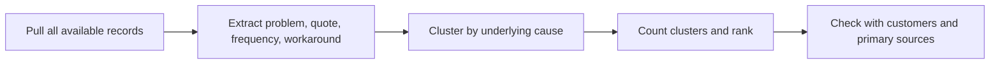

# Lecture Sheet: Signal to Problem

**Topic:** Finding a problem worth solving and using AI to check it
**Source deck:** `1st Class .pdf`
**Deck title:** *Class 1: Signal to Problem*
**Deck length:** 39 pages
**Prepared:** 2026-09-22
**Audience:** IUT undergraduate students, early builders, and Bangladesh-based founders
**Central idea:** AI can accelerate problem discovery and research, but it cannot decide what matters in your reality, access private evidence on its own, or turn an unsupported answer into proof. Start with a reachable signal, add context, collect primary and public evidence, and cross-check before building.

> **How to read this sheet:** **Deck content** records the teaching point on the page. **Lecture interpretation** explains the mechanism and how to use it. **Verification note** separates a practical heuristic from a fact that should be checked against sources, customers, policies, or local conditions.

## 1. Learning objectives

By the end of this class, you should be able to:

1. Distinguish a **signal**, a **problem**, a **solution idea**, and **evidence**.
2. Explain the five-class roadmap: Decide, Build, Sell, Operate, and the current move from signal to problem.
3. Describe why the same model can produce different answers when the context changes.
4. Choose between a no-search answer and a search-assisted answer deliberately.
5. Write a compact context document containing your skills, access, people, time, money, tools, reach, constraints, and desired outcome.
6. Explain why private and local context is valuable, while also recognising that private context can be biased, incomplete, or sensitive.
7. Identify four common AI failure modes: agreement, invented facts, silent gap-filling, and generic writing.
8. Use adversarial roles and explicit sources to make an AI response more useful for decision-making.
9. Define the outcome and decision criteria before asking AI to compare ideas.
10. Treat reviews and public traces as a dataset: pull, extract, cluster, count, and rank.
11. Select legitimate data-access methods such as official APIs, exports, licensed providers, or small manual samples.
12. Build a problem sheet where every row has a quote, source, date, underlying problem, workaround, and payment signal.
13. Choose the cheapest workable task mode: buy, chat, automate, or agent.
14. Recognise survivorship and selection bias in reviews, job posts, public discussion, and AI search results.
15. Cross-check AI claims with identical questions, citations, disagreements, direct source reading, and field observation.
16. Complete the three pre-Class-2 artifacts: a context document, a 20-row problem sheet, and a list of five competitors with pricing pages.

## 2. Prerequisites and working rules

- Basic familiarity with a conversational AI tool and web search.
- A spreadsheet or table editor for evidence collection.
- A problem area you can observe directly: a family business, student workflow, campus service, local shop, or reachable professional group.
- Use fictional, public, or safely anonymized data in class. Do not paste private customer names, phone numbers, credentials, financial records, or confidential business documents into a model without permission and a suitable data policy.
- Treat every AI-generated market claim as a **hypothesis** until a source, observation, customer behavior, or payment supports it.
- Record the date, geography, language, source type, and search method for evidence. “I saw it online” is not enough provenance.
- Prefer official APIs, exports, licensed providers, or small manual samples. Do not assume that a page being visible in a browser grants permission to scrape, store, republish, or automate it.
- A citation is a pointer, not proof. Open the source and verify the exact sentence, date, scope, and limitations.
- The deck is a founder-workflow class. It does not replace legal, privacy, financial, or platform-policy advice.

## 3. One-page lecture summary

### The core workflow

```text
Signal -> Context -> Precise question -> Memory or search mode
       -> Private evidence + public evidence -> Criteria -> Decision
       -> Small test -> Cross-check -> Build only what the evidence earns
```

The bad shortcut is:

```text
Idea -> Ask AI for approval -> Believe the answer -> Build too much
```

The class replaces that shortcut with a repeatable loop:

| Stage | Question | Minimum useful output |
|---|---|---|
| Signal | What recurring friction, cost, delay, or workaround did I notice? | A one-sentence observation with place and date |
| Context | What is true about my skills, access, constraints, and reach? | A one-page context document |
| Question | What decision do I need to make? | A bounded question with a decision rule |
| Search mode | Does this require current external evidence? | Memory mode or search mode chosen explicitly |
| Evidence | What public and private information can be checked? | Source log, interview notes, exports, or observations |
| Criteria | What makes an option fit this reality? | A written filter or weighted scorecard |
| Decision | What survives the filter? | A ranked shortlist and unresolved unknowns |
| Small test | What is the cheapest test of demand or pain? | Interview, manual service, landing page, or paid pilot |
| Cross-check | What does not agree across sources or models? | Disagreement log and verification plan |
| Build | What is now justified? | The smallest useful workflow, not a feature catalogue |

### The five-class roadmap

The deck shows five connected classes:

| Class | Focus | Main question |
|---|---|---|
| 1 | Signal to Problem | What problem is real, reachable, and worth checking? |
| 2 | Deciding what to build | Which response best fits the evidence and constraints? |
| 3 | Building it | How can the smallest useful version be made? |
| 4 | Selling and scaling with one or two people | How do we find customers and deliver repeatedly? |
| 5 | AI in operations | Which operating work should remain human, be assisted, automated, or delegated to an agent? |

Technical depth in models, code, and evaluations is presented in the deck as the co-founder's six-class track. This class therefore emphasises judgment, evidence, context, and decision quality.

### The evidence ladder

| Level | Evidence | What it can support | What it cannot prove alone |
|---|---|---|---|
| 1 | AI hypothesis | Possible problem statements and research leads | That the problem exists or matters |
| 2 | Public traces | Competitor presence, complaints, job descriptions, search direction, visible offers | Local demand, willingness to pay, or market size by itself |
| 3 | Direct customer evidence | How a person describes a past problem and workaround | That every similar customer behaves the same way |
| 4 | Behavioural evidence | Clicks, demos, data submissions, pilots, repeated use | Sustainable economics or retention unless measured over time |
| 5 | Commercial evidence | Payment, contract, renewal, or paid pilot | A large scalable market; it only proves value for that buyer or segment |

### The class rule in one sentence

> Give AI a well-formed context and a bounded question, force it to show sources when current evidence matters, carry in private context by hand, and verify any claim that could change your decision.

## 4. Core concepts and technical foundations

### 4.1 Signal, problem, solution, and evidence

These words are often collapsed in startup conversations. Keep them separate:

| Term | Formal working definition | Example |
|---|---|---|
| Signal | An observation suggesting that something may be worth investigating | A garment accounts clerk repeatedly checks hundreds of order lines against purchase orders |
| Problem | A recurring, costly, risky, slow, or frustrating condition experienced by a defined person in a defined context | The clerk spends hours reconciling mismatched data and delays shipment approval |
| Solution idea | A proposed way to change the condition | A tool that compares order lines and flags mismatches |
| Evidence | Information that supports or weakens a claim, with traceable provenance | A dated quote, observed workflow, sample of records, or paid test |

The correct order is usually **signal -> problem hypothesis -> evidence -> solution**. If the solution comes first, the founder tends to search for confirmation.

### 4.2 Context is a model input, not decoration

Let a question be (q), a context document be (c), a retrieval/search set be (r), and the model be (M). A useful teaching abstraction is:

\[
\text{answer} = M(q, c, r)
\]

The equation is not a guarantee or a production-quality reliability model. It highlights why changing only the context can change the answer. A vague question with no context asks for an average answer. A specific question with realistic constraints asks for a decision relevant to one situation.

Good context usually contains:

1. Who you are and what you can actually build.
2. What you can access directly.
3. Who will answer your call or grant an introduction.
4. How much time you can invest honestly.
5. How much money you can risk.
6. What tools or skills you already possess.
7. What reach or trust you already have.
8. What outcome you want and what you will not do.

### 4.3 Memory mode versus search mode

In the deck, “from memory” means the model answers without an explicit live search or retrieval step. “With search” means the model is asked to inspect current external sources. The practical distinction is:

| Mode | Strength | Main risk | Use it for |
|---|---|---|---|
| No external search | Fast, cheap, useful for synthesis and brainstorming | Stale, generic, uncited, or wrong about current facts | Framing, prompt refinement, first hypotheses, explanation of stable concepts |
| Search-assisted | Can inspect current public sources and cite them | Search ranking bias, missing pages, inaccessible information, weak or misleading sources | Competitors, pricing, current policies, recent events, market traces |
| Private-data-assisted | Can reason over information you provide | Privacy risk, small or biased sample, transcription error, stale records | Local workflows, WhatsApp exports, order sheets, interviews, screenshots |

The phrase “search means research happened” is false. Search is an action; research is a process that includes source selection, reading, extraction, comparison, and judgment.

### 4.4 What search can and cannot reach

The deck contrasts visible public traces with information that usually requires access:

| Often discoverable publicly | Often missing unless you provide access or conduct fieldwork |
|---|---|
| Public reviews and app-store pages | Login-only dashboards |
| Public job posts | Private groups and direct messages |
| Public ad libraries | WhatsApp conversations |
| Search results and public pages | What a shop owner says at the counter |
| Company registry entries | Unwritten manual work and informal workarounds |

“Cannot reach” is not absolute. An official API, licensed provider, consented export, interview, or observation can close the gap. The point is that the model does not receive these facts by default.

### 4.5 Source quality and provenance

For every important claim, record:

| Field | Question |
|---|---|
| Claim | What exact statement are we trying to support? |
| Source | Where did it come from? URL, file, person, or observation |
| Exact support | Which sentence, row, screenshot, or quote supports it? |
| Date | When was it published, observed, or collected? |
| Scope | Geography, language, customer type, product, and time window |
| Method | Search, API, export, interview, site visit, or manual coding |
| Limitation | What does this source fail to measure? |
| Decision impact | Which assumption or action does it change? |

This makes a claim auditable. A URL without an extracted sentence is only a bookmark.

### 4.6 Four AI failure modes

The deck's four memorable categories are:

| Failure mode | Technical description | Typical symptom | Countermeasure |
|---|---|---|---|
| Agreement | Sycophantic or overly accommodating response to the user's framing | “Great idea” with no serious objection | Assign a role with a stake; ask for disconfirming evidence |
| Invented facts | Unsupported detail presented fluently | A precise quote, cost, market count, or competitor that cannot be found | Ask for sources; open them; recalculate from primary data |
| Silent gap-filling | Missing rows, assumptions, or exceptions are completed without disclosure | A summary includes complaints absent from the input | Require row-level traceability and an “unknown” label |
| Generic writing | Polished output that could have been written for anyone | “Dear Valued Customer” or a generic pitch | Supply audience, situation, proof, voice, and a concrete next action |

The deck groups all four under a lack of personal context and research, but the fuller explanation is multi-causal: ambiguity, missing data, retrieval failure, data coverage, model incentives, and weak instructions can all contribute.

### 4.7 Evidence is not the same as confidence

A fluent answer can feel highly confident without being well-supported. Ask two separate questions:

1. **How confident does the model sound?** This is a property of the language.
2. **How well-supported is the claim?** This depends on provenance, source quality, recency, scope, and independent corroboration.

Use the following teaching score, not as a scientific law:

\[
\text{evidence strength} \approx \text{source quality} \times \text{relevance} \times \text{recency} \times \text{independence}
\]

If any factor is near zero, do not let confident prose hide the weakness.

### 4.8 Choose the cheapest workable task mode

The four modes shown in the deck are a capability and cost ladder:

| Mode | What it means | Best first use | Failure risk |
|---|---|---|---|
| Buy | Use an existing SaaS product or service | The problem is common and a credible product already works | Paying for unused features; poor fit |
| Chat | Human uses a model with a good prompt and context | Low frequency or exploratory work | Inconsistent manual effort; no repeatability |
| Automate | A workflow calls model APIs or tools on a schedule | Repeated, bounded, observable task | Scaling an incorrect rule or bad data |
| Agent | A system plans, acts, checks, and continues with limited supervision | Stable task, reliable tools, clear approval boundaries | Unwanted actions, loops, privacy or permission failures |

The rule “pick the cheapest one that works” is useful for early validation, but cost is not the only criterion. Safety, reversibility, privacy, latency, quality, and user trust also matter.

### 4.9 Reviews as a dataset

The deck replaces passive reading with a pipeline:



The key transformation is from **wording** to **underlying cause**. “Slow,” “takes forever,” and “waiting three days” may belong to one delay cluster. “App crashes,” “loses my draft,” and “cannot upload” may belong to reliability or workflow continuity.

### 4.10 Two different kinds of cross-checking

Cross-checking can mean:

- **Model cross-check:** Ask two or three models the identical question and investigate disagreement.
- **Source cross-check:** Compare a model answer with the original source, a second independent source, direct observation, or customer behavior.

Multiple models are not automatically independent. They may share training data, search indexes, and the same blind spot. Agreement is a prompt to inspect, not a substitute for evidence.

## 5. Reusable frameworks and templates

### 5.1 One-page context document

Use this structure; keep it specific and versioned.

```markdown
# Context document - v1 - YYYY-MM-DD

## Who I am
- Programme/year:
- Skills I can use today:
- What I can build without outside help:

## What I can access
- Businesses, rooms, devices, datasets, workflows:
- People who may answer questions:
- Geography and language:

## My constraints
- Hours per week:
- Money I can risk:
- Tools I already use:
- Things I will not do:

## My reach
- People who already trust or respond to me:
- Channels I can use:
- Introductions available:

## Outcome
- What I want in one sentence:
- Time horizon:
- Success metric:

## Open decisions
- What remains unknown:
- What I need to test next:
```

Treat the document like a small specification. Update the version rather than letting a long chat quietly change the assumptions.

### 5.2 Prompt for interviewing yourself

```text
Interview me one question at a time to build my founder context.
Cover skills, access, people, time, money, tools, reach, constraints,
and the outcome I want. Push back when my answers are vague or
contradict one another. Do not recommend an idea yet. At the end,
write a one-page context document and list unresolved assumptions.
```

Why this works: it converts an underspecified request into a structured elicitation process. The instruction to ask one question at a time reduces the chance that a user gives a shallow answer to seven topics at once.

### 5.3 Research prompt with a bounded decision

```text
You are helping me investigate one decision, not approve my idea.

Context:
[paste the versioned context document]

Decision:
[what I need to decide by when]

Candidates:
[list ten candidate problems or competitors]

Criteria:
[write the filter before looking at the candidates]

Method:
1. Search the web when current evidence is required.
2. Cite the exact sentence or data point supporting each claim.
3. Separate verified fact, estimate, assumption, and unknown.
4. State what could be missing because it is private, local, new, or non-English.
5. Score every candidate against every criterion.
6. Do not name a single "best" idea without showing the evidence and trade-offs.
```

### 5.4 Adversarial roles

| Role | Question to ask |
|---|---|
| Skeptical investor | Who has tried this and quit? What would make the market too small? |
| Competitor | If I entered, how would you undercut me or copy the offer? |
| Burned buyer | What did the last product promise and fail to deliver? |
| Operations lead | What data, exception, or manual step will break the workflow? |
| Privacy reviewer | Whose information is being used, and what consent or minimization is required? |

The role is useful because it changes the objective of the response. It is not a guarantee that the model will be critical.

### 5.5 Problem sheet

| ID | Who | Exact quote | Underlying problem | Frequency | Current workaround | Paying today? | Where/when collected | Evidence type | Follow-up |
|---|---|---|---|---|---|---|---|---|---|
| P-01 | Person and role | Verbatim, short, anonymized | Cause, not wording | Daily/weekly/rare | Manual step or tool | Yes/no/unknown | Interview, visit, review, job post | Primary/secondary | Next question |

Rules:

1. Every row has a quote or an explicit reason why no quote is available.
2. Keep the original wording separate from your interpretation.
3. Record a date and source location.
4. Do not count ten repeated sentences from one person as ten independent customers.
5. Cluster by cause, then count unique people, businesses, or independent sources.
6. Mark payment evidence separately from pain evidence.

### 5.6 Cross-check log

| Claim | Model/source A | Model/source B | Disagreement | Primary check | Status |
|---|---|---|---|---|---|
| Example: number of local competitors | Says 40 | Says no reliable count | Scope and definition differ | Search company sites, ads, registries, and interviews | Open |

## 6. Detailed page-by-page lecture notes

### Page 1 - Class 1: Signal to Problem

**Deck content:** The opening page names the class and frames it as finding a problem worth solving and learning how to use AI to check it.

**Lecture interpretation:** The first move is not “build an AI product.” It is to notice a signal in a real setting and ask whether the underlying problem is repeated, costly, reachable, and worth solving. A signal is an invitation to investigate, not a validated opportunity.

**Verification note:** “Worth solving” is not universal. It depends on the founder's goal, customer segment, access, economics, ethics, and time horizon. The rest of the class supplies the tests.

**Class question:** What did you observe this week that was inefficient enough to make someone invent a workaround?

### Page 2 - Who used AI to make a decision?

**Deck content:** The page asks students whether they used AI for a decision during the week and whether the tool ever disagreed with them.

**Lecture interpretation:** This is a diagnostic for **confirmation bias**. If AI mostly agrees, the user may be asking for validation, using a model tuned to be helpful, or providing a frame that leaves no room for dissent. Decision support is valuable only when it changes or sharpens the decision.

**Exercise:** Think of one AI-assisted decision. Write the original question, what you believed before asking, what evidence the answer contained, and whether you changed anything afterward.

**Verification note:** Agreement alone is not evidence that the decision was correct. Disagreement alone is not evidence that the model is correct either.

### Page 3 - Five classes: Decide, Build, Sell, Operate

**Deck content:** The roadmap places five classes in sequence: the current “Signal to Problem” class, deciding what to build, building it, selling and scaling with one or two people, and AI in operations. The deck notes that technical depth comes in a co-founder's six classes.

**Lecture interpretation:** The course separates commercial judgment from technical depth without treating them as unrelated. A builder who cannot identify a real problem can make an impressive non-solution; a founder who understands the problem but cannot deliver may need a technical co-founder or a simpler first mode such as buying or chatting.

**Verification note:** The class labels describe this course's teaching sequence, not a universal startup law. Some ventures discover the problem while prototyping; the discipline is to record the new evidence rather than pretend the original plan was right.

**Study prompt:** For one problem idea, state which class answers each of these: what to pursue, what to make, how to get customers, and how to deliver repeatedly.

### Page 4 - Where the examples come from

**Deck content:** The instructor presents three sources of experience: education in civil engineering and an MBA at IBA-DU, products including SaaS built and sold in more than 60 countries, and operations in a family garment business.

**Lecture interpretation:** The purpose is to establish a mix of technical, commercial, and operational perspective. It also models an important source of founder advantage: direct access to a real workflow. A family business can be a field site for observation, but family access still requires consent and the discipline to avoid assuming that one business represents a whole market.

**Verification note:** These are presenter-provided credentials and context shown in the deck. Treat the claims as source-deck statements unless independently verified. Do not use a credential as proof that a particular idea will work.

### Page 5 - What we built and sold

**Deck content:** The page shows examples including Agency Handy, Feedboss, Onethread, and several micro-SaaS products, with revenue, geography, enterprise-client, and exit claims. It contrasts products with and without AI: some have AI or MCP layers now; earlier research and development took months or a year.

**Lecture interpretation:** The useful lesson is not the product list. It is that products require customer discovery, research, distribution, and operational effort even when an AI layer makes some work faster. “Built in a weekend” may describe a prototype, not a durable product with users, reliability, support, billing, and retention.

**Verification note:** Revenue, customer counts, countries, and exits are time-sensitive and self-reported in this deck. Record the currency, period, revenue definition, customer definition, and source before using them as a benchmark.

### Page 6 - The honest scoreboard

**Deck content:** Four failed or parked examples are used to teach that timing matters, an unreachable market is not your market, AI can miss active competition, and filtering before spending is cheaper. The examples include enterprise connectivity, a global plan that pivoted locally, Righted, and factory-category ideas.

**Lecture interpretation:** A failure is valuable when it changes a decision rule. The page turns anecdotes into filters:

| Failure signal | Better rule |
|---|---|
| A good product launched at a bad time | Check timing, budget, urgency, and adoption constraints |
| A global market could not be reached | Define the reachable segment, not the theoretical segment |
| AI reported an empty market | Verify the claim with competitors, ads, jobs, customers, and local sources |
| A category was killed before spending | Run a cheap filter before building or buying inventory |

**Verification note:** These are case lessons, not controlled experiments. The causes may be multiple; use them to generate questions rather than universal laws.

### Page 7 - Hands up if you have a product idea

**Deck content:** The page invites students with product ideas to identify themselves.

**Lecture interpretation:** Ideas are not the scarce resource. The scarce resources are attention, access, evidence, time, money, and the ability to deliver value. The instructor is preparing students to bring one idea into a structured test rather than defend it emotionally.

**Exercise:** Write your idea in one sentence without naming the technology. Then write who experiences the problem, the current workaround, and what would change if the problem disappeared.

### Page 8 - Section 2: Getting a real answer out of AI

**Deck content:** A divider introduces the second section.

**Lecture interpretation:** “Real answer” does not mean an answer that sounds confident. It means an answer that is relevant to your context, explicit about uncertainty, traceable to evidence when needed, and useful for the decision you actually have to make.

**Verification note:** No prompting technique can guarantee factual correctness. Prompt design changes the conditions for a useful response; it does not replace research.

### Page 9 - Same model, different context

**Deck content:** The slide compares a vague question about an AI tool for small restaurants in Dhaka with a contextual question from a third-year CSE student at IUT who can build web apps, has 15 hours a week, no budget, and an uncle running two restaurants in Dhanmondi. The contextual question asks what to check first.

**Lecture interpretation:** The second prompt adds capabilities, access, constraints, target geography, time horizon, and a concrete desired outcome. It transforms “is this a good idea?” into “is this a good fit for me, and what evidence should I collect first?” That is the important improvement.

**A stronger version:** Ask the model to list the assumptions it is making, give a test for each, and avoid recommending a build until at least a few customer and competitor checks are complete.

**Verification note:** The contextual example is illustrative. The existence of two reachable restaurants does not establish a large market; it establishes a low-cost place to start learning.

### Page 10 - Two modes: from memory or with search

**Deck content:** The page contrasts fast, free, cutoff-limited, uncited “from memory” answers with slower, call-consuming, current, source-bearing search answers. It warns that no sources usually means no research was performed.

**Lecture interpretation:** Use memory mode for framing, brainstorming, rewriting, stable explanations, and prompt refinement. Use search mode for current prices, competitors, product availability, regulations, rankings, recent market activity, and any claim that could change your decision.

**Important correction:** A no-source answer may still be useful synthesis, and a search answer may still contain errors. Sources increase inspectability; they do not guarantee truth.

**Practice prompt:** “Answer from general knowledge first. Then list which parts require current external verification and why.”

### Page 11 - Force it to go and look

**Deck content:** The page teaches four research instructions: ask explicitly for search, demand sources and open them, require the exact sentence rather than only a page or domain, and use a deeper research mode when the question is worth the time. Its rule is that cited does not mean read.

**Lecture interpretation:** Turn “research this” into an auditable protocol:

1. State the claim or decision.
2. Define the geography, customer, product, and time window.
3. Ask for sources and an evidence table.
4. Open the original page.
5. Extract the exact supporting sentence or data point.
6. Check date, scope, author, incentives, and missing information.
7. Record contradictions and unresolved unknowns.

**Verification note:** A search system can rank what is popular, optimised for search, indexed, or accessible. It may miss private, new, local, or non-English activity. Deep research is more time and cost, not an infallibility switch.

### Page 12 - The reach of any model

**Deck content:** The page lists public reviews, app stores, job posts, ad libraries, search data, and company registries as things AI can find. It contrasts login-only material, private groups and DMs, WhatsApp, much Bangla-language discussion, and what an owner says at a counter as things it will miss by default.

**Lecture interpretation:** Public data is a useful map, not the full territory. A founder researching Dhaka businesses should combine online traces with interviews, site visits, local-language searches, and direct observation. The harder-to-index evidence may be exactly where a small, locally embedded venture has an advantage.

**Verification note:** The boundary changes when an authorized API, account, export, or uploaded file is available. “The model cannot see it by default” is more precise than “AI cannot see it.”

### Page 13 - Carry the data in by hand

**Deck content:** The page proposes three ways to close the private-context gap: paste exports and chat logs, upload screenshots, and write up visits in your own words with dates.

**Lecture interpretation:** Private context becomes usable only after it is structured. Keep original material, a sanitized working copy, and a short interpretation separate. For a screenshot, record who owns it, what it shows, when it was captured, and which fields were removed.

**Safe workflow:**

```text
Obtain permission -> Minimize sensitive fields -> Preserve provenance
-> Analyze a copy -> Validate against the original -> Delete when no longer needed
```

**Verification note:** Private data is an edge only when it is accurate, current, ethically obtained, and relevant. It can also encode one person's bias or expose someone to harm.

### Page 14 - Four ways AI fails you

**Deck content:** Four examples are shown: agreeing that an idea is good, inventing a quote or cost, silently creating complaints in a review summary, and writing a generic sales email.

**Lecture interpretation:** These correspond to four distinct tests:

| Test | Instruction |
|---|---|
| Pushback | “List the strongest reasons not to do this.” |
| Factuality | “Cite the source or say unknown. Do not estimate unless labelled.” |
| Completeness | “Use only the supplied rows; show which row supports each finding.” |
| Specificity | “Write for this person, situation, proof, and next action.” |

**Verification note:** The deck's unifying explanation is that the model lacks personal context and research. That is directionally useful but incomplete; models can fail even with context because the data is noisy, the prompt is ambiguous, or the model misunderstands the task.

### Page 15 - Why it agrees with you

**Deck content:** The page says that models are tuned using human ratings, that people often rate agreement highly, and that assigning a role with a stake can produce more useful pushback. It gives skeptical-investor, competitor, and burned-buyer prompts.

**Lecture interpretation:** The tactic works by making the objective explicit. Instead of asking for generic feedback, define the perspective and the cost of being wrong. The answer should include objections, evidence needed, and a way to test each objection.

**Improved prompt:**

```text
Act as a skeptical investor and operations reviewer.
Do not praise the idea. Identify the three assumptions that could kill it.
For each assumption, cite any supporting evidence, state what is missing,
and propose the cheapest test I can run this week.
```

**Verification note:** The psychological explanation on the page is a teaching simplification. Model behavior depends on training, system instructions, model family, safety policies, and the exact interaction. Role prompting improves critique sometimes; it does not create independent expertise.

### Page 16 - It knows nothing about you

**Deck content:** A full-page statement emphasises that a model does not know the user's reality by default.

**Lecture interpretation:** The practical meaning is not that a model knows literally nothing. It may know broad public patterns or information in a provided conversation. It does not know your actual access, budget, family relationship, customer trust, schedule, local language, or willingness to act unless you state those facts.

**Verification note:** Do not infer that an AI system has private data because it gives a personal-sounding answer. Treat personal relevance as something you supplied and can audit.

### Page 17 - Take an idea you have had

**Deck content:** Students are asked what AI would need to know in order to judge an idea.

**Lecture interpretation:** This is a bridge from critique to context design. A good answer depends on the user's skills, access, people, time, money, tools, reach, target outcome, and constraints. Students should discover the missing variables before asking AI to compare ideas.

**Mini-exercise:** For your idea, complete: “AI would need to know ___ because without it the answer could be wrong about ___.” Write at least five different blanks.

### Page 18 - Section 3: Your context

**Deck content:** A divider starts the context section.

**Lecture interpretation:** Context is treated as a reusable artifact rather than a long, inconsistent chat history. The goal is to write it once, version it, and paste or attach it wherever a decision depends on your reality.

### Page 19 - Context is a structure, not a paragraph

**Deck content:** The page orders five parts: who you are, what you can access, what you want, what you will not do, and then the question. It instructs students to put the question last because the earlier facts shape the answer.

**Lecture interpretation:** This is input specification. The question should be downstream of the decision context, not a substitute for it. The “will not do” field is especially important because constraints eliminate attractive but infeasible recommendations.

**Checklist:**

- Can another person reproduce the relevant assumptions from the document?
- Does the desired outcome have a time horizon and success metric?
- Are real constraints distinguished from preferences?
- Does the question ask for a test or decision, not vague approval?

### Page 20 - Three places to keep it

**Deck content:** The slide lists project knowledge or a custom GPT, a file that can be re-uploaded and version-controlled, and custom instructions for things that do not change.

**Lecture interpretation:** Choose storage based on change rate and portability:

| Storage | Good for | Risk |
|---|---|---|
| Project knowledge or custom assistant | A repeated project context used across related chats | Context can become stale or platform-specific |
| Versioned file | A source of truth you can inspect, update, and reuse across models | You must attach the right version |
| Custom instructions | Stable preferences and response style | Not suitable for changing business facts or sensitive data |

**Verification note:** Product capabilities, file limits, plan availability, privacy controls, and names change. Check the current product documentation before relying on a particular feature.

### Page 21 - Seven things only you know

**Deck content:** The page groups reality into skills, access, people, time, money, tools, and reach. It calls out access as a major advantage, especially a family business that a founder can observe directly.

**Lecture interpretation:** These are opportunity constraints and distribution assets. A student with modest capital but direct access to two businesses may be able to learn faster than a well-funded outsider who cannot get an interview. Access should be converted into permissioned observations, quotes, and tests, not assumed market size.

**Context table:**

| Dimension | Useful question | Evidence to record |
|---|---|---|
| Skills | What can I build or operate today? | Demonstrable artifact or task |
| Access | Which workflow can I observe? | Permission, location, system, sample |
| People | Who will answer honestly? | Named relationship and next contact |
| Time | How many hours can I give weekly? | Calendar commitment |
| Money | What can I lose without harm? | Explicit budget ceiling |
| Tools | What do I already pay for or know? | Tool list and limits |
| Reach | Who already listens or trusts me? | Channel, audience, introductions |

### Page 22 - Interview me one question at a time

**Deck content:** The page gives a prompt for building founder context through one-question-at-a-time interviewing, pushing back on vague answers, and producing a one-page context document.

**Lecture interpretation:** This is a lightweight elicitation protocol. One question at a time creates a sequence of commitments, exposes contradictions, and makes it harder to hide a missing constraint inside a paragraph. Ask the model to mark assumptions rather than silently resolving them.

**Lab:** Run the prompt in Section 5.2. After the generated context document, manually correct every sentence that the model inferred instead of receiving from you.

### Page 23 - Three different games

**Deck content:** The page distinguishes side income, sustainable business, and venture scale. Each has different demands and success metrics. A billing tool for two restaurants may be good for side income, perhaps suitable for a sustainable business with more customers, and too small for venture scale.

**Lecture interpretation:** The idea did not change; the yardstick changed. This is a goal-function problem. Define the game before evaluating the idea.

| Game | Typical constraint | Example success metric |
|---|---|---|
| Side income | 10-15 hours a week, little or no outside money | A few hundred dollars per month that arrives repeatedly |
| Sustainable business | Full attention, small team, years of execution | Pays salaries without the founder selling every day |
| Venture scale | Large market, co-founder, investors or equivalent resources | A company someone would pay a lot to own |

**Verification note:** The monetary examples are illustrative and context-dependent. Define currency, net versus gross income, time period, and whether the founder's labor is costed.

### Page 24 - Write the filter before you look

**Deck content:** The “factory filter” asks whether the team can make it, demand is real and growing, the space is underserved, buyers are reachable, and the team can sell in English from Dhaka. Students are told to give AI the filter and ten candidates, score every candidate, and not ask which idea is best.

**Lecture interpretation:** Writing criteria first reduces hindsight bias and moving the goalposts. Turn the filter into a scorecard:

\[
\text{candidate score} = \sum_{i=1}^{n} w_i s_i
\]

where (w_i) is the importance weight and (s_i) is the evidence-backed score. The formula is a decision aid, not objective truth. A score should always be accompanied by evidence, uncertainty, and a reason for the weight.

**Suggested scorecard:**

| Criterion | Weight | Score 0-5 | Evidence | Unknown |
|---|---:|---:|---|---|
| Can we make it? |  |  |  |  |
| Is demand real and growing? |  |  |  |  |
| Is it underserved? |  |  |  |  |
| Can we reach buyers? |  |  |  |  |
| Can we sell and deliver from Dhaka? |  |  |  |  |

### Page 25 - Say your outcome in one sentence

**Deck content:** The page asks whether the founder's reality is enough for the outcome they want.

**Lecture interpretation:** A decision is only meaningful against a target. Complete this sentence:

> “Within ___ months, using ___ hours per week and no more than ___ budget, I want ___ measurable outcome from ___ customer group.”

Then ask whether the access, skills, money, and distribution in the context document make that target plausible. If not, shrink the outcome or change the plan before judging the idea.

**Verification note:** “Plausible” is a hypothesis. Test it with a small experiment rather than asking the model to guarantee the result.

### Page 26 - Section 4: Getting real data in

**Deck content:** A divider starts the data section.

**Lecture interpretation:** The class now moves from prompt quality to evidence operations: how to collect, structure, cluster, count, and interpret real traces.

### Page 27 - Reviews are a dataset, not reading

**Deck content:** Reviews are processed in four ordered steps: pull all of them, extract the problem, quote, frequency, and workaround, cluster by underlying cause rather than wording, then count and rank clusters. The deck warns that the clustering step matters more than simply reading.

**Lecture interpretation:** The workflow turns unstructured text into analyzable observations. A simple schema for each review is:

```text
review_id | date | source | product | exact_text | problem | quote
frequency | workaround | sentiment | cluster | confidence | notes
```

Do not let an LLM create a count without preserving row-level links. Sample a subset manually, compare the model's labels with your labels, then revise the taxonomy before processing a large batch.

**Verification note:** “All of them” means all records you are authorized and able to obtain in a defined window. It does not mean the dataset represents every user.

### Page 28 - Eight sources worth knowing

**Deck content:** The slide lists app stores, Google Places, Meta Ad Library, company registries, job boards, Reddit and forums, Google Trends, and SEO/SERP providers. It marks some as free, paid, or dependent on an API/provider and warns that terms and pricing should be checked before building on them.

**Lecture interpretation:** Each source answers a different question:

| Source | Useful signal | Bias or limitation |
|---|---|---|
| App stores | Complaints from people who installed or paid for apps | Reviews overrepresent extremes and public users |
| Google Places | Local businesses, ratings, reviews, categories | Coverage, duplicate listings, review selection, API cost |
| Meta Ad Library | Ads currently visible in Meta's transparency library | Ads show an active campaign, not profit or customer satisfaction |
| Company registries | Existence and formal registration | May be incomplete, delayed, or uninformative about activity |
| Job boards | Employers paying for a task or capability | Only captures employers who post and can afford hiring |
| Reddit/forums | Repeated public complaints and language | Community-specific, self-selected, and sometimes unverified |
| Google Trends | Relative search interest over time and geography | Not volume, not intent, not revenue; low-volume terms may be unavailable |
| SEO/SERP providers | Keyword volume, difficulty, ranking traces | Provider estimates, expensive, and biased toward searchable demand |

**Verification note:** These sources should be combined with private/local evidence. Check current terms, access methods, and pricing immediately before implementation.

### Page 29 - What not to point a scraper at

**Deck content:** LinkedIn, Amazon, Facebook and Instagram, Google search results, and Glassdoor are shown as sources likely to block scraping. The suggested alternatives are official APIs or licensed providers, a separate account rather than a main account if access is allowed, and manual export for a small sample. The slide warns that a banned account can cost more than the data was worth.

**Lecture interpretation:** The underlying lesson is not “make a disposable account and scrape anyway.” It is to treat access as a permission and continuity problem:

1. Read the current terms, API policy, robots guidance, and data license.
2. Prefer an official API, export, or licensed provider.
3. Collect the smallest dataset that answers the question.
4. Avoid bypassing rate limits, login controls, or anti-bot systems.
5. Store only what is necessary and document consent, purpose, and retention.

**Verification note:** Platform rules, API access, pricing, and permitted use change. The deck's operational advice should be updated before every research project. A small manual sample is a research method, not a license to automate at scale.

### Page 30 - The problem sheet

**Deck content:** The problem sheet contains who said what, where it was observed, and whether that person or organization is paying someone today. Examples include a garment accounts clerk checking order lines, an agency owner losing a client because approvals were not chased, a clinic manager whose appointment book is a WhatsApp thread, and a freight forwarder whose staff retype shipment data.

**Lecture interpretation:** The sheet joins four important dimensions:

- **Actor:** who experiences the work.
- **Pain:** the specific task, delay, error, cost, or risk.
- **Provenance:** where and when the observation came from.
- **Economic signal:** who is already paying in time, salary, software, or lost revenue.

The rule “no quote, no row” protects against turning a founder's imagination into fake customer evidence. If a row is based on observation rather than a spoken quote, label it as observation and preserve the field note.

**Privacy practice:** Anonymize people and companies in the working sheet unless permission and a legitimate need require identification.

### Page 31 - Four ways to do any task

**Deck content:** The page presents buy, chat, automate, and agent. The choice depends on time, money, technical skill, and repetition frequency. The rule is to choose the cheapest mode that works.

**Lecture interpretation:** Add four operational questions to the slide's criteria:

1. How reversible is a mistake?
2. Does the task touch sensitive information or external systems?
3. Can quality be checked automatically or by a human?
4. What happens when the input is unusual or missing?

Example: For five competitor pages, manually read them or use chat with a source table. For 5,000 recurring records, automate only after the extraction schema and quality checks are proven. For actions such as sending messages or changing orders, use approvals and narrow permissions before considering an agent.

### Page 32 - Chat first, automate the next 5,000

**Deck content:** The slide says to read the first 50 items yourself, then automate the next 5,000. The model may write the pull script, but the founder decides what to pull and reads the first batch.

**Lecture interpretation:** This is an exploration-to-exploitation transition:

| Stage | Human responsibility | AI or code responsibility |
|---|---|---|
| First 50 | Define categories, notice exceptions, verify labels | Assist with transcription or draft labels |
| Next 5,000 | Audit samples, revise rules, handle exceptions | Pull, classify, aggregate, and report according to approved schema |
| Ongoing | Monitor drift and decide when rules change | Run repeatable jobs and surface anomalies |

**Verification note:** The number 50 is a heuristic, not a universal sample size. The right sample depends on variation, risk, error cost, and how quickly new categories appear.

### Page 33 - Survivorship in your data

**Deck content:** The slide explains that reviews come from angry and delighted users, job posts come from companies that can afford to hire, and people doing work manually often write nothing online. It concludes that in Dhaka, the invisible manual worker may represent much of the market and requires in-person observation.

**Lecture interpretation:** This is a selection-bias lesson. Your dataset is generated by a process:

```text
All real experiences -> who posts, pays, is indexed, or is reachable -> observed dataset
```

The unobserved people may be the most relevant. Ask who is missing, why they are missing, and what method could reach them. For local research, site visits, phone interviews, Bangla/Banglish questions, and introductions may outperform a large public scrape.

**Verification note:** The claim about Dhaka is an instructor heuristic, not a measured population estimate. Test it in the specific segment you study.

### Page 34 - A small problem people pay for today?

**Deck content:** The page asks students to choose between a small problem with current payment and a big problem that nobody pays for yet.

**Lecture interpretation:** This is a choice between observable economic pain and speculative future demand. A small paid problem can be an excellent first wedge if it is reachable, repeatable, and expandable. A large unpaid problem may still matter, but it needs a different validation plan: behavior, pre-orders, pilots, policy change, or another credible commitment.

**Decision prompt:** “What is the smallest paid version of this problem, and who can I ask to pay or commit this month?”

### Page 35 - Section 5: Checking AI's work

**Deck content:** A divider starts the final section.

**Lecture interpretation:** The class now treats AI output as a claim set to be audited. The objective is not to distrust every sentence; it is to know which sentences deserve trust, which deserve testing, and which are only suggestions.

### Page 36 - Why AI reports empty markets

**Deck content:** Three reasons are given for an AI answer claiming that nobody is in a market: thin coverage of small or non-English categories, a training cutoff that misses recent launches, and search that surfaces what ranks rather than everyone who competes. The warning is that absence of evidence is reported as evidence of absence.

**Lecture interpretation:** Formalise the problem:

\[
\text{not observed in search} \neq \text{does not exist}
\]

A market search can miss a competitor because the name is different, the page is not indexed, the business is offline, the evidence is in Bangla, the product is new, or the model's retrieval query was poor. Search is a measurement process with false negatives.

**Verification plan:** Search by customer problem, workflow, category, local-language synonyms, incumbent workaround, job title, ad copy, app category, and competitor feature - not only by your preferred solution name.

### Page 37 - What AI said versus what was true

**Deck content:** The example shows one model claiming there was no established player and an open space. A second model with web search found several funded players making a similar claim. The idea was parked before launch, making the lesson inexpensive.

**Lecture interpretation:** The failure was not merely “the model hallucinated.” The research design was weak: one question, one model, no sources, and no direct competitor search. A robust process would have looked for:

- product and category terms;
- customer-language complaints;
- funded players and company pages;
- current ads and landing pages;
- job postings showing internal substitutes;
- local businesses and informal providers;
- pricing, pilots, and signs of continued activity.

**Verification note:** The deck's funded-player example is a case illustration. Do not treat the number of players or funding status as current without checking the original sources.

### Page 38 - The cross-check

**Deck content:** Students are told to ask two or three models the identical question, force search, open citations, chase every disagreement, and follow ads and hiring rather than only old product lists. The example contrasts a small agency estimate with more visible hiring demand and concludes that demand is visible but data is missing.

**Lecture interpretation:** Use a controlled cross-check:

1. Freeze the wording, context, geography, and time window.
2. Ask each model for sources and exact supporting claims.
3. Put claims into one comparison table.
4. Mark agreement, disagreement, missing data, and different definitions.
5. Resolve disagreements with primary sources, interviews, observation, or a small test.
6. Update the decision and preserve the old conclusion for learning.

**Important limitation:** Model agreement is correlated evidence, not independent proof. The strongest check is often outside the models: a real buyer, a recorded workflow, a current price, a paid pilot, or an authorized dataset.

### Page 39 - Before next class

**Deck content:** Students must finish the context document, start a problem sheet with 20 evidence rows and a quote for every row, and list five competitors with their pricing pages. The next class asks what exactly to build.

**Lecture interpretation:** These deliverables create a bridge from abstract AI use to build decisions:

| Deliverable | Minimum standard | Why it matters for Class 2 |
|---|---|---|
| Context document | One page, versioned, specific constraints and outcome | Prevents generic solution advice |
| Problem sheet | 20 rows, quote/source/date, underlying cause, payment signal | Provides raw evidence for choosing a problem |
| Five competitors | Name, customer, promise, pricing page, evidence date | Prevents the “empty market” mistake |

**Verification note:** A 20-row sheet is a learning target, not proof of market size. Quality, independence, and relevance matter more than filling rows with repeated or invented content.

## 7. Guided lab: from an IUT context to a verified problem

### Scenario

Use the deck's illustrative student: a third-year CSE student at IUT who can build web apps, has approximately 15 hours a week, no money to spend, and access to an uncle's two restaurants in Dhanmondi. The outcome is side income within one year.

### Step 1 - Write the context

Do not write “I want to build an AI restaurant tool.” Write the reality:

| Field | Example |
|---|---|
| Skills | Web application development; limited time for research and operations |
| Access | Two restaurants in Dhanmondi through a family relationship |
| Time | 15 hours/week |
| Money | No budget for paid acquisition or expensive data providers |
| Reach | Restaurant owners and staff reachable through the uncle |
| Outcome | Repeated side income within one year |
| Constraint | Must start small, local, and affordable; cannot assume broad restaurant demand |

### Step 2 - Turn the idea into testable hypotheses

| Hypothesis | Cheapest test |
|---|---|
| Restaurants repeatedly lose time on one administrative task | Observe one shift; time the task; ask for past examples |
| The task causes a cost, delay, error, or missed sale | Compare records or ask for a recent incident |
| Existing tools do not fit the local workflow | List current tools and the workaround; compare alternatives |
| The owner would exchange money for improvement | Ask for a paid pilot or explicit commitment, not just interest |
| The founder can deliver without disrupting operations | Run a manual concierge version with approval |

### Step 3 - Run the interview without leading

Ask about the past:

1. “Walk me through the last time this task happened.”
2. “What did you do first, and what happened next?”
3. “Where did it slow down or fail?”
4. “How often does that happen?”
5. “What do you do today to work around it?”
6. “Who spends time or money on it?”
7. “What have you already tried?”
8. “What would make you pay to change it?”

Avoid: “Would you use an AI app that does this?” Hypothetical enthusiasm is weaker than observed behavior, a data handoff, a scheduled pilot, or payment.

### Step 4 - Create 20 rows

Collect across both restaurants and multiple roles. Keep roles, dates, and sources visible. If every row comes from one conversation, the sheet is a detailed interview, not 20 independent signals.

### Step 5 - Compare sources

Use public sources to find existing restaurant software, complaints, menus, reviews, job posts, local competitors, and current pricing. Use private observations to learn what the public sources cannot show. Record disagreements rather than smoothing them away.

### Step 6 - Choose the first task mode

If the task appears twice a week and can be handled manually, begin with chat or a concierge workflow. If it repeats hundreds of times and the categories are stable, automate after reading and labelling a sample. Use an agent only after you have defined permissions, approvals, checks, and recovery.

## 8. Exercises and assessment

### Exercise A - Context quality audit

Give a partner your context document without explaining it verbally. Ask them to answer:

- What can you build?
- Who can you reach?
- What is the desired outcome?
- What can you not afford to do?
- What decision should AI help with?

Score one point for each answer that matches your intention. Rewrite any section that requires oral explanation.

### Exercise B - Claim classification

Classify each statement as **fact**, **estimate**, **assumption**, **recommendation**, or **unknown**:

1. “Three restaurants use WhatsApp to coordinate orders.”
2. “This tool could save ten hours a week.”
3. “Owners will pay 5,000 taka per month.”
4. “We should interview five managers next week.”
5. “No competitor exists in Dhaka.”

Model answers depend on evidence. The learning goal is to explain what would move each item into a stronger category.

### Exercise C - Review clustering

Take 30 public reviews from one product or app that you are allowed to study. Manually label ten. Ask AI to label all 30 using your taxonomy. Compare labels, revise the taxonomy, and report:

- the top three underlying clusters;
- number of unique reviewers per cluster;
- representative quotes;
- one missing group or likely bias;
- one interview question to validate the cluster.

### Exercise D - Cross-check a market claim

Ask two models the identical question about a local category. Require sources. Open every citation that influences the decision. Build a disagreement log. Then add one non-model check: a competitor pricing page, registry record, ad, job post, interview, or observation.

### Homework rubric: 20 points

| Criterion | Points |
|---|---:|
| Context document is specific, versioned, and internally consistent | 4 |
| Problem sheet has 20 traceable rows and preserves exact quotes or labelled observations | 5 |
| Rows are clustered by cause and count independent people or sources | 3 |
| Five competitors include current pricing or an explicit “pricing not public” note | 3 |
| Claims separate facts, estimates, assumptions, and unknowns | 3 |
| Cross-check plan names what will be verified before building | 2 |
| **Total** | **20** |

## 9. Exam review

### Key definitions

- **Signal:** An observation that suggests investigation.
- **Problem:** A recurring condition that creates cost, delay, risk, or frustration for a defined actor.
- **Context:** Structured facts and constraints that make an AI answer relevant to a particular decision-maker.
- **Private context:** Information not available to a model by default, such as interviews, internal records, or local observations.
- **Evidence:** Traceable information that supports or weakens a claim.
- **Provenance:** The record of where, when, and how evidence was obtained.
- **Selection bias:** Systematic difference between observed data and the full population because some cases are more likely to be seen or recorded.
- **Survivorship bias:** Drawing conclusions from visible successes or visible participants while missing those that disappeared or never entered the dataset.
- **Cross-check:** A deliberate comparison of claims against other models, original sources, independent evidence, or direct behavior.

### Short-answer questions

1. Why does adding context change an AI answer? Explain with the IUT restaurant example.
2. Give two cases where memory mode is appropriate and two where search mode is necessary.
3. Why is “cited” not the same as “verified”?
4. Name the four AI failure modes and one countermeasure for each.
5. Why should the decision criteria be written before comparing candidates?
6. Why are reviews not a representative sample of all users?
7. When is buying a tool better than automating the task yourself?
8. Why should the first 50 records be read or labelled before automating thousands?
9. Give two reasons an AI system might report an empty market.
10. Why is model agreement weaker than a paid pilot or a direct observation?

### Long-answer question

> You are an IUT student with 12-15 hours per week and access to one small local business. You have an AI product idea but no budget. Design a one-week research plan that uses a context document, a written filter, public sources, private evidence, a problem sheet, and a cross-check. Explain what would make you stop building.

**Rubric:** 20% context and outcome; 20% evidence plan; 20% source and privacy discipline; 20% decision criteria and stop rule; 20% realistic sequence and interpretation of uncertainty.

## 10. Necessary links and sites

The links below are the working set for this class. Treat product interfaces, pricing, access rules, and API terms as changeable. Checked for this sheet on 2026-09-22.

### AI search, context, and product documentation

- [OpenAI Web Search documentation](https://developers.openai.com/api/docs/guides/tools-web-search) - how a current API-based search tool works and how to inspect citations.
- [ChatGPT Projects](https://help.openai.com/en/articles/10169521-projects-in-chatgpt) - current guidance for grouping chats, files, and project instructions.
- [ChatGPT Custom Instructions](https://help.openai.com/en/articles/8096356-chatgpt-custom-instructions) - current guidance for stable preferences and instructions.
- [ChatGPT](https://chatgpt.com/) - a conversational tool for practicing context, critique, and source-driven prompts.
- [Google Gemini](https://gemini.google.com/) - a second model interface for controlled cross-checking.
- [Claude](https://claude.ai/) - another model interface for controlled cross-checking.
- [Perplexity](https://www.perplexity.ai/) - a search-oriented interface; still open every citation that matters.

### Public evidence and market signals

- [Google Trends](https://trends.google.com/trends/) - explore relative search interest by term, location, and time.
- [Google Trends Help](https://support.google.com/trends/) - limits, interpretation, comparison, export, and citation guidance.
- [Google Trends data FAQ](https://support.google.com/trends/answer/4365533?hl=en) - explains that Trends uses anonymized, aggregated, sampled search data.
- [Google Maps](https://www.google.com/maps) - manual local business discovery; do not treat listings as a complete census.
- [Google Places API documentation](https://developers.google.com/maps/documentation/places/web-service/overview) - official API path for authorized place data; review field, quota, and billing rules.
- [Meta Ad Library](https://www.facebook.com/ads/library) - inspect currently visible ads across Meta technologies.
- [Meta Ad Library tools](https://transparency.meta.com/researchtools/ad-library-tools/) - Meta's research and transparency guidance.
- [Apple App Store](https://www.apple.com/app-store/) - public app discovery and review evidence.
- [Google Play Store](https://play.google.com/store) - public app discovery and review evidence.
- [Google Search Central](https://developers.google.com/search/docs) - official guidance for understanding search visibility; do not scrape Google Search results as a default data pipeline.

### Job, company, and community sources

- [LinkedIn Jobs](https://www.linkedin.com/jobs/) - public job-post signals; use official LinkedIn APIs or permitted access for automation.
- [LinkedIn Developer Solutions](https://developer.linkedin.com/) - official product and API entry point.
- [BDjobs](https://bdjobs.com/) - Bangladesh-focused job-post evidence.
- [Upwork Jobs](https://www.upwork.com/ab/jobs/) - global freelance job-post evidence; treat posted demand as a selected sample.
- [Reddit API documentation](https://www.reddit.com/dev/api/) - official API reference; check OAuth, rate, and data-use requirements.
- [Office of the Registrar of Joint Stock Companies and Firms (RJSC), Bangladesh](https://app.roc.gov.bd/) - official company/entity search and registration portal.

### API and access-policy references

- [Amazon Product Advertising API](https://webservices.amazon.com/paapi5/documentation/) - official product-data API documentation; access and commercial terms apply.
- [Amazon Selling Partner API](https://developer.amazonservices.com/) - official seller data API entry point; only use data for authorized accounts and purposes.
- [LinkedIn API products](https://developer.linkedin.com/product-catalog) - official list of available products and access routes.
- [Google Places usage and billing](https://developers.google.com/maps/documentation/places/web-service/usage-and-billing) - confirm current quota, billing, and authentication requirements before implementation.
- [Reddit Data API help](https://support.reddithelp.com/hc/en-us/articles/16160319875092-Reddit-Data-API-Wiki) - current API and authentication guidance.

### How to use the links

1. Start with one decision and one geography.
2. Use public pages to create candidate sources, not to declare a market size.
3. Save the exact page, sentence, date, and scope for every claim that changes the decision.
4. Use official APIs or exports when automation is necessary.
5. Stop and ask for permission when the evidence is private, personal, or behind a login.
6. Compare public traces with interviews, site visits, and observed workflows.

## 11. Final takeaways and checklist

### Five takeaways

1. **Context beats generic prompting.** An answer becomes more relevant when it knows your actual skills, access, constraints, and outcome.
2. **Search is a method, not a guarantee.** The model can still miss local, private, new, non-English, or low-ranking evidence.
3. **Private context is valuable but not automatically true.** Preserve provenance, consent, and limitations.
4. **Filter before building.** Write the game, criteria, and stop rule before asking AI to compare ideas.
5. **Cross-check before you spend.** Investigate disagreement, read sources, and test a small paid or behavioral signal.

### Before starting Class 2

- [ ] Context document is one page, versioned, and specific.
- [ ] Outcome is one sentence with time, effort, and a measurable success condition.
- [ ] Written filter has five criteria and evidence fields.
- [ ] Problem sheet contains 20 traceable rows.
- [ ] Every row has a quote or a clearly labelled observation.
- [ ] Clusters describe underlying causes, not only repeated words.
- [ ] At least five competitors are listed with current pricing pages or “not public” notes.
- [ ] Public and private evidence are separated.
- [ ] Sensitive data is minimized and permissioned.
- [ ] AI-generated claims are labelled fact, estimate, assumption, recommendation, or unknown.
- [ ] The biggest disagreement and the cheapest next check are written down.

### Source fidelity and caveats

- This sheet preserves the deck's sequence and its examples while expanding the reasoning and adding implementation safeguards.
- Presenter credentials, revenue figures, product counts, country counts, and case outcomes are treated as deck-reported claims unless separately sourced.
- The deck uses memorable rules such as “no sources means no research,” “private context is the only edge,” and “model disagreement is where the truth is.” In practice, these are heuristics: useful prompts for investigation, not literal guarantees.
- The most important evidence for a new venture remains observed behavior, a credible commitment, and payment or repeated use by the target customer.
